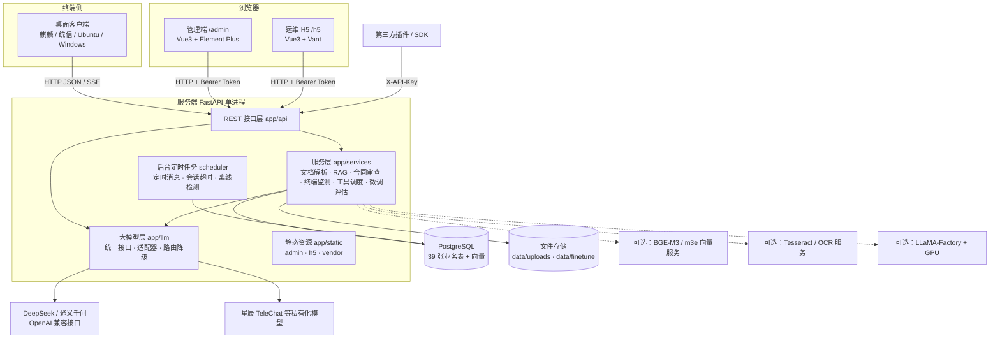
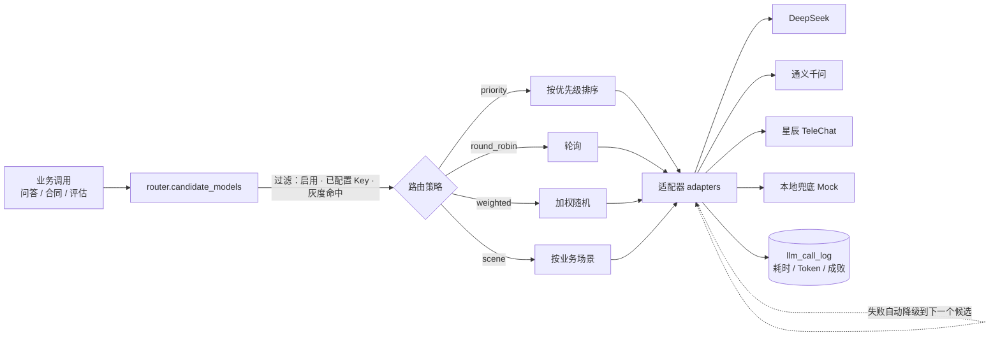
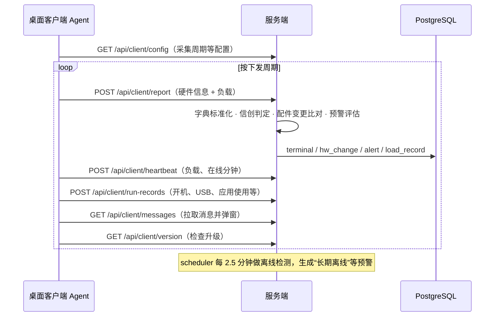
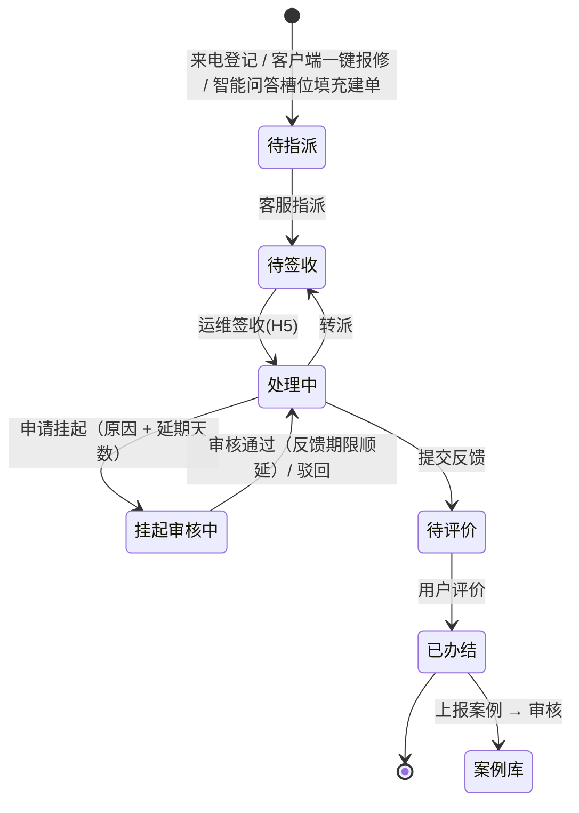
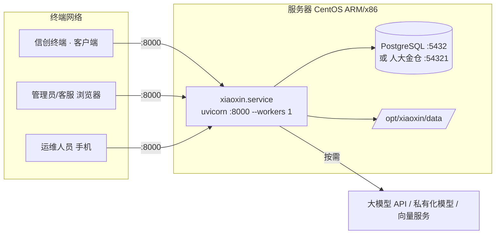

# 小信助手智能体 · 技术架构说明

## 1. 系统概述

小信助手是面向信创终端（国产 CPU + 国产操作系统）的智能运维平台，由四个端和一个能力底座组成：

| 组成 | 使用者 | 形态 | 主要职责 |
|---|---|---|---|
| 桌面客户端 | 终端用户 | Python + Tkinter 桌面程序（.deb / .exe） | 软硬件采集上报、一键提速、智能问答、合同智审、消息接收、软件中心、一键报修 |
| 管理端 | 管理员、客服 | Web（`/admin/`） | 终端资源与运行监测、客户端管理、消息、智能运维、模型、知识库、合同、工具插件、系统管理 |
| 运维移动端 H5 | 运维人员 | 移动 Web（`/h5/`） | 工单签收、转派、挂起、补充信息、反馈、补录 |
| 开放平台 | 第三方开发者 | HTTP API + Python SDK（`/open/v1`） | 注册插件、调用工具 |
| 服务端（能力底座） | — | FastAPI 单体服务 | 业务接口、大模型统一调用与路由、RAG 知识检索、合同审查、微调评估、定时任务 |

## 2. 总体架构



设计要点：

- **单体服务、零前端构建**：管理端和 H5 是直接由 FastAPI 托管的静态页面，前端依赖（Vue、Element Plus、Vant、ECharts）已内置到 `static/vendor`，内网离线可用，无需 Node.js 构建。
- **与 CPU 架构无关**：服务端和客户端都是纯 Python 代码，依赖均有 aarch64 / x86_64 预编译包。鲲鹏、飞腾（ARM）和海光、兆芯（x86）可用同一套代码部署。
- **配置即生效**：大模型、路由策略、检索参数、客户端采集周期、预警规则等都存放在数据库中，在管理端修改后立即生效，无需重启。

## 3. 技术选型

| 层次 | 选型 | 说明 |
|---|---|---|
| 服务端语言/框架 | Python 3.8+、FastAPI、Uvicorn | 异步 Web 框架，自动生成 OpenAPI 文档（`/api/docs`） |
| ORM | SQLAlchemy 2.x | 启动时 `create_all` 自动建表 |
| 数据库 | PostgreSQL 或人大金仓 KingbaseES（生产）/ SQLite（体验） | 驱动 psycopg2（金仓走 PostgreSQL 协议，同一驱动）；连接串和 schema 可用环境变量覆盖 |
| 向量检索 | 向量以 JSON 存于 `kb_chunk`，numpy 计算余弦相似度 | 数据量很大时可替换为 pgvector |
| 文档解析 | pypdf、python-docx、openpyxl、python-pptx、OFD 解析、OCR | 支持 TXT/MD/PDF/DOCX/XLSX/PPTX/OFD/图片 |
| HTTP 客户端 | httpx | 调用大模型、向量服务和第三方插件 |
| 管理端 | Vue 3 + Element Plus + ECharts | 免构建，按页面拆分为 `js/pages-*.js` |
| 移动端 | Vue 3 + Vant | 单文件 `h5/index.html` |
| 桌面客户端 | Python + Tkinter + psutil，通信只用标准库 | PyInstaller 打包，Linux 生成 .deb，Windows 生成 exe |
| 部署 | systemd、Docker（可选） | 提供 CentOS ARM 一键脚本和离线依赖下载脚本 |

## 4. 服务端分层设计

```
server/app/
├── main.py         应用入口：注册路由、挂载静态资源、启动时建表 + 种子数据 + 定时任务
├── config.py       读取 config.yaml，支持环境变量覆盖
├── db.py           数据模型（39 张表）、数据库连接、init_db()
├── auth.py         密码哈希（PBKDF2-SHA256）、Token 签发与校验、角色鉴权
├── seed.py         首次启动初始化数据
├── scheduler.py    后台线程，每 30 秒执行一次定时任务
├── api/            接口层（按业务模块拆分）
├── services/       业务服务层
├── llm/            大模型统一调用层
└── static/         admin / h5 / vendor 静态资源
```

### 4.1 接口层（`app/api`）

| 模块文件 | 路由前缀 | 功能 | 调用方 |
|---|---|---|---|
| system.py | `/api/login`、`/api/me`、`/api/users`、`/api/staff`、`/api/settings` | 登录、个人信息与改密、用户管理、系统设置 | 管理端、H5 |
| client.py | `/api/client/*` | 终端上报、心跳、运行数据、配置下发、消息拉取、版本检查、软件下载 | 桌面客户端 |
| terminal.py | `/api/admin/*` | 终端清单、云桌面、全量总览、监测指标、配件变更、预警及规则、活跃度、运行数据、版本/软件/字典/客户端配置管理 | 管理端 |
| message.py | `/api/admin/messages`、`/api/admin/message-templates` | 即时/定时消息、推送范围、回执、模板 | 管理端 |
| ops.py | `/api/ops/*`、`/api/mobile/*` | 运维工作台、来电登记、工单全流程、案例库与审核、案例检索；移动端工单处理 | 管理端、H5 |
| llm.py | `/api/chat/*`、`/api/admin/models`、`/api/admin/route`、`/api/admin/ft/*`、`/api/admin/eval-runs` | 多轮会话问答（SSE 流式）、意图与槽位、模型接入/健康检查/灰度发布/监控、路由策略、微调数据集与任务、模型评估 | 客户端、管理端 |
| kb.py | `/api/kb/*` | 知识库与文档管理、导入进度与日志、版本回滚、检索测试、策略参数、RAG 监控与评估 | 管理端、客户端 |
| contract.py | `/api/contract/*`、`/api/contract-rules/*` | 合同上传与审查、模板库、审查规则、误报标记、规则效果统计 | 客户端、管理端 |
| tools.py | `/api/tools/*`、`/api/admin/tools`、`/open/v1/*` | 工具管理与调用、链式调度、性能统计、API Key、开放平台 | 管理端、第三方 |
| common.py | — | 通用 CRUD 路由生成器 `crud_router`、文件上传保存 | 内部 |

### 4.2 服务层（`app/services`）

| 服务 | 职责 |
|---|---|
| docparse.py | 多格式文档解析为统一结构（全文、段落/标题/表格块）；编码自动识别；图片和扫描件走 OCR |
| rag.py | 文档切分（`chunk_size` / `chunk_overlap`）、质量过滤与去重、向量化（内置哈希向量或外部 embedding 服务）、语义/关键词（BM25）/混合检索、阈值过滤与重排、自动打标签；导入失败重试与断点续传 |
| contract.py | 合同条款结构化拆分、要素抽取、与模板的差异比对、规则引擎合规审查（必备/禁止关键词、必备/禁止正则、必备要素、金额上限、金额一致性等规则类型） |
| monitor.py | 型号数据字典标准化、信创判定（国产 CPU + 国产 OS）、配件变更检测、接入率/替代完成率/双轨率/活跃率等指标测算、预警规则评估、离线检测 |
| tools.py | 内置工具（OCR 文字识别、图片场景/图表分析、知识库检索、文档解析、文本摘要、计算器、当前时间）、第三方插件 REST / GraphQL / WebSocket 调用、链式调度（`${steps.N.字段}` 引用）、调用日志 |
| finetune.py | 微调数据集读取（jsonl/json/csv/xlsx）与清洗分类、生成 LLaMA-Factory 配置、执行真实训练命令或模拟训练、模型评估（关键词命中、相似度） |

### 4.3 大模型层（`app/llm`）



- **统一接口**：所有模型都走 `BaseAdapter.chat / stream`。DeepSeek、通义千问、TeleChat 都基于 OpenAI 兼容协议适配，只在参数构造和消息格式上做差异处理。
- **实时读取配置**：每次调用都从 `llm_model` 表读取配置，管理端修改后立即生效。
- **自动降级**：首选模型调用失败时，按候选顺序自动切换。全部失败或未配置 API Key 时，由“本地兜底（Mock）”返回提示，其他功能不受影响。
- **灰度发布**：按用户标识哈希分桶，模型的 `gray_percent` 决定命中比例。
- **多轮会话**：支持滑动窗口或摘要两种上下文策略，会话超时自动销毁，回答以 SSE 流式返回，可中途停止。

## 5. 核心业务流程

### 5.1 终端接入与监测



- 设备唯一标识：Linux 用 `/etc/machine-id`，Windows 用注册表 `MachineGuid`。
- 默认采集周期：配件 3600 秒、负载 300 秒、运行数据 1800 秒、消息 120 秒，均可在管理端“客户端软件配置”中修改并下发。
- 客户端接入密钥：管理端“系统设置”中配置后，客户端调用智能接口时须携带一致的 `client_key`（上报类接口当前不校验，见第 7 章）。
- 离线判定：终端超过 10 分钟没有上报即标记为离线。

### 5.2 运维工单



### 5.3 知识问答（RAG）

1. **入库**：上传文档 → `docparse` 解析 → 清洗、切分 → 质量过滤与去重 → 向量化 → 写入 `kb_chunk`。导入过程有进度和日志，失败可重试，已完成的分片不会重复处理。
2. **检索**：问题向量化 → 在进程内的知识库索引缓存中计算余弦相似度，和 BM25 关键词得分按 `hybrid_alpha` 融合 → 用阈值过滤后取 `top_k`。
3. **生成**：检索片段作为上下文拼入提示词，交大模型生成回答，并返回引用来源。每次检索记录到 `kb_rag_log`，用于命中率监控和用户反馈。

### 5.4 合同智审

上传合同（PDF / Word / OFD / TXT / 图片）→ 解析全文 → 拆分条款 → 抽取要素（甲乙方、金额、期限等）→ 与合同模板逐条比对差异 → 规则引擎逐条检查 → 生成风险等级和修改建议（可调用大模型润色）。人工标记误报后，结果计入规则效果统计。

## 6. 数据设计

数据库共 39 张表，由 `init_db()` 在启动时自动创建：

| 业务域 | 表 |
|---|---|
| 系统 | `sys_user` 用户、`sys_setting` 系统设置 |
| 终端资源与监测 | `terminal` 终端、`terminal_hw_change` 配件变更、`terminal_run_record` 运行数据、`terminal_load_record` 负载、`terminal_active_day` 活跃天、`cloud_server` 云桌面服务器、`alert_rule` 预警规则、`alert` 预警 |
| 客户端管理 | `client_version` 版本、`software` 装机软件、`dict_item` 型号字典、`client_config` 客户端配置 |
| 消息 | `message_template` 模板、`message` 消息、`message_receipt` 回执 |
| 智能运维 | `ops_ticket` 工单、`ops_ticket_log` 工单日志、`ops_case` 案例 |
| 大模型与问答 | `llm_model` 模型、`llm_call_log` 调用日志、`chat_session` 会话、`chat_message` 消息、`chat_intent` 意图 |
| 知识库 | `kb` 知识库、`kb_doc` 文档、`kb_import_log` 导入日志、`kb_chunk` 分片与向量、`kb_rag_log` 检索日志 |
| 微调评估 | `ft_dataset` 数据集、`ft_job` 微调任务、`eval_set` 评估集、`eval_run` 评估记录 |
| 合同智审 | `contract_template` 模板、`review_rule` 审查规则、`contract` 合同 |
| 工具插件 | `tool` 工具、`tool_call_log` 调用日志 |

文件存储（相对 `server/` 目录）：

| 目录 | 内容 |
|---|---|
| `data/uploads/{kb,contract,finetune,packages,tools}` | 知识库文档、合同、微调数据集、客户端安装包/软件包、工具图片 |
| `data/finetune/datasets`、`data/finetune/jobs/{id}` | 清洗后的数据集、训练配置与输出 |
| `data/sample_kb.md` | 首次启动导入的示例知识 |

## 7. 安全设计

| 方面 | 实现 |
|---|---|
| 身份认证 | 用户密码以 PBKDF2-SHA256 加盐哈希存储（10 万次迭代）；登录后签发 HMAC-SHA256 签名的 Token，默认 24 小时过期（`token_expire_hours`） |
| 角色鉴权 | `admin` 管理员、`cs` 客服、`ops` 运维、`user` 普通用户；接口通过 `require_roles` 校验，管理端菜单按角色显示 |
| 客户端接入 | 设备以 `X-Device-Id` 标识；设置了接入密钥后，设备调用问答、知识库、合同等智能接口须带 `X-Client-Key`。当前版本终端上报、心跳、运行数据接口（`/api/client/report` 等）不校验密钥，需通过网络访问控制限制来源 |
| 开放平台 | 第三方使用 `X-API-Key` 调用，插件需管理员审核启用 |
| 签名密钥 | `server.secret_key` 用于 Token 签名，生产环境必须修改（或用 `XX_SECRET_KEY` 注入） |
| 客户端防误报 | 不注入进程、不挂钩 API；只结束当前用户的非关键进程并需二次确认；系统和杀毒软件进程列入保护名单 |

## 8. 部署架构与约束



- **必须单进程运行**（`--workers 1`）：会话中止标记、知识库检索索引缓存、定时任务线程都在进程内存中，多进程会导致状态不一致和定时任务重复执行。需要水平扩展时，应先把这些状态迁移到 Redis 等外部存储。
- **建表方式**：启动时 `create_all` 只创建不存在的表，**不会修改已有表的结构**。版本升级如有字段变更，需要先执行相应的 SQL 变更脚本。
- **端口**：服务 8000（可改），PostgreSQL 5432 或人大金仓 54321（只需本机访问）。
- **人大金仓**：连接串仍为 `postgresql+psycopg2://`，必须配置 `database.schema`，全部业务表建在该独立 schema 下（金仓的系统视图 `sys_catalog.sys_user` 与用户表同名）。`app/db.py` 在连接时自动处理三处差异：用 `server_version_num` 识别版本；按会话关闭 Oracle 兼容模式的“空串存为 NULL”；把金仓多出的保留字（如 `level`）加入引号规则。
- **无 root 权限的服务器**：不注册 systemd，程序装在普通用户目录，用 `deploy/ctl.sh` 启停、crontab `@reboot` 自启，日志写入 `logs/server.log`。详见《系统安装部署手册》3.5。

## 9. 扩展点

| 扩展需求 | 做法 |
|---|---|
| 接入新的大模型 | OpenAI 兼容的模型直接在管理端新增，`provider` 选 openai；协议不同的模型在 `app/llm/adapters.py` 新增适配器 |
| 提升检索效果 | `embedding.provider: api`，接入 BGE-M3 / m3e 向量服务；数据量很大时迁移到 pgvector |
| 真实微调 | 配置 `finetune.train_command`（如 `llamafactory-cli train {config}`），在 GPU 服务器执行 |
| OCR | `ocr.provider: tesseract` 或 `api` |
| 新的终端型号 | 在管理端“型号数据字典”中补充原始值到标准值的映射，无需改代码 |
| 第三方工具 | 通过 `sdk/xiaoxin_sdk.py` 注册 REST / GraphQL / WebSocket 插件 |
