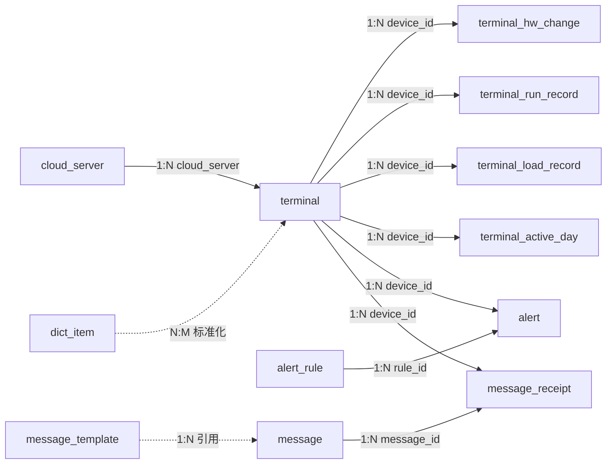
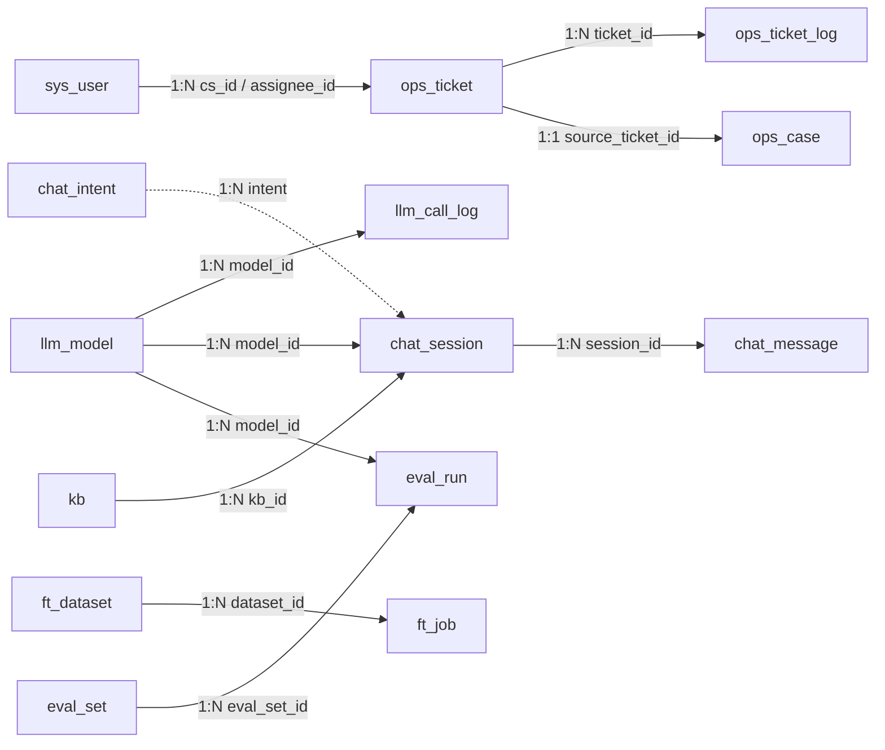
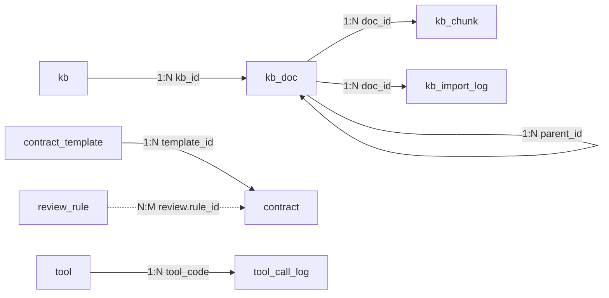

# 小信助手智能体 · 数据库设计说明书

| 项目 | 内容 |
|---|---|
| 系统名称 | 小信助手智能体 |
| 文档版本 | V1.0 |
| 对应程序版本 | 服务端 1.0.0 |
| 数据库 | PostgreSQL 10 及以上（开发体验可用 SQLite） |
| 表结构来源 | `server/app/db.py`（SQLAlchemy 模型），本文第 5 章由模型自动导出，与代码一致 |

## 1. 引言

### 1.1 编写目的

本文说明小信助手智能体服务端的数据库设计，包括数据库环境、命名规范、表间逻辑关系、各表字段定义、JSON 字段结构、索引、初始化数据、容量估算和数据安全要求，供开发、测试、运维和数据库管理人员使用。

### 1.2 参考文档

- 《小信助手智能体 需求规格说明书》
- 《小信助手智能体 系统设计说明书》
- 《技术架构说明》《系统安装部署手册》

## 2. 数据库环境

| 项目 | 说明 |
|---|---|
| 数据库产品 | PostgreSQL（生产）；SQLite（仅开发体验） |
| 字符集 | UTF8 |
| 访问方式 | SQLAlchemy 2.x ORM，驱动 psycopg2；连接池默认 10 |
| 库名 / 用户 | `xiaoxin` / `xiaoxin`（可在部署时修改） |
| 建表方式 | 服务启动时执行 `Base.metadata.create_all()`，只创建不存在的表，不修改已有表结构 |
| 时间 | 统一使用服务器本地时间，类型为 `TIMESTAMP`（不带时区） |

## 3. 设计原则与命名规范

### 3.1 设计原则

1. **按业务域划分**：39 张表分属 10 个业务域，表名前缀体现所属业务（如 `terminal_`、`ops_`、`kb_`、`chat_`、`ft_`）。
2. **逻辑外键**：表间关联通过 ID 或业务键（如 `device_id`）维护，**数据库层不建立外键约束**，由应用层保证一致性。这样各模块可以独立清理和归档数据，删除主记录时不会被级联约束阻塞。
3. **灵活结构用 JSON**：配件快照、槽位、模板条款、规则参数、训练指标、知识向量等结构多变的数据使用 `JSON` 类型存储，避免频繁改表。
4. **适度冗余**：日志、工单等表冗余保存名称字段（如 `model_name`、`assignee_name`、`rule_name`），便于查询展示，也能在源记录被修改或删除后保留历史信息。
5. **配置入库**：大模型、路由策略、客户端采集周期、预警规则、审查规则等运行参数都保存在数据库中，在管理端修改后立即生效。

### 3.2 命名规范

| 对象 | 规范 | 示例 |
|---|---|---|
| 表名 | 小写英文 + 下划线，业务前缀 + 实体名 | `ops_ticket`、`kb_chunk` |
| 主键 | 统一为 `id`，整型自增（`chat_session` 为 32 位十六进制字符串，`sys_setting`、`client_config` 以 `key` 为主键） | `id` |
| 关联字段 | `被关联实体_id` | `ticket_id`、`kb_id`、`model_id` |
| 时间字段 | `*_at` 表示时间点，`*_time` 表示业务时间 | `created_at`、`send_time` |
| 布尔字段 | `is_*` 或形容词 | `is_xinchuang`、`enabled` |
| 计数字段 | `*_count` | `read_count`、`chunk_count` |

### 3.3 类型约定

| 业务含义 | 类型 |
|---|---|
| 主键 | `SERIAL`（INTEGER 自增） |
| 短文本（名称、编码、状态） | `VARCHAR(n)` |
| 长文本（描述、正文、日志） | `TEXT` |
| 金额、比例、容量 | `FLOAT` |
| 是否 | `BOOLEAN` |
| 时间 / 日期 | `TIMESTAMP` / `DATE` |
| 结构化数据 | `JSON` |

## 4. 数据库总体设计

### 4.1 表清单

共 39 张表，383 个字段。

| 序号 | 表名 | 中文名 | 业务域 | 字段数 |
|---|---|---|---|---|
| 1 | `sys_user` | 系统用户 | 系统管理 | 10 |
| 2 | `sys_setting` | 系统设置（键值对） | 系统管理 | 3 |
| 3 | `terminal` | 终端资源 | 终端资源与监测 | 32 |
| 4 | `terminal_hw_change` | 配件变更记录 | 终端资源与监测 | 7 |
| 5 | `terminal_run_record` | 终端运行数据 | 终端资源与监测 | 5 |
| 6 | `terminal_load_record` | 终端负载记录 | 终端资源与监测 | 6 |
| 7 | `terminal_active_day` | 终端日活跃记录 | 终端资源与监测 | 4 |
| 8 | `cloud_server` | 云桌面服务器 | 终端资源与监测 | 6 |
| 9 | `alert_rule` | 预警规则 | 终端资源与监测 | 8 |
| 10 | `alert` | 预警记录 | 终端资源与监测 | 8 |
| 11 | `client_version` | 客户端版本 | 客户端管理 | 9 |
| 12 | `software` | 装机软件 | 客户端管理 | 9 |
| 13 | `dict_item` | 型号数据字典 | 客户端管理 | 6 |
| 14 | `client_config` | 客户端软件配置 | 客户端管理 | 5 |
| 15 | `message_template` | 消息模板 | 消息管理 | 5 |
| 16 | `message` | 消息任务 | 消息管理 | 13 |
| 17 | `message_receipt` | 消息回执 | 消息管理 | 5 |
| 18 | `ops_ticket` | 运维工单 | 智能运维 | 26 |
| 19 | `ops_ticket_log` | 工单流转日志 | 智能运维 | 6 |
| 20 | `ops_case` | 运维案例 | 智能运维 | 13 |
| 21 | `llm_model` | 大模型配置 | 大模型与智能问答 | 21 |
| 22 | `llm_call_log` | 大模型调用日志 | 大模型与智能问答 | 11 |
| 23 | `chat_session` | 问答会话 | 大模型与智能问答 | 13 |
| 24 | `chat_message` | 问答消息 | 大模型与智能问答 | 7 |
| 25 | `chat_intent` | 意图与槽位配置 | 大模型与智能问答 | 7 |
| 26 | `kb` | 知识库 | 信创知识库 | 5 |
| 27 | `kb_doc` | 知识库文档 | 信创知识库 | 19 |
| 28 | `kb_import_log` | 知识导入日志 | 信创知识库 | 5 |
| 29 | `kb_chunk` | 知识分片与向量 | 信创知识库 | 7 |
| 30 | `kb_rag_log` | 检索日志 | 信创知识库 | 10 |
| 31 | `ft_dataset` | 微调数据集 | 模型微调与评估 | 10 |
| 32 | `ft_job` | 微调任务 | 模型微调与评估 | 12 |
| 33 | `eval_set` | 评估测试集 | 模型微调与评估 | 4 |
| 34 | `eval_run` | 模型评估记录 | 模型微调与评估 | 11 |
| 35 | `contract_template` | 合同模板 | 合同智审 | 7 |
| 36 | `review_rule` | 合同审查规则 | 合同智审 | 12 |
| 37 | `contract` | 合同审查记录 | 合同智审 | 15 |
| 38 | `tool` | 工具与插件 | 工具与插件 | 15 |
| 39 | `tool_call_log` | 工具调用日志 | 工具与插件 | 6 |

### 4.2 逻辑关系（E-R 图）

图中的关联都是逻辑关联（应用层维护），不是数据库外键。按业务分三张图展示；箭头由“一”方指向“多”方，标注为“对应关系 关联字段”，虚线表示弱关联（引用或标准化）。

**（1）终端、客户端与消息**



**（2）运维、大模型与问答**



**（3）知识库、合同与工具**



### 4.3 主要业务数据流

| 业务 | 写入的表（按先后顺序） |
|---|---|
| 终端上报 | `terminal`（新增或更新，含当前负载）→ `terminal_hw_change`（配件变化时）→ `alert`（命中预警规则时） |
| 终端心跳 | `terminal`（负载、在线状态、最近上报时间）→ `terminal_load_record` → `terminal_active_day`（累计在线分钟）→ `alert`（命中预警规则时） |
| 运行数据采集 | `terminal_run_record` |
| 消息推送 | `message` → `message_receipt`（终端拉取时送达，阅读时更新） |
| 工单流转 | `ops_ticket` → `ops_ticket_log`（每次操作一条）→ `ops_case`（上报案例） |
| 智能问答 | `chat_session` → `chat_message`（问、答各一条）→ `llm_call_log`；知识问答还写 `kb_rag_log` |
| 知识导入 | `kb_doc` → `kb_import_log` → `kb_chunk` |
| 合同审查 | `contract`（解析、要素、差异、审查结果）→ `review_rule.hit_count` 累加 |
| 微调与评估 | `ft_dataset` → `ft_job`；`eval_set` → `eval_run` |
| 工具调用 | `tool_call_log` |

## 5. 表结构设计

说明：“非空”列只标出数据库层面的 NOT NULL 约束（主键）；其余字段在数据库层允许为空，必填校验由应用层完成。“默认值”为应用层（ORM）默认值，“当前时间”表示插入时取服务器时间。

### 5.1 系统管理

#### sys_user 系统用户（10 个字段）

| 序号 | 字段名 | 类型 | 主键 | 非空 | 唯一/索引 | 默认值 | 说明 |
|---|---|---|---|---|---|---|---|
| 1 | `id` | SERIAL | ✓ | ✓ |  |  | 主键，自增 |
| 2 | `username` | VARCHAR(64) |  |  | 唯一 |  | 登录账号，唯一 |
| 3 | `password_hash` | VARCHAR(256) |  |  |  |  | 密码哈希（PBKDF2-SHA256，盐$哈希） |
| 4 | `real_name` | VARCHAR(64) |  |  |  |  | 姓名 |
| 5 | `role` | VARCHAR(16) |  |  |  | user | 角色：admin 管理员 / cs 客服 / ops 运维 / user 普通用户 |
| 6 | `station` | VARCHAR(64) |  |  |  | 市保障中心 | 所属保障站，如市保障中心、西湖区保障站 |
| 7 | `company` | VARCHAR(64) |  |  |  | 空字符串 | 所属供应商/厂商（纳管厂商运维人员填写） |
| 8 | `phone` | VARCHAR(32) |  |  |  | 空字符串 | 联系电话 |
| 9 | `enabled` | BOOLEAN |  |  |  | true | 是否启用，禁用后不能登录 |
| 10 | `created_at` | TIMESTAMP |  |  |  | 当前时间 | 创建时间 |

#### sys_setting 系统设置（键值对）（3 个字段）

| 序号 | 字段名 | 类型 | 主键 | 非空 | 唯一/索引 | 默认值 | 说明 |
|---|---|---|---|---|---|---|---|
| 1 | `key` | VARCHAR(64) | ✓ | ✓ |  |  | 设置键，如 client_key、route_strategy、session_timeout_minutes |
| 2 | `value` | JSON |  |  |  |  | 设置值（JSON） |
| 3 | `description` | VARCHAR(256) |  |  |  | 空字符串 | 描述 |

### 5.2 终端资源与监测

#### terminal 终端资源（32 个字段）

| 序号 | 字段名 | 类型 | 主键 | 非空 | 唯一/索引 | 默认值 | 说明 |
|---|---|---|---|---|---|---|---|
| 1 | `id` | SERIAL | ✓ | ✓ |  |  | 主键，自增 |
| 2 | `device_id` | VARCHAR(64) |  |  | 唯一 |  | 终端设备唯一标识，唯一（客户端生成：Linux 取 /etc/machine-id，Windows 取 MachineGuid） |
| 3 | `hostname` | VARCHAR(128) |  |  |  |  | 主机名 |
| 4 | `user_name` | VARCHAR(64) |  |  |  | 空字符串 | 使用人 |
| 5 | `dept` | VARCHAR(128) |  |  |  | 空字符串 | 所属部门 |
| 6 | `ip` | VARCHAR(64) |  |  |  | 空字符串 | IP 地址 |
| 7 | `mac` | VARCHAR(64) |  |  |  | 空字符串 | 网卡 MAC 地址 |
| 8 | `os_name` | VARCHAR(128) |  |  |  | 空字符串 | 操作系统名称（经数据字典标准化） |
| 9 | `os_version` | VARCHAR(128) |  |  |  | 空字符串 | 操作系统版本 |
| 10 | `arch` | VARCHAR(32) |  |  |  | 空字符串 | CPU 架构，如 aarch64、x86_64 |
| 11 | `cpu_model` | VARCHAR(256) |  |  |  | 空字符串 | CPU 型号（经数据字典标准化） |
| 12 | `cpu_vendor` | VARCHAR(64) |  |  |  | 空字符串 | CPU 厂商 |
| 13 | `cpu_cores` | INTEGER |  |  |  | 0 | CPU 核数 |
| 14 | `mem_total` | FLOAT |  |  |  | 0 | 内存容量（GB） |
| 15 | `disk_total` | FLOAT |  |  |  | 0 | 硬盘容量（GB） |
| 16 | `disk_model` | VARCHAR(256) |  |  |  | 空字符串 | 硬盘型号 |
| 17 | `brand` | VARCHAR(128) |  |  |  | 空字符串 | 整机品牌 |
| 18 | `model` | VARCHAR(128) |  |  |  | 空字符串 | 整机型号 |
| 19 | `serial` | VARCHAR(128) |  |  |  | 空字符串 | 整机序列号 |
| 20 | `is_xinchuang` | BOOLEAN |  |  |  | false | 是否信创终端（国产 CPU + 国产操作系统） |
| 21 | `dual_system` | BOOLEAN |  |  |  | false | 是否存在违规双系统 |
| 22 | `is_cloud_desktop` | BOOLEAN |  |  |  | false | 是否云桌面终端 |
| 23 | `cloud_server` | VARCHAR(128) |  |  |  | 空字符串 | 所属云桌面服务器 |
| 24 | `client_version` | VARCHAR(32) |  |  |  | 空字符串 | 客户端版本 |
| 25 | `cpu_usage` | FLOAT |  |  |  | 0 | 最近一次 CPU 利用率（%） |
| 26 | `mem_usage` | FLOAT |  |  |  | 0 | 最近一次内存利用率（%） |
| 27 | `disk_usage` | FLOAT |  |  |  | 0 | 最近一次磁盘使用率（%） |
| 28 | `status` | VARCHAR(16) |  |  |  | online | 在线状态：online / offline |
| 29 | `boot_time` | TIMESTAMP |  |  |  |  | 最近开机时间 |
| 30 | `hw_snapshot` | JSON |  |  |  |  | 最近一次配件信息快照（JSON），用于配件变更比对 |
| 31 | `first_seen` | TIMESTAMP |  |  |  | 当前时间 | 首次接入时间 |
| 32 | `last_seen` | TIMESTAMP |  |  |  | 当前时间 | 最近上报时间（超过 10 分钟未上报判为离线） |

#### terminal_hw_change 配件变更记录（7 个字段）

| 序号 | 字段名 | 类型 | 主键 | 非空 | 唯一/索引 | 默认值 | 说明 |
|---|---|---|---|---|---|---|---|
| 1 | `id` | SERIAL | ✓ | ✓ |  |  | 主键，自增 |
| 2 | `device_id` | VARCHAR(64) |  |  | 索引 |  | 终端设备唯一标识（关联 terminal.device_id） |
| 3 | `component` | VARCHAR(64) |  |  |  |  | 变更配件，如 CPU、内存(GB)、硬盘型号、网卡MAC |
| 4 | `old_value` | TEXT |  |  |  |  | 变更前取值 |
| 5 | `new_value` | TEXT |  |  |  |  | 变更后取值 |
| 6 | `confirmed` | BOOLEAN |  |  |  | false | 管理员是否已确认 |
| 7 | `created_at` | TIMESTAMP |  |  |  | 当前时间 | 创建时间 |

#### terminal_run_record 终端运行数据（5 个字段）

| 序号 | 字段名 | 类型 | 主键 | 非空 | 唯一/索引 | 默认值 | 说明 |
|---|---|---|---|---|---|---|---|
| 1 | `id` | SERIAL | ✓ | ✓ |  |  | 主键，自增 |
| 2 | `device_id` | VARCHAR(64) |  |  | 索引 |  | 终端设备唯一标识（关联 terminal.device_id） |
| 3 | `kind` | VARCHAR(32) |  |  | 索引 |  | 数据类型：boot 开机 / shutdown 关机 / app_installed 已装应用 / app_usage 应用使用 / usb U 盘 / printer 打印机 |
| 4 | `content` | JSON |  |  |  |  | 数据内容（JSON） |
| 5 | `created_at` | TIMESTAMP |  |  | 索引 | 当前时间 | 采集时间 |

#### terminal_load_record 终端负载记录（6 个字段）

| 序号 | 字段名 | 类型 | 主键 | 非空 | 唯一/索引 | 默认值 | 说明 |
|---|---|---|---|---|---|---|---|
| 1 | `id` | SERIAL | ✓ | ✓ |  |  | 主键，自增 |
| 2 | `device_id` | VARCHAR(64) |  |  | 索引 |  | 终端设备唯一标识（关联 terminal.device_id） |
| 3 | `cpu` | FLOAT |  |  |  |  | CPU 利用率（%） |
| 4 | `mem` | FLOAT |  |  |  |  | 内存利用率（%） |
| 5 | `disk` | FLOAT |  |  |  |  | 磁盘使用率（%） |
| 6 | `created_at` | TIMESTAMP |  |  | 索引 | 当前时间 | 采集时间 |

#### terminal_active_day 终端日活跃记录（4 个字段）

| 序号 | 字段名 | 类型 | 主键 | 非空 | 唯一/索引 | 默认值 | 说明 |
|---|---|---|---|---|---|---|---|
| 1 | `id` | SERIAL | ✓ | ✓ |  |  | 主键，自增 |
| 2 | `device_id` | VARCHAR(64) |  |  | 索引 |  | 终端设备唯一标识（关联 terminal.device_id） |
| 3 | `day` | DATE |  |  | 索引 |  | 日期 |
| 4 | `online_minutes` | INTEGER |  |  |  | 0 | 当日在线分钟数，用于按日/周计算活跃度 |

#### cloud_server 云桌面服务器（6 个字段）

| 序号 | 字段名 | 类型 | 主键 | 非空 | 唯一/索引 | 默认值 | 说明 |
|---|---|---|---|---|---|---|---|
| 1 | `id` | SERIAL | ✓ | ✓ |  |  | 主键，自增 |
| 2 | `name` | VARCHAR(128) |  |  |  |  | 服务器名称 |
| 3 | `ip` | VARCHAR(64) |  |  |  |  | 服务器 IP |
| 4 | `spec` | VARCHAR(256) |  |  |  | 空字符串 | 配置规格 |
| 5 | `location` | VARCHAR(128) |  |  |  | 空字符串 | 所在位置/机房 |
| 6 | `remark` | VARCHAR(256) |  |  |  | 空字符串 | 备注 |

#### alert_rule 预警规则（8 个字段）

| 序号 | 字段名 | 类型 | 主键 | 非空 | 唯一/索引 | 默认值 | 说明 |
|---|---|---|---|---|---|---|---|
| 1 | `id` | SERIAL | ✓ | ✓ |  |  | 主键，自增 |
| 2 | `name` | VARCHAR(128) |  |  |  |  | 规则名称 |
| 3 | `metric` | VARCHAR(32) |  |  |  |  | 监测指标：cpu_usage / mem_usage / disk_usage / offline_days / dual_system / usb / hw_change / blacklist_app / non_xinchuang |
| 4 | `operator` | VARCHAR(8) |  |  |  | > | 比较运算符：> / < / = / in |
| 5 | `threshold` | VARCHAR(256) |  |  |  | 空字符串 | 阈值（违规软件为逗号分隔的进程名列表） |
| 6 | `level` | VARCHAR(8) |  |  |  | 中 | 预警级别：高 / 中 / 低 |
| 7 | `enabled` | BOOLEAN |  |  |  | true | 是否启用 |
| 8 | `description` | VARCHAR(256) |  |  |  | 空字符串 | 描述 |

#### alert 预警记录（8 个字段）

| 序号 | 字段名 | 类型 | 主键 | 非空 | 唯一/索引 | 默认值 | 说明 |
|---|---|---|---|---|---|---|---|
| 1 | `id` | SERIAL | ✓ | ✓ |  |  | 主键，自增 |
| 2 | `device_id` | VARCHAR(64) |  |  | 索引 |  | 终端设备唯一标识（关联 terminal.device_id） |
| 3 | `rule_id` | INTEGER |  |  |  |  | 触发的规则 ID（关联 alert_rule.id） |
| 4 | `rule_name` | VARCHAR(128) |  |  |  |  | 规则名称（冗余） |
| 5 | `level` | VARCHAR(8) |  |  |  |  | 级别（高/中/低） |
| 6 | `content` | TEXT |  |  |  |  | 预警内容 |
| 7 | `status` | VARCHAR(16) |  |  |  | 未处理 | 处理状态：未处理 / 已处理 |
| 8 | `created_at` | TIMESTAMP |  |  | 索引 | 当前时间 | 预警时间 |

### 5.3 客户端管理

#### client_version 客户端版本（9 个字段）

| 序号 | 字段名 | 类型 | 主键 | 非空 | 唯一/索引 | 默认值 | 说明 |
|---|---|---|---|---|---|---|---|
| 1 | `id` | SERIAL | ✓ | ✓ |  |  | 主键，自增 |
| 2 | `version` | VARCHAR(32) |  |  |  |  | 版本号，如 1.2.0 |
| 3 | `platform` | VARCHAR(16) |  |  |  |  | 平台：windows / linux |
| 4 | `arch` | VARCHAR(16) |  |  |  | all | 架构：all / amd64 / arm64 |
| 5 | `file_path` | VARCHAR(512) |  |  |  | 空字符串 | 安装包存储路径 |
| 6 | `changelog` | TEXT |  |  |  | 空字符串 | 更新说明 |
| 7 | `force_update` | BOOLEAN |  |  |  | false | 是否强制更新 |
| 8 | `status` | VARCHAR(16) |  |  |  | 已发布 | 状态：草稿 / 灰度 / 已发布 / 已下线 |
| 9 | `created_at` | TIMESTAMP |  |  |  | 当前时间 | 创建时间 |

#### software 装机软件（9 个字段）

| 序号 | 字段名 | 类型 | 主键 | 非空 | 唯一/索引 | 默认值 | 说明 |
|---|---|---|---|---|---|---|---|
| 1 | `id` | SERIAL | ✓ | ✓ |  |  | 主键，自增 |
| 2 | `name` | VARCHAR(128) |  |  |  |  | 软件名称 |
| 3 | `version` | VARCHAR(32) |  |  |  | 空字符串 | 软件版本 |
| 4 | `category` | VARCHAR(64) |  |  |  | 办公 | 软件分类，如办公、安全、工具 |
| 5 | `platform` | VARCHAR(16) |  |  |  | linux | 适用平台：linux / windows |
| 6 | `description` | TEXT |  |  |  | 空字符串 | 软件说明 |
| 7 | `file_path` | VARCHAR(512) |  |  |  | 空字符串 | 安装包存储路径 |
| 8 | `size` | INTEGER |  |  |  | 0 | 安装包大小（字节） |
| 9 | `created_at` | TIMESTAMP |  |  |  | 当前时间 | 创建时间 |

#### dict_item 型号数据字典（6 个字段）

| 序号 | 字段名 | 类型 | 主键 | 非空 | 唯一/索引 | 默认值 | 说明 |
|---|---|---|---|---|---|---|---|
| 1 | `id` | SERIAL | ✓ | ✓ |  |  | 主键，自增 |
| 2 | `dict_type` | VARCHAR(32) |  |  |  |  | 字典类型：cpu / brand / model / os / disk |
| 3 | `raw_value` | VARCHAR(256) |  |  |  |  | 采集到的原始值（匹配关键字） |
| 4 | `std_value` | VARCHAR(256) |  |  |  |  | 规范名称 |
| 5 | `extra` | VARCHAR(256) |  |  |  | 空字符串 | 附加属性，如“信创”表示信创型号 |
| 6 | `remark` | VARCHAR(256) |  |  |  | 空字符串 | 备注 |

#### client_config 客户端软件配置（5 个字段）

| 序号 | 字段名 | 类型 | 主键 | 非空 | 唯一/索引 | 默认值 | 说明 |
|---|---|---|---|---|---|---|---|
| 1 | `key` | VARCHAR(64) | ✓ | ✓ |  |  | 配置键，如 hardware_collect、load_collect |
| 2 | `name` | VARCHAR(128) |  |  |  |  | 配置名称 |
| 3 | `value` | VARCHAR(256) |  |  |  |  | 配置值（周期秒数或阈值） |
| 4 | `trigger` | VARCHAR(16) |  |  |  | interval | 执行方式：startup 启动时 / interval 固定间隔 / manual 手动 |
| 5 | `description` | VARCHAR(256) |  |  |  | 空字符串 | 说明 |

### 5.4 消息管理

#### message_template 消息模板（5 个字段）

| 序号 | 字段名 | 类型 | 主键 | 非空 | 唯一/索引 | 默认值 | 说明 |
|---|---|---|---|---|---|---|---|
| 1 | `id` | SERIAL | ✓ | ✓ |  |  | 主键，自增 |
| 2 | `name` | VARCHAR(128) |  |  |  |  | 模板名称 |
| 3 | `title` | VARCHAR(256) |  |  |  | 空字符串 | 消息标题 |
| 4 | `content` | TEXT |  |  |  |  | 消息正文 |
| 5 | `created_at` | TIMESTAMP |  |  |  | 当前时间 | 创建时间 |

#### message 消息任务（13 个字段）

| 序号 | 字段名 | 类型 | 主键 | 非空 | 唯一/索引 | 默认值 | 说明 |
|---|---|---|---|---|---|---|---|
| 1 | `id` | SERIAL | ✓ | ✓ |  |  | 主键，自增 |
| 2 | `title` | VARCHAR(256) |  |  |  |  | 消息名称/标题 |
| 3 | `content` | TEXT |  |  |  |  | 消息正文 |
| 4 | `scope_type` | VARCHAR(16) |  |  |  | all | 推送范围类型：all 全部 / dept 部门 / device 指定终端 |
| 5 | `scope_value` | VARCHAR(512) |  |  |  | 空字符串 | 推送范围取值（部门名或设备 ID，逗号分隔） |
| 6 | `send_type` | VARCHAR(16) |  |  |  | now | 发送方式：now 即时 / timed 定时 |
| 7 | `send_time` | TIMESTAMP |  |  |  |  | 定时发送时间 |
| 8 | `status` | VARCHAR(16) |  |  |  | 待发送 | 状态：草稿 / 待发送 / 已发送 |
| 9 | `target_count` | INTEGER |  |  |  | 0 | 发送对象数 |
| 10 | `read_count` | INTEGER |  |  |  | 0 | 阅读对象数 |
| 11 | `creator` | VARCHAR(64) |  |  |  | 空字符串 | 创建人 |
| 12 | `created_at` | TIMESTAMP |  |  |  | 当前时间 | 创建时间 |
| 13 | `sent_at` | TIMESTAMP |  |  |  |  | 实际发送时间 |

#### message_receipt 消息回执（5 个字段）

| 序号 | 字段名 | 类型 | 主键 | 非空 | 唯一/索引 | 默认值 | 说明 |
|---|---|---|---|---|---|---|---|
| 1 | `id` | SERIAL | ✓ | ✓ |  |  | 主键，自增 |
| 2 | `message_id` | INTEGER |  |  | 索引 |  | 消息 ID（关联 message.id） |
| 3 | `device_id` | VARCHAR(64) |  |  | 索引 |  | 终端设备唯一标识（关联 terminal.device_id） |
| 4 | `delivered_at` | TIMESTAMP |  |  |  |  | 送达时间 |
| 5 | `read_at` | TIMESTAMP |  |  |  |  | 阅读时间 |

### 5.5 智能运维

#### ops_ticket 运维工单（26 个字段）

| 序号 | 字段名 | 类型 | 主键 | 非空 | 唯一/索引 | 默认值 | 说明 |
|---|---|---|---|---|---|---|---|
| 1 | `id` | SERIAL | ✓ | ✓ |  |  | 主键，自增 |
| 2 | `ticket_no` | VARCHAR(32) |  |  | 唯一 |  | 工单号，唯一，格式 GD + 年月日时分秒 + 2 位随机数 |
| 3 | `title` | VARCHAR(256) |  |  |  |  | 问题标题 |
| 4 | `description` | TEXT |  |  |  | 空字符串 | 问题描述 |
| 5 | `category` | VARCHAR(64) |  |  |  | 其他 | 问题分类 |
| 6 | `reporter` | VARCHAR(64) |  |  |  | 空字符串 | 报修人 |
| 7 | `reporter_phone` | VARCHAR(32) |  |  |  | 空字符串 | 报修人电话 |
| 8 | `dept` | VARCHAR(128) |  |  |  | 空字符串 | 报修部门 |
| 9 | `address` | VARCHAR(256) |  |  |  | 空字符串 | 报修地点 |
| 10 | `device_info` | VARCHAR(256) |  |  |  | 空字符串 | 报修设备信息 |
| 11 | `source` | VARCHAR(16) |  |  |  | 来电 | 来源：来电 / 补录 / 移动补录 / 智能问答 |
| 12 | `status` | VARCHAR(16) |  |  | 索引 | 待指派 | 状态：待指派 / 待签收 / 处理中 / 挂起审核中 / 待评价 / 已办结 |
| 13 | `station` | VARCHAR(64) |  |  |  | 市保障中心 | 所属保障站 |
| 14 | `cs_id` | INTEGER |  |  |  |  | 登记客服用户 ID（关联 sys_user.id） |
| 15 | `assignee_id` | INTEGER |  |  | 索引 |  | 处理人用户 ID（关联 sys_user.id） |
| 16 | `assignee_name` | VARCHAR(64) |  |  |  | 空字符串 | 处理人姓名（冗余） |
| 17 | `deadline` | TIMESTAMP |  |  |  |  | 反馈期限 |
| 18 | `suspend_reason` | TEXT |  |  |  | 空字符串 | 挂起原因 |
| 19 | `suspend_days` | INTEGER |  |  |  | 0 | 申请延期天数 |
| 20 | `solution` | TEXT |  |  |  | 空字符串 | 解决方案 |
| 21 | `feedback` | TEXT |  |  |  | 空字符串 | 反馈内容 |
| 22 | `rating` | INTEGER |  |  |  |  | 用户评价（1~5 星） |
| 23 | `rating_comment` | VARCHAR(256) |  |  |  | 空字符串 | 评价意见 |
| 24 | `created_at` | TIMESTAMP |  |  |  | 当前时间 | 创建时间 |
| 25 | `updated_at` | TIMESTAMP |  |  |  | 当前时间 | 最后更新时间 |
| 26 | `finished_at` | TIMESTAMP |  |  |  |  | 办结时间 |

#### ops_ticket_log 工单流转日志（6 个字段）

| 序号 | 字段名 | 类型 | 主键 | 非空 | 唯一/索引 | 默认值 | 说明 |
|---|---|---|---|---|---|---|---|
| 1 | `id` | SERIAL | ✓ | ✓ |  |  | 主键，自增 |
| 2 | `ticket_id` | INTEGER |  |  | 索引 |  | 工单 ID（关联 ops_ticket.id） |
| 3 | `action` | VARCHAR(32) |  |  |  |  | 操作，如登记、指派、签收、转派、申请挂起、反馈、评价 |
| 4 | `operator` | VARCHAR(64) |  |  |  |  | 操作人 |
| 5 | `content` | TEXT |  |  |  | 空字符串 | 操作说明 |
| 6 | `created_at` | TIMESTAMP |  |  |  | 当前时间 | 操作时间 |

#### ops_case 运维案例（13 个字段）

| 序号 | 字段名 | 类型 | 主键 | 非空 | 唯一/索引 | 默认值 | 说明 |
|---|---|---|---|---|---|---|---|
| 1 | `id` | SERIAL | ✓ | ✓ |  |  | 主键，自增 |
| 2 | `title` | VARCHAR(256) |  |  |  |  | 案例标题 |
| 3 | `category` | VARCHAR(64) |  |  |  | 其他 | 问题分类 |
| 4 | `question` | TEXT |  |  |  |  | 问题描述 |
| 5 | `answer` | TEXT |  |  |  |  | 解决方案 |
| 6 | `status` | VARCHAR(16) |  |  |  | 待审核 | 审核状态：待审核 / 已通过 / 已驳回 |
| 7 | `quality` | BOOLEAN |  |  |  | false | 是否高质量案例（检索时优先） |
| 8 | `source_ticket_id` | INTEGER |  |  |  |  | 来源工单 ID（关联 ops_ticket.id） |
| 9 | `reporter` | VARCHAR(64) |  |  |  | 空字符串 | 上报人 |
| 10 | `station` | VARCHAR(64) |  |  |  | 空字符串 | 上报保障站 |
| 11 | `audit_comment` | VARCHAR(256) |  |  |  | 空字符串 | 审核意见 |
| 12 | `view_count` | INTEGER |  |  |  | 0 | 查看次数 |
| 13 | `created_at` | TIMESTAMP |  |  |  | 当前时间 | 创建时间 |

### 5.6 大模型与智能问答

#### llm_model 大模型配置（21 个字段）

| 序号 | 字段名 | 类型 | 主键 | 非空 | 唯一/索引 | 默认值 | 说明 |
|---|---|---|---|---|---|---|---|
| 1 | `id` | SERIAL | ✓ | ✓ |  |  | 主键，自增 |
| 2 | `name` | VARCHAR(128) |  |  |  |  | 模型显示名称 |
| 3 | `provider` | VARCHAR(32) |  |  |  | deepseek | 适配器：deepseek / qwen / telechat / openai / mock |
| 4 | `base_url` | VARCHAR(512) |  |  |  | 空字符串 | 接口地址（OpenAI 兼容） |
| 5 | `api_key` | VARCHAR(512) |  |  |  | 空字符串 | API Key（列表接口中脱敏显示） |
| 6 | `model` | VARCHAR(128) |  |  |  | 空字符串 | 模型标识，如 deepseek-chat |
| 7 | `temperature` | FLOAT |  |  |  | 0.7 | 温度参数 |
| 8 | `top_p` | FLOAT |  |  |  | 0.95 | top_p 参数 |
| 9 | `max_tokens` | INTEGER |  |  |  | 2048 | 最大输出 Token 数 |
| 10 | `timeout` | INTEGER |  |  |  | 60 | 调用超时（秒） |
| 11 | `priority` | INTEGER |  |  |  | 10 | 优先级，数字越小越优先（priority 路由及降级顺序） |
| 12 | `weight` | INTEGER |  |  |  | 1 | 权重（weighted 路由） |
| 13 | `scene` | VARCHAR(128) |  |  |  | 空字符串 | 适用业务场景，逗号分隔：chat,kb,contract,ops（scene 路由） |
| 14 | `version` | VARCHAR(32) |  |  |  | v1 | 版本号 |
| 15 | `gray_percent` | INTEGER |  |  |  | 100 | 灰度比例 0~100 |
| 16 | `enabled` | BOOLEAN |  |  |  | true | 是否启用 |
| 17 | `is_default` | BOOLEAN |  |  |  | false | 是否默认模型 |
| 18 | `extra` | JSON |  |  |  |  | 透传给接口的扩展参数（JSON） |
| 19 | `health` | VARCHAR(16) |  |  |  | 未知 | 健康状态：未知 / 健康 / 异常 |
| 20 | `last_check` | TIMESTAMP |  |  |  |  | 最近健康检查时间 |
| 21 | `created_at` | TIMESTAMP |  |  |  | 当前时间 | 创建时间 |

#### llm_call_log 大模型调用日志（11 个字段）

| 序号 | 字段名 | 类型 | 主键 | 非空 | 唯一/索引 | 默认值 | 说明 |
|---|---|---|---|---|---|---|---|
| 1 | `id` | SERIAL | ✓ | ✓ |  |  | 主键，自增 |
| 2 | `model_id` | INTEGER |  |  | 索引 |  | 模型 ID（关联 llm_model.id） |
| 3 | `model_name` | VARCHAR(128) |  |  |  |  | 模型名称（冗余） |
| 4 | `scene` | VARCHAR(32) |  |  |  | chat | 业务场景 |
| 5 | `latency_ms` | INTEGER |  |  |  |  | 耗时（毫秒） |
| 6 | `success` | BOOLEAN |  |  |  |  | 是否成功 |
| 7 | `error` | TEXT |  |  |  | 空字符串 | 错误信息 |
| 8 | `prompt_tokens` | INTEGER |  |  |  | 0 | 输入 Token 数 |
| 9 | `completion_tokens` | INTEGER |  |  |  | 0 | 输出 Token 数 |
| 10 | `fallback` | BOOLEAN |  |  |  | false | 是否为降级调用 |
| 11 | `created_at` | TIMESTAMP |  |  | 索引 | 当前时间 | 调用时间 |

#### chat_session 问答会话（13 个字段）

| 序号 | 字段名 | 类型 | 主键 | 非空 | 唯一/索引 | 默认值 | 说明 |
|---|---|---|---|---|---|---|---|
| 1 | `id` | VARCHAR(64) | ✓ | ✓ |  |  | 会话 ID（Session ID，UUID） |
| 2 | `user` | VARCHAR(64) |  |  |  | 空字符串 | 用户标识（登录用户名） |
| 3 | `device_id` | VARCHAR(64) |  |  |  | 空字符串 | 终端设备 ID（客户端发起时） |
| 4 | `title` | VARCHAR(256) |  |  |  | 新会话 | 会话标题 |
| 5 | `mode` | VARCHAR(16) |  |  |  | chat | 模式：chat 智能问答 / kb 本地知识问答 |
| 6 | `model_id` | INTEGER |  |  |  |  | 指定模型 ID（为空按路由策略） |
| 7 | `kb_id` | INTEGER |  |  |  |  | 知识问答使用的知识库 ID |
| 8 | `intent` | VARCHAR(64) |  |  |  | 空字符串 | 当前命中的意图 |
| 9 | `slots` | JSON |  |  |  |  | 已收集的槽位值（JSON） |
| 10 | `summary` | TEXT |  |  |  | 空字符串 | 超出窗口部分的历史摘要 |
| 11 | `expired` | BOOLEAN |  |  |  | false | 是否已超时销毁 |
| 12 | `created_at` | TIMESTAMP |  |  |  | 当前时间 | 创建时间 |
| 13 | `last_active` | TIMESTAMP |  |  |  | 当前时间 | 最近活跃时间 |

#### chat_message 问答消息（7 个字段）

| 序号 | 字段名 | 类型 | 主键 | 非空 | 唯一/索引 | 默认值 | 说明 |
|---|---|---|---|---|---|---|---|
| 1 | `id` | SERIAL | ✓ | ✓ |  |  | 主键，自增 |
| 2 | `session_id` | VARCHAR(64) |  |  | 索引 |  | 会话 ID（关联 chat_session.id） |
| 3 | `role` | VARCHAR(16) |  |  |  |  | 角色：user / assistant |
| 4 | `content` | TEXT |  |  |  |  | 消息内容 |
| 5 | `model_name` | VARCHAR(128) |  |  |  | 空字符串 | 回答所用模型 |
| 6 | `refs` | JSON |  |  |  |  | 知识问答的引用来源（JSON） |
| 7 | `created_at` | TIMESTAMP |  |  |  | 当前时间 | 创建时间 |

#### chat_intent 意图与槽位配置（7 个字段）

| 序号 | 字段名 | 类型 | 主键 | 非空 | 唯一/索引 | 默认值 | 说明 |
|---|---|---|---|---|---|---|---|
| 1 | `id` | SERIAL | ✓ | ✓ |  |  | 主键，自增 |
| 2 | `name` | VARCHAR(64) |  |  |  |  | 意图名称，如故障报修 |
| 3 | `keywords` | VARCHAR(256) |  |  |  | 空字符串 | 触发关键词，逗号分隔 |
| 4 | `description` | VARCHAR(256) |  |  |  | 空字符串 | 描述 |
| 5 | `slots` | JSON |  |  |  |  | 槽位定义（JSON）：[{name,label,required,pattern}] |
| 6 | `action` | VARCHAR(32) |  |  |  | none | 槽位收集完成后的动作：none 仅汇总 / create_ticket 自动创建工单 |
| 7 | `enabled` | BOOLEAN |  |  |  | true | 是否启用 |

### 5.7 信创知识库

#### kb 知识库（5 个字段）

| 序号 | 字段名 | 类型 | 主键 | 非空 | 唯一/索引 | 默认值 | 说明 |
|---|---|---|---|---|---|---|---|
| 1 | `id` | SERIAL | ✓ | ✓ |  |  | 主键，自增 |
| 2 | `name` | VARCHAR(128) |  |  |  |  | 知识库名称 |
| 3 | `description` | VARCHAR(512) |  |  |  | 空字符串 | 描述 |
| 4 | `owner` | VARCHAR(64) |  |  |  | public | 归属：public 公共 或 device_id（个人私有知识库） |
| 5 | `created_at` | TIMESTAMP |  |  |  | 当前时间 | 创建时间 |

#### kb_doc 知识库文档（19 个字段）

| 序号 | 字段名 | 类型 | 主键 | 非空 | 唯一/索引 | 默认值 | 说明 |
|---|---|---|---|---|---|---|---|
| 1 | `id` | SERIAL | ✓ | ✓ |  |  | 主键，自增 |
| 2 | `kb_id` | INTEGER |  |  | 索引 |  | 知识库 ID（关联 kb.id） |
| 3 | `filename` | VARCHAR(256) |  |  |  |  | 原始文件名 |
| 4 | `file_path` | VARCHAR(512) |  |  |  |  | 文件存储路径 |
| 5 | `file_type` | VARCHAR(16) |  |  |  |  | 文件类型（扩展名） |
| 6 | `size` | INTEGER |  |  |  | 0 | 文件大小（字节） |
| 7 | `md5` | VARCHAR(64) |  |  | 索引 |  | 文件 MD5，用于重复检测 |
| 8 | `version` | INTEGER |  |  |  | 1 | 文档版本号 |
| 9 | `parent_id` | INTEGER |  |  |  |  | 历史版本指向的最新文档 ID |
| 10 | `is_latest` | BOOLEAN |  |  |  | true | 是否最新版本 |
| 11 | `tags` | VARCHAR(256) |  |  |  | 空字符串 | 分类标签，逗号分隔（自动打标） |
| 12 | `tag_checked` | BOOLEAN |  |  |  | false | 标签是否已人工校验 |
| 13 | `status` | VARCHAR(16) |  |  |  | 待处理 | 处理状态：待处理 / 处理中 / 完成 / 失败 |
| 14 | `progress` | INTEGER |  |  |  | 0 | 处理进度（%） |
| 15 | `chunk_count` | INTEGER |  |  |  | 0 | 有效分片数 |
| 16 | `filtered_count` | INTEGER |  |  |  | 0 | 被过滤的低质量分片数 |
| 17 | `retry` | INTEGER |  |  |  | 0 | 重试次数 |
| 18 | `error` | TEXT |  |  |  | 空字符串 | 错误信息 |
| 19 | `created_at` | TIMESTAMP |  |  |  | 当前时间 | 创建时间 |

#### kb_import_log 知识导入日志（5 个字段）

| 序号 | 字段名 | 类型 | 主键 | 非空 | 唯一/索引 | 默认值 | 说明 |
|---|---|---|---|---|---|---|---|
| 1 | `id` | SERIAL | ✓ | ✓ |  |  | 主键，自增 |
| 2 | `doc_id` | INTEGER |  |  | 索引 |  | 文档 ID（关联 kb_doc.id） |
| 3 | `level` | VARCHAR(8) |  |  |  | INFO | 日志级别：INFO / ERROR |
| 4 | `message` | TEXT |  |  |  |  | 日志内容 |
| 5 | `created_at` | TIMESTAMP |  |  |  | 当前时间 | 创建时间 |

#### kb_chunk 知识分片与向量（7 个字段）

| 序号 | 字段名 | 类型 | 主键 | 非空 | 唯一/索引 | 默认值 | 说明 |
|---|---|---|---|---|---|---|---|
| 1 | `id` | SERIAL | ✓ | ✓ |  |  | 主键，自增 |
| 2 | `kb_id` | INTEGER |  |  | 索引 |  | 知识库 ID（关联 kb.id） |
| 3 | `doc_id` | INTEGER |  |  | 索引 |  | 文档 ID（关联 kb_doc.id） |
| 4 | `seq` | INTEGER |  |  |  |  | 分片序号 |
| 5 | `content` | TEXT |  |  |  |  | 分片文本 |
| 6 | `vector` | JSON |  |  |  |  | 向量（JSON 数组，默认 512 维） |
| 7 | `created_at` | TIMESTAMP |  |  |  | 当前时间 | 创建时间 |

#### kb_rag_log 检索日志（10 个字段）

| 序号 | 字段名 | 类型 | 主键 | 非空 | 唯一/索引 | 默认值 | 说明 |
|---|---|---|---|---|---|---|---|
| 1 | `id` | SERIAL | ✓ | ✓ |  |  | 主键，自增 |
| 2 | `query` | TEXT |  |  |  |  | 检索问题 |
| 3 | `kb_id` | INTEGER |  |  |  |  | 知识库 ID |
| 4 | `mode` | VARCHAR(16) |  |  |  |  | 检索模式：vector / keyword / hybrid |
| 5 | `hit_count` | INTEGER |  |  |  |  | 命中片段数 |
| 6 | `top_score` | FLOAT |  |  |  |  | 最高相关度得分 |
| 7 | `retrieve_ms` | INTEGER |  |  |  |  | 检索耗时（毫秒） |
| 8 | `generate_ms` | INTEGER |  |  |  | 0 | 生成耗时（毫秒） |
| 9 | `feedback` | INTEGER |  |  |  | 0 | 用户反馈：1 有用 / -1 无用 / 0 未反馈 |
| 10 | `created_at` | TIMESTAMP |  |  | 索引 | 当前时间 | 检索时间 |

### 5.8 模型微调与评估

#### ft_dataset 微调数据集（10 个字段）

| 序号 | 字段名 | 类型 | 主键 | 非空 | 唯一/索引 | 默认值 | 说明 |
|---|---|---|---|---|---|---|---|
| 1 | `id` | SERIAL | ✓ | ✓ |  |  | 主键，自增 |
| 2 | `name` | VARCHAR(128) |  |  |  |  | 数据集名称 |
| 3 | `kind` | VARCHAR(16) |  |  |  | 运维知识 | 知识类型：运维知识 / 政策知识 |
| 4 | `file_path` | VARCHAR(512) |  |  |  |  | 原始文件路径 |
| 5 | `total` | INTEGER |  |  |  | 0 | 原始条数 |
| 6 | `valid` | INTEGER |  |  |  | 0 | 清洗后有效条数 |
| 7 | `categories` | JSON |  |  |  |  | 分类统计（JSON） |
| 8 | `processed_path` | VARCHAR(512) |  |  |  | 空字符串 | 清洗后数据文件路径 |
| 9 | `status` | VARCHAR(16) |  |  |  | 未处理 | 状态：未处理 / 已处理 / 处理失败: 原因 |
| 10 | `created_at` | TIMESTAMP |  |  |  | 当前时间 | 创建时间 |

#### ft_job 微调任务（12 个字段）

| 序号 | 字段名 | 类型 | 主键 | 非空 | 唯一/索引 | 默认值 | 说明 |
|---|---|---|---|---|---|---|---|
| 1 | `id` | SERIAL | ✓ | ✓ |  |  | 主键，自增 |
| 2 | `name` | VARCHAR(128) |  |  |  |  | 任务名称 |
| 3 | `dataset_id` | INTEGER |  |  |  |  | 数据集 ID（关联 ft_dataset.id） |
| 4 | `base_model` | VARCHAR(128) |  |  |  |  | 基座模型 |
| 5 | `method` | VARCHAR(16) |  |  |  | lora | 微调方法：lora / qlora |
| 6 | `params` | JSON |  |  |  |  | 训练超参数（JSON）：学习率、轮数、批大小、LoRA rank 等 |
| 7 | `status` | VARCHAR(16) |  |  |  | 待运行 | 状态：待运行 / 训练中 / 已完成 / 失败 / 已停止 |
| 8 | `progress` | INTEGER |  |  |  | 0 | 进度（%） |
| 9 | `metrics` | JSON |  |  |  |  | 训练指标（JSON）：loss、eval_loss 曲线 |
| 10 | `log` | TEXT |  |  |  | 空字符串 | 训练日志 |
| 11 | `created_at` | TIMESTAMP |  |  |  | 当前时间 | 创建时间 |
| 12 | `finished_at` | TIMESTAMP |  |  |  |  | 结束时间 |

#### eval_set 评估测试集（4 个字段）

| 序号 | 字段名 | 类型 | 主键 | 非空 | 唯一/索引 | 默认值 | 说明 |
|---|---|---|---|---|---|---|---|
| 1 | `id` | SERIAL | ✓ | ✓ |  |  | 主键，自增 |
| 2 | `name` | VARCHAR(128) |  |  |  |  | 测试集名称 |
| 3 | `items` | JSON |  |  |  |  | 测试题（JSON）：[{question,answer,keywords}] |
| 4 | `created_at` | TIMESTAMP |  |  |  | 当前时间 | 创建时间 |

#### eval_run 模型评估记录（11 个字段）

| 序号 | 字段名 | 类型 | 主键 | 非空 | 唯一/索引 | 默认值 | 说明 |
|---|---|---|---|---|---|---|---|
| 1 | `id` | SERIAL | ✓ | ✓ |  |  | 主键，自增 |
| 2 | `eval_set_id` | INTEGER |  |  |  |  | 测试集 ID（关联 eval_set.id） |
| 3 | `model_id` | INTEGER |  |  |  |  | 被评估模型 ID（关联 llm_model.id） |
| 4 | `model_name` | VARCHAR(128) |  |  |  |  | 模型名称（冗余） |
| 5 | `params` | JSON |  |  |  |  | 评估时的模型参数 |
| 6 | `accuracy` | FLOAT |  |  |  | 0 | 准确率（%） |
| 7 | `professional` | FLOAT |  |  |  | 0 | 专业度（%） |
| 8 | `avg_latency` | FLOAT |  |  |  | 0 | 平均耗时（毫秒） |
| 9 | `results` | JSON |  |  |  |  | 逐题结果（JSON） |
| 10 | `status` | VARCHAR(16) |  |  |  | 运行中 | 状态：运行中 / 已完成 |
| 11 | `created_at` | TIMESTAMP |  |  |  | 当前时间 | 创建时间 |

### 5.9 合同智审

#### contract_template 合同模板（7 个字段）

| 序号 | 字段名 | 类型 | 主键 | 非空 | 唯一/索引 | 默认值 | 说明 |
|---|---|---|---|---|---|---|---|
| 1 | `id` | SERIAL | ✓ | ✓ |  |  | 主键，自增 |
| 2 | `name` | VARCHAR(128) |  |  |  |  | 模板名称 |
| 3 | `category` | VARCHAR(64) |  |  |  | 采购合同 | 合同类别，如采购合同 |
| 4 | `industry` | VARCHAR(64) |  |  |  | 通用 | 适用行业 |
| 5 | `clauses` | JSON |  |  |  |  | 条款要素定义（JSON）：[{name,required,keywords}] |
| 6 | `content` | TEXT |  |  |  | 空字符串 | 模板全文 |
| 7 | `created_at` | TIMESTAMP |  |  |  | 当前时间 | 创建时间 |

#### review_rule 合同审查规则（12 个字段）

| 序号 | 字段名 | 类型 | 主键 | 非空 | 唯一/索引 | 默认值 | 说明 |
|---|---|---|---|---|---|---|---|
| 1 | `id` | SERIAL | ✓ | ✓ |  |  | 主键，自增 |
| 2 | `code` | VARCHAR(32) |  |  |  |  | 规则编号 |
| 3 | `name` | VARCHAR(128) |  |  |  |  | 规则名称 |
| 4 | `category` | VARCHAR(32) |  |  |  | 要素完整性 | 规则类别：要素完整性 / 条款完整性 / 金额审查 / 签章审查 / 信创合规 / 风险条款 / 付款审查 / 文本规范 |
| 5 | `rule_type` | VARCHAR(32) |  |  |  |  | 规则类型：element_required / keyword_required / keyword_forbidden / regex_required / regex_forbidden / amount_max / amount_consistent / llm |
| 6 | `params` | JSON |  |  |  |  | 规则参数（JSON） |
| 7 | `level` | VARCHAR(8) |  |  |  | 中 | 风险级别：高 / 中 / 低 |
| 8 | `enabled` | BOOLEAN |  |  |  | true | 是否启用 |
| 9 | `version` | INTEGER |  |  |  | 1 | 规则版本 |
| 10 | `hit_count` | INTEGER |  |  |  | 0 | 累计命中次数 |
| 11 | `false_positive` | INTEGER |  |  |  | 0 | 累计误报次数 |
| 12 | `description` | VARCHAR(256) |  |  |  | 空字符串 | 描述 |

#### contract 合同审查记录（15 个字段）

| 序号 | 字段名 | 类型 | 主键 | 非空 | 唯一/索引 | 默认值 | 说明 |
|---|---|---|---|---|---|---|---|
| 1 | `id` | SERIAL | ✓ | ✓ |  |  | 主键，自增 |
| 2 | `filename` | VARCHAR(256) |  |  |  |  | 原始文件名 |
| 3 | `file_path` | VARCHAR(512) |  |  |  |  | 文件存储路径 |
| 4 | `file_type` | VARCHAR(16) |  |  |  |  | 文件类型（扩展名） |
| 5 | `uploader` | VARCHAR(64) |  |  |  | 空字符串 | 上传人（用户名或设备 ID） |
| 6 | `text` | TEXT |  |  |  | 空字符串 | 解析出的合同全文 |
| 7 | `structure` | JSON |  |  |  |  | 条款结构（JSON） |
| 8 | `elements` | JSON |  |  |  |  | 要素抽取结果（JSON）：甲乙方、金额、期限、违约责任、管辖等 |
| 9 | `diff` | JSON |  |  |  |  | 与模板的差异（JSON） |
| 10 | `review` | JSON |  |  |  |  | 规则审查结果（JSON） |
| 11 | `risk_level` | VARCHAR(8) |  |  |  | 空字符串 | 综合风险等级：高 / 中 / 低 / 无（取未通过规则的最高级别） |
| 12 | `status` | VARCHAR(16) |  |  |  | 待审查 | 状态：待审查 / 解析中 / 已完成 / 失败 |
| 13 | `template_id` | INTEGER |  |  |  |  | 比对的模板 ID（关联 contract_template.id） |
| 14 | `duration_ms` | INTEGER |  |  |  | 0 | 审查耗时（毫秒） |
| 15 | `created_at` | TIMESTAMP |  |  |  | 当前时间 | 创建时间 |

### 5.10 工具与插件

#### tool 工具与插件（15 个字段）

| 序号 | 字段名 | 类型 | 主键 | 非空 | 唯一/索引 | 默认值 | 说明 |
|---|---|---|---|---|---|---|---|
| 1 | `id` | SERIAL | ✓ | ✓ |  |  | 主键，自增 |
| 2 | `code` | VARCHAR(64) |  |  | 唯一 |  | 工具编码，唯一 |
| 3 | `name` | VARCHAR(128) |  |  |  |  | 工具名称 |
| 4 | `kind` | VARCHAR(16) |  |  |  | plugin | 类型：builtin 内置 / plugin 第三方插件 |
| 5 | `description` | VARCHAR(512) |  |  |  | 空字符串 | 描述 |
| 6 | `protocol` | VARCHAR(16) |  |  |  | rest | 协议：builtin / rest / graphql / websocket |
| 7 | `endpoint` | VARCHAR(512) |  |  |  | 空字符串 | 插件接口地址 |
| 8 | `method` | VARCHAR(8) |  |  |  | POST | HTTP 方法（REST） |
| 9 | `auth_type` | VARCHAR(16) |  |  |  | none | 认证方式：none / api_key / bearer |
| 10 | `auth_value` | VARCHAR(512) |  |  |  | 空字符串 | 认证密钥（列表接口中脱敏显示） |
| 11 | `params_schema` | JSON |  |  |  |  | 参数定义（JSON） |
| 12 | `timeout` | INTEGER |  |  |  | 30 | 调用超时（秒） |
| 13 | `enabled` | BOOLEAN |  |  |  | true | 是否启用 |
| 14 | `provider` | VARCHAR(128) |  |  |  | 空字符串 | 提供方 |
| 15 | `created_at` | TIMESTAMP |  |  |  | 当前时间 | 创建时间 |

#### tool_call_log 工具调用日志（6 个字段）

| 序号 | 字段名 | 类型 | 主键 | 非空 | 唯一/索引 | 默认值 | 说明 |
|---|---|---|---|---|---|---|---|
| 1 | `id` | SERIAL | ✓ | ✓ |  |  | 主键，自增 |
| 2 | `tool_code` | VARCHAR(64) |  |  | 索引 |  | 工具编码（关联 tool.code） |
| 3 | `success` | BOOLEAN |  |  |  |  | 是否成功 |
| 4 | `latency_ms` | INTEGER |  |  |  |  | 耗时（毫秒） |
| 5 | `error` | TEXT |  |  |  | 空字符串 | 错误信息 |
| 6 | `created_at` | TIMESTAMP |  |  | 索引 | 当前时间 | 调用时间 |

## 6. JSON 字段结构说明

| 表.字段 | 结构 | 示例 |
|---|---|---|
| `terminal.hw_snapshot` | 客户端上报的配件信息对象 | `{"cpu_model":"Phytium FT-2000/4","cpu_cores":4,"mem_total":8,"disk_total":256,"disk_model":"...","os_name":"Kylin V10","arch":"aarch64","brand":"GreatWall","model":"...","serial":"SN1","mac":"..."}` |
| `terminal_run_record.content` | 随 `kind` 变化 | 开机 `{"time":"2025-01-01 08:00"}`；U 盘 `{"device":"Kingston"}`；应用使用 `{"apps":["wps","thunder"]}` |
| `sys_setting.value` | 任意 JSON 值 | `route_strategy`：`"priority"`；`chat`：`{"session_timeout_minutes":60,"context_window_rounds":6,"context_strategy":"window"}`；`indicator_thresholds`：`{"接入率":90,"替代完成率":80,"活跃率":70,"双轨率":20,"违规双系统数":0}` |
| `llm_model.extra` | 透传给模型接口的参数 | `{"frequency_penalty":0,"presence_penalty":0}` |
| `chat_session.slots` | 意图槽位的已收集值 | `{"device":"电脑","problem":"开机蓝屏","address":"3楼301","phone":"13812345678"}` |
| `chat_message.refs` | 知识问答引用来源列表 | `[{"file":"信创终端常见问题.md","content":"...","score":0.82}]` |
| `chat_intent.slots` | 槽位定义列表 | `[{"name":"phone","label":"联系电话","required":true,"pattern":"(1[3-9]\d{9})"}]` |
| `kb_chunk.vector` | 浮点数组，维度由 `embedding.dim` 决定（默认 512） | `[0.012,-0.034, ...]` |
| `ft_dataset.categories` | 分类 → 条数 | `{"操作系统":80,"网络":74,"其他":33}` |
| `ft_job.params` | 训练超参数 | `{"epochs":3,"learning_rate":0.0001,"batch_size":4,"lora_rank":8,"lora_alpha":16,"template":"deepseek"}` |
| `ft_job.metrics` | 训练曲线 | `{"loss":[{"step":1,"loss":2.61}],"eval_loss":[{"step":10,"loss":1.20}]}` |
| `eval_set.items` | 测试题列表 | `[{"question":"飞腾CPU属于什么架构？","answer":"ARM架构","keywords":["ARM"]}]` |
| `eval_run.results` | 逐题评估结果 | `[{"question":"...","answer":"...","reference":"...","similarity":0.71,"keyword_hit":1.0,"correct":true,"latency_ms":820}]` |
| `contract_template.clauses` | 条款要素定义 | `[{"name":"合同金额","required":true,"keywords":["合同金额","合同价款","总价"]}]` |
| `review_rule.params` | 随 `rule_type` 变化 | `element_required`：`{"element":"甲方"}`；`keyword_required`：`{"keywords":["违约"],"any":true}`；`regex_forbidden`：`{"pattern":"违约金..."}`；`amount_max`：`{"pattern":"单价...","max":12000}`；`llm`：`{"prompt":"..."}` |
| `contract.elements` | 抽取出的要素 | `{"合同名称":"...","合同编号":"...","甲方":"...","乙方":"...","合同金额(小写)":"...","合同金额(大写)":"...","履行期限":"...","付款方式":"...","签订日期":"..."}` |
| `contract.review` | 每条规则的审查结果 | `[{"rule_id":9,"code":"R009","name":"违约责任条款","category":"条款完整性","level":"高","passed":false,"message":"缺少关键内容：违约"}]` |
| `tool.params_schema` | 参数名 → 说明 | `{"expression":"算式"}` |

## 7. 索引设计

| 表 | 索引字段 | 类型 | 用途 |
|---|---|---|---|
| `sys_user` | `username` | 唯一 | 登录查询 |
| `terminal` | `device_id` | 唯一 | 上报时按设备定位终端 |
| `terminal_hw_change`、`terminal_run_record`、`terminal_load_record`、`terminal_active_day`、`alert`、`message_receipt` | `device_id` | 普通 | 按终端查询明细 |
| `terminal_run_record` | `kind`、`created_at` | 普通 | 按类型、时间统计运行数据 |
| `terminal_load_record`、`alert`、`llm_call_log`、`kb_rag_log`、`tool_call_log` | `created_at` | 普通 | 按时间段统计与监控 |
| `terminal_active_day` | `day` | 普通 | 按日、周计算活跃度 |
| `message_receipt` | `message_id` | 普通 | 统计发送数、阅读数 |
| `ops_ticket` | `ticket_no` | 唯一 | 工单号查询 |
| `ops_ticket` | `status`、`assignee_id` | 普通 | 工单池筛选、“我的工单” |
| `ops_ticket_log` | `ticket_id` | 普通 | 工单流转记录 |
| `llm_call_log` | `model_id` | 普通 | 模型性能监控 |
| `chat_message` | `session_id` | 普通 | 加载会话历史 |
| `kb_doc` | `kb_id`、`md5` | 普通 | 文档列表、重复上传检测 |
| `kb_chunk` | `kb_id`、`doc_id` | 普通 | 加载检索索引、查看分片 |
| `kb_import_log` | `doc_id` | 普通 | 导入日志 |
| `tool` | `code` | 唯一 | 按编码调用工具 |
| `tool_call_log` | `tool_code` | 普通 | 工具性能统计 |

## 8. 初始化数据

服务首次启动时由 `server/app/seed.py` 写入，每类数据只在对应表为空时写入：

| 表 | 初始数据 |
|---|---|
| `sys_user` | 6 个账号：admin（管理员）、kefu（客服）、yunwei1 / yunwei2（运维）、changshang（厂商运维）、xqyunwei（区县保障站运维） |
| `llm_model` | 5 个模型：DeepSeek-Chat、DeepSeek-Reasoner、Qwen-Plus、星辰 TeleChat、本地兜底（Mock），取自 `config.yaml` |
| `sys_setting` | `route_strategy` 路由策略、`chat` 会话参数、`planned_terminals` 应接入终端数、`indicator_thresholds` 监测指标预警阈值、`client_key` 客户端接入密钥（空）、`open_api_keys` 开放平台密钥 |
| `client_config` | 8 项：双系统监测（启动时）、版本检查（启动时）、配件采集 3600 秒、负载采集 300 秒、运行数据采集 1800 秒、消息拉取 120 秒、闲置进程 CPU 阈值 0.5%、大文件阈值 100MB |
| `alert_rule` | 9 条：CPU / 内存 / 磁盘过高、违规双系统、长期离线、配件更换、U 盘使用、违规软件、非信创终端（其中“U 盘使用”“非信创终端”默认停用） |
| `dict_item` | 飞腾、鲲鹏、海光、兆芯、龙芯、麒麟、统信等 CPU、操作系统的标准化映射 |
| `chat_intent` | “故障报修”（槽位收集完成后自动建单）、“会议室预订”（示例，默认停用） |
| `review_rule` | 33 条默认审查规则（R001~R033），覆盖要素完整性、条款完整性、金额、签章、信创合规、风险条款、付款、文本规范 |
| `contract_template` | 信创终端采购合同标准模板 |
| `tool` | 7 个内置工具 |
| `message_template`、`cloud_server`、`eval_set` | 2 个消息模板、2 台云桌面服务器、1 个评估测试集 |
| `kb`、`kb_doc`、`kb_chunk` | “信创运维知识库”（导入 `data/sample_kb.md`）、“信创政策知识库” |
| 演示数据 | `server.seed_demo: true` 时写入演示终端、活跃记录、工单和案例；生产环境应关闭 |

## 9. 数据量估算与归档建议

按 1 万台终端、默认采集周期估算：

| 表 | 写入频率 | 日增量（估算） | 建议 |
|---|---|---|---|
| `terminal_load_record` | 每台终端每 5 分钟 1 条（心跳） | 约 288 万行 | **增长最快**。建议只保留 30~90 天明细，按月分区或定期删除；长期趋势可先汇总再保存 |
| `terminal_run_record` | 每台终端每 30 分钟一批 | 数十万行 | 保留 180 天，按时间分区 |
| `terminal_active_day` | 每台终端每天 1 条 | 1 万行 | 长期保留 |
| `llm_call_log`、`kb_rag_log`、`tool_call_log` | 每次调用 1 条 | 与使用量相关 | 保留 180 天 |
| `chat_message` | 每次问答 2 条 | 与使用量相关 | 按单位规定保留期限清理 |
| `kb_chunk` | 文档导入时 | — | 每个分片约含 500 字文本 + 512 维向量（JSON 约 5KB）；10 万分片约 0.5GB。数据量很大时建议迁移到 pgvector |
| `alert` | 命中规则时 | 视规则阈值 | 已处理预警保留 1 年 |

当前版本**没有自动清理任务**，以上清理和归档需要由运维人员通过定时 SQL 执行，例如：

```sql
-- 删除 90 天前的负载明细
DELETE FROM terminal_load_record WHERE created_at < now() - interval '90 days';
-- 删除 180 天前的调用日志
DELETE FROM llm_call_log  WHERE created_at < now() - interval '180 days';
DELETE FROM tool_call_log WHERE created_at < now() - interval '180 days';
DELETE FROM kb_rag_log    WHERE created_at < now() - interval '180 days';
VACUUM ANALYZE;
```

## 10. 数据安全

### 10.1 敏感字段

| 字段 | 敏感内容 | 当前保护措施 |
|---|---|---|
| `sys_user.password_hash` | 用户密码 | PBKDF2-SHA256 加盐哈希（10 万次迭代），不存明文 |
| `llm_model.api_key` | 大模型 API Key | 明文存储，列表接口脱敏为 `******` |
| `tool.auth_value` | 第三方插件密钥 | 明文存储，列表接口脱敏 |
| `sys_setting(client_key)` | 客户端接入密钥 | 明文存储 |
| `contract.text`、`contract.elements` | 合同全文及金额、主体等商业信息 | 明文存储 |
| `kb_chunk.content` | 知识库原文（含个人私有知识库） | 明文存储 |
| `ops_ticket.reporter_phone`、`sys_user.phone` | 个人联系方式 | 明文存储 |

建议：数据库只允许服务端所在主机访问；数据库账号只授予 `xiaoxin` 库的权限；备份文件加密保存；需要更高安全等级时，可对 `api_key`、`auth_value` 等字段做应用层加密。

### 10.2 备份与恢复

- 每日使用 `pg_dump -Fc` 做全量逻辑备份，同时备份 `data/` 上传目录（数据库只保存文件路径，文件本身在磁盘上）。
- 至少保留 30 天，异地保存一份。
- 具体命令见《系统安装部署手册》第 8.3 节。

### 10.3 表结构变更

服务启动时的自动建表**不会修改已有表**。新版本增加字段或修改类型时，必须随版本提供 SQL 变更脚本（如 `ALTER TABLE ... ADD COLUMN ...`），先在测试环境验证，再在生产环境升级前执行。
