# 小信助手智能体 · 用户操作手册

| 项目 | 内容 |
|---|---|
| 文档版本 | V1.0 |
| 对应程序版本 | 服务端 1.0.0、桌面客户端 1.0.0 |
| 适用对象 | 系统管理员、保障中心客服、运维人员、终端用户、第三方开发者 |

> 本手册截图来自演示环境，数据为演示数据；实际界面以部署版本为准。系统安装与部署见《系统安装部署手册》。

## 目录

1. [概述](#1-概述)
2. [管理端通用操作](#2-管理端通用操作)
3. [首页总览](#3-首页总览)
4. [终端资源管理](#4-终端资源管理)
5. [终端运行监测](#5-终端运行监测)
6. [客户端管理](#6-客户端管理)
7. [消息管理](#7-消息管理)
8. [智能运维](#8-智能运维)
9. [智能问答](#9-智能问答)
10. [模型管理](#10-模型管理)
11. [信创知识库](#11-信创知识库)
12. [合同智审](#12-合同智审)
13. [工具与插件](#13-工具与插件)
14. [系统管理](#14-系统管理)
15. [运维人员移动端](#15-运维人员移动端)
16. [桌面客户端](#16-桌面客户端)
17. [典型业务流程](#17-典型业务流程)
18. [常见问题](#18-常见问题)

---

## 1. 概述

### 1.1 系统组成

| 组成 | 访问方式 | 使用者 |
|---|---|---|
| 管理端 | 浏览器访问 `http://服务器地址:8000/admin/` | 系统管理员、保障中心客服 |
| 运维人员移动端 | 手机浏览器访问 `http://服务器地址:8000/h5/` | 运维人员 |
| 桌面客户端 | 终端上的“小信助手”程序 | 终端用户 |
| 开放平台 | 接口 `/open/v1` + SDK | 第三方开发者 |

### 1.2 角色与可用功能

| 角色 | 管理端可见菜单 | 其他 |
|---|---|---|
| 管理员（admin） | 全部菜单 | — |
| 客服（cs） | 首页总览、消息管理、智能运维、智能问答、合同智审 | — |
| 运维（ops） | 首页总览、智能运维、智能问答、合同智审 | 主要使用移动端处理工单 |
| 终端用户 | — | 使用桌面客户端 |

### 1.3 初始账号

| 账号 | 角色 | 初始密码 |
|---|---|---|
| admin | 管理员 | admin123 |
| kefu | 客服 | 123456 |
| yunwei1、yunwei2 | 运维（市保障中心） | 123456 |
| changshang | 运维（纳管厂商） | 123456 |
| xqyunwei | 运维（区县保障站） | 123456 |

> 首次登录后请立即修改密码（见 [14.2](#142-系统设置)）。

---

## 2. 管理端通用操作

### 2.1 登录

1. 浏览器打开 `http://服务器地址:8000/admin/`（直接访问服务器地址也会自动跳转）；
2. 输入账号和密码，点击“登 录”，或在密码框中按回车。

登录有效期默认 24 小时，过期后需要重新登录。

### 2.2 界面布局

| 区域 | 说明 |
|---|---|
| 顶部栏 | 左侧为系统名称；右侧显示当前角色和姓名，点击后可“退出登录” |
| 左侧菜单 | 按角色显示功能菜单，点击一级菜单展开二级菜单 |
| 面包屑栏 | 显示当前所在位置；最左侧按钮可收起 / 展开左侧菜单 |
| 内容区 | 当前页面的内容，标题前有蓝色箭头 |

### 2.3 列表页通用操作

大多数列表页（如用户、版本、软件、字典、模板、规则）操作方式相同：

| 操作 | 方法 |
|---|---|
| 查询 | 在顶部输入关键字或选择筛选条件，点击“搜 索”；点击“重 置”清空条件 |
| 新增 | 点击“新 增”，在弹窗中填写后点击“保存” |
| 编辑 | 点击行内“编辑”，修改后点击“保存” |
| 删除 | 点击行内“删除”，在确认框中点击“确定” |
| 翻页 | 在列表右下角切换页码、每页条数，或输入页码跳转 |

---

## 3. 首页总览

菜单：**首页总览**

展示接入小信助手的终端统计：

- **统计卡片**：接入终端总数、在线终端、离线终端、信创终端、云桌面终端、未处理预警；
- **指标卡片**：接入率、替代完成率、双轨率、活跃率（近 7 日）、违规双系统数，不达标时显示为橙色或红色；
- **图表**：操作系统分布、CPU 分布、部门分布、近 14 日活跃终端、负载 TOP10（在线）、客户端版本分布、品牌分布。

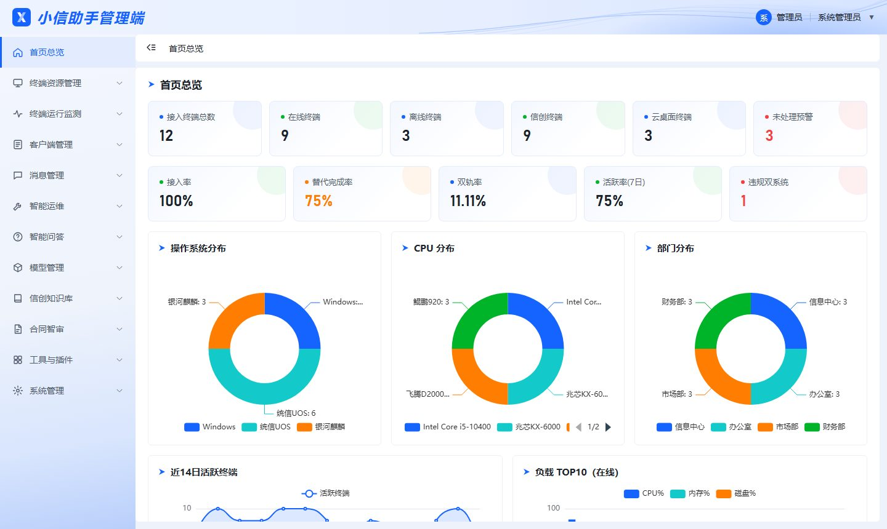

---

## 4. 终端资源管理

### 4.1 终端资源清单

菜单：**终端资源管理 → 终端资源清单**

1. 按需输入“主机名 / 使用人 / IP / 序列号”关键字，或选择部门、状态、是否信创、双系统、云桌面、操作系统、CPU、品牌，点击“查询”；
2. 列表显示主机名、使用人、部门、IP、CPU、操作系统、内存 / 硬盘、当前负载、是否信创、双系统、状态、客户端版本、最后上报时间。

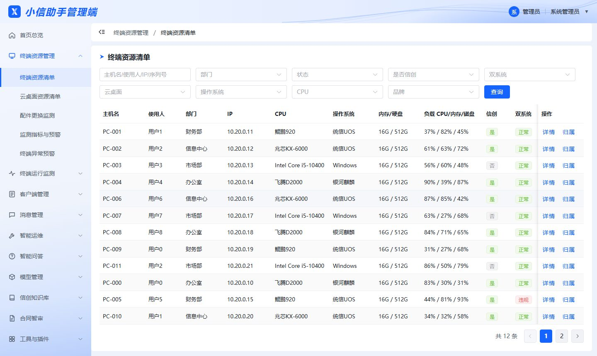

3. 点击行内“详情”，打开终端详情：上方为完整采集信息，中间为负载趋势，下方页签可查看该终端的**配件变更**、**预警**、**运行记录**和**原始采集**数据。

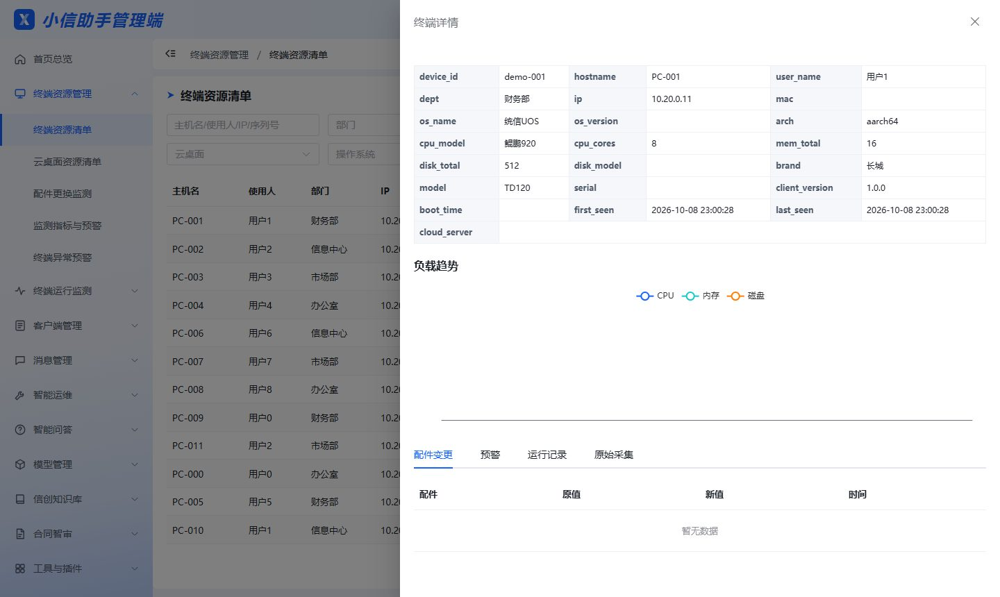

### 4.2 云桌面资源清单

菜单：**终端资源管理 → 云桌面资源清单**

- “云桌面资源清单”页签：按云桌面服务端分组，展示其下的用户端终端（主机、使用人、部门、操作系统、状态、最后上报），可按“用户端主机名 / 使用人 / IP”查询；
- “云桌面服务端”页签：维护云桌面服务器（名称、IP、配置、位置、备注）。

> 终端在客户端“设置”中勾选“本机为云桌面用户端”并填写云桌面服务端名称后，会归入对应服务端。

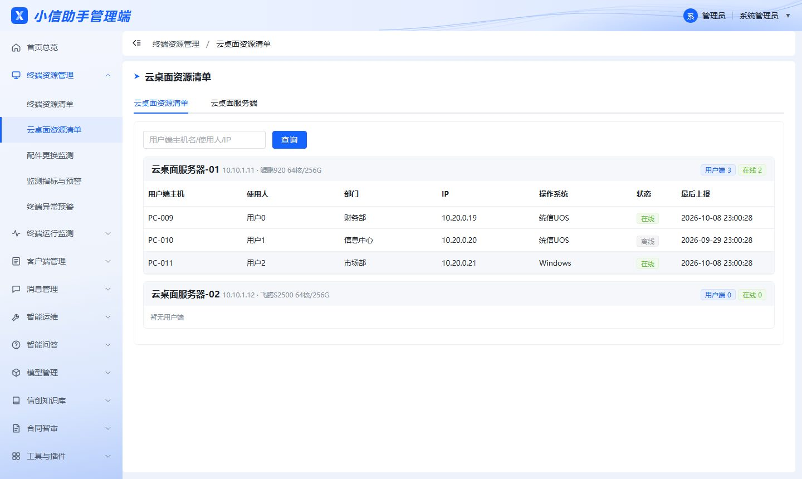

### 4.3 配件更换监测

菜单：**终端资源管理 → 配件更换监测**

客户端发现配件变化（CPU、内存、硬盘、操作系统、品牌、型号、序列号、网卡 MAC）时会上报到这里。

1. 可按“设备 ID / 配件”和确认状态（未确认 / 已确认）查询；
2. 核实变更属实（例如有对应的维修工单）后，点击“确认更换”。

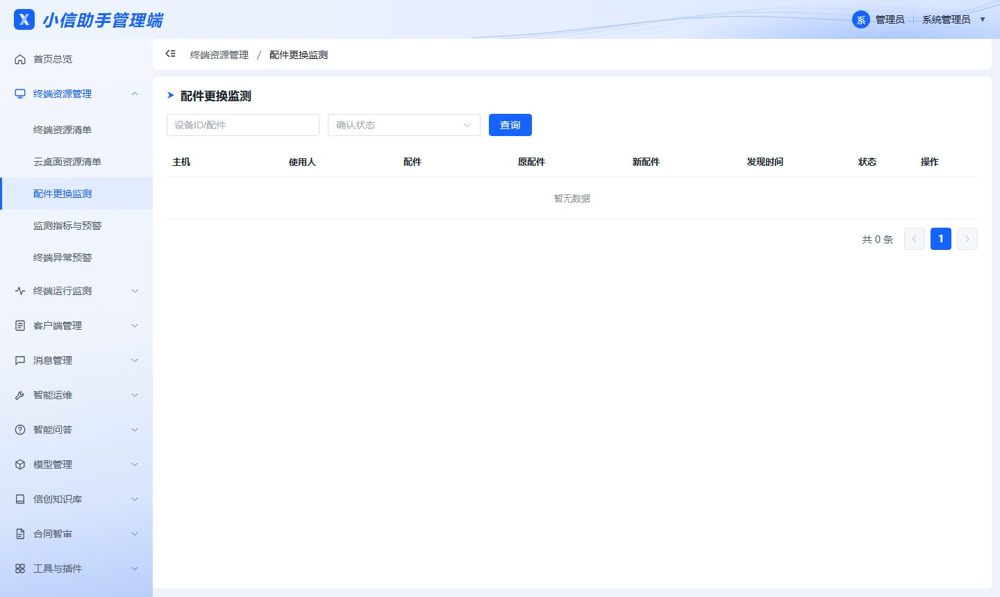

### 4.4 监测指标与预警

菜单：**终端资源管理 → 监测指标与预警**

- **指标预警**：列出未达标的指标（如接入率低于 90%）；
- **全局指标**：接入率、替代完成率、双轨率、活跃率、违规双系统数；
- **各部门对比**、**部门指标明细**：按部门统计终端数、信创数和各项指标；
- **异常 / 不合规终端**：列出违规双系统、非信创等问题终端；
- **指标阈值与应接入数配置**：设置各指标的预警阈值，以及“应接入终端总数”（填 0 表示按已接入数计算），点击“保存”。

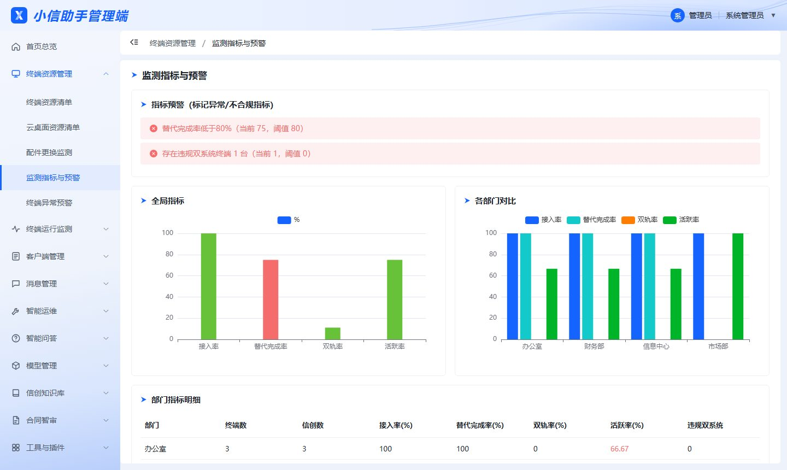

指标计算口径：

| 指标 | 计算方法 |
|---|---|
| 接入率 | 已接入终端数 ÷ 应接入终端数 |
| 替代完成率 | 信创终端数 ÷ 已接入终端数 |
| 双轨率 | 同时使用信创和非信创终端的人数 ÷ 有使用人信息的人数 |
| 活跃率 | 近 7 天有上报的终端数 ÷ 已接入终端数 |
| 违规双系统数 | 检测到双系统的终端数 |

### 4.5 终端异常预警

菜单：**终端资源管理 → 终端异常预警**

- **预警信息**页签：按内容 / 设备、状态（未处理 / 已处理）、级别查询；处理后点击行内“处理”，或勾选多条后点击“批量处理”。
- **预警规则**页签：新增或编辑规则，设置规则名称、监测项、比较符、阈值、级别、是否启用。

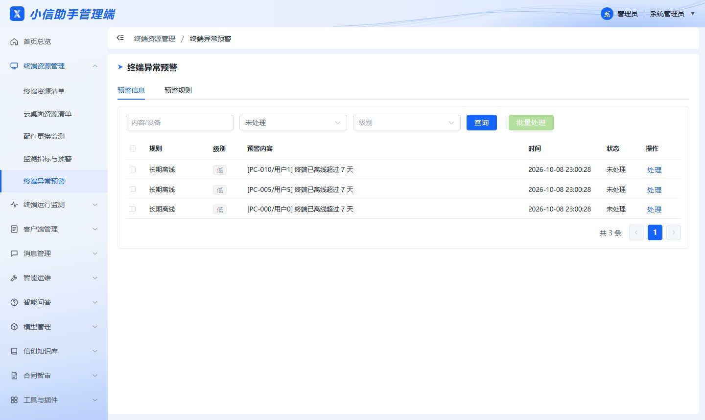

| 监测项 | 说明 | 阈值示例 |
|---|---|---|
| CPU / 内存 / 磁盘使用率 | 超过阈值时预警 | `>` 90 |
| 长期离线 | 离线天数超过阈值 | `>` 7 |
| 违规双系统 | 检测到双系统 | `=` 1 |
| 配件更换 | 发生配件变更 | `=` 1 |
| U 盘使用 | 出现 U 盘插入记录 | `=` 1 |
| 违规软件 | 安装或运行了指定软件 | `in` 迅雷,thunder,steam |
| 非信创终端 | 终端不是信创终端 | `=` 1 |

> 同一终端、同一规则 6 小时内只产生一条未处理预警。

---

## 5. 终端运行监测

### 5.1 终端运行情况

菜单：**终端运行监测 → 终端运行情况**

切换“按日 / 按周”，查看活跃终端数量趋势。

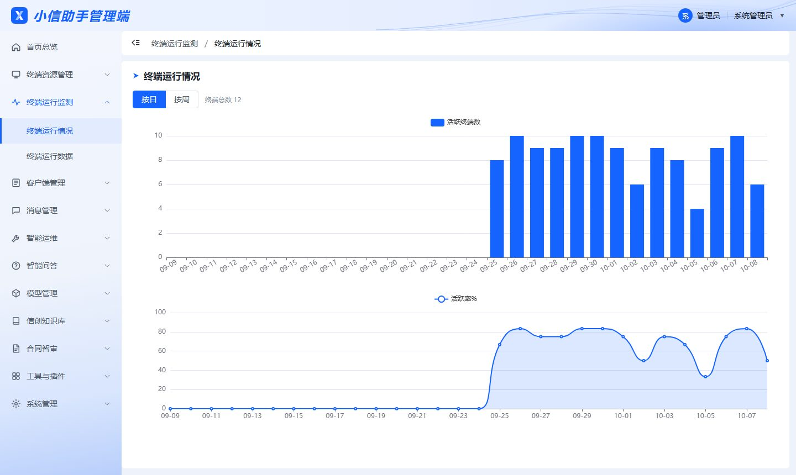

### 5.2 终端运行数据

菜单：**终端运行监测 → 终端运行数据**

查看客户端采集的开关机、已装应用、应用使用、U 盘使用、打印机使用记录。可按数据类型和设备 ID 查询；上方图表显示近 7 日各类数据的分布和应用使用 TOP15。

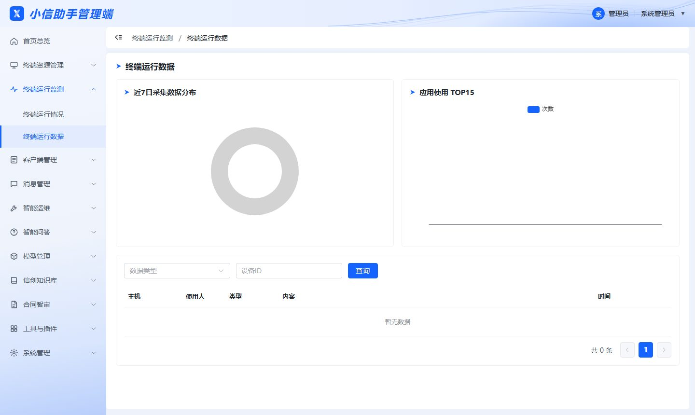

---

## 6. 客户端管理

### 6.1 版本管理

菜单：**客户端管理 → 版本管理**

1. 点击“新 增”，填写版本号（如 1.1.0）、平台（linux / windows）、架构（all / amd64 / arm64）、变更说明，状态选“草稿”，保存；
2. 在行内点击“上传安装包”，选择打包好的 `.deb` 或安装文件；
3. 编辑该版本，将状态改为“已发布”（需要强制升级时勾选“强制更新”）；
4. 客户端下次启动检查更新时，会提示用户下载新版本。不再使用的版本可改为“已下线”。

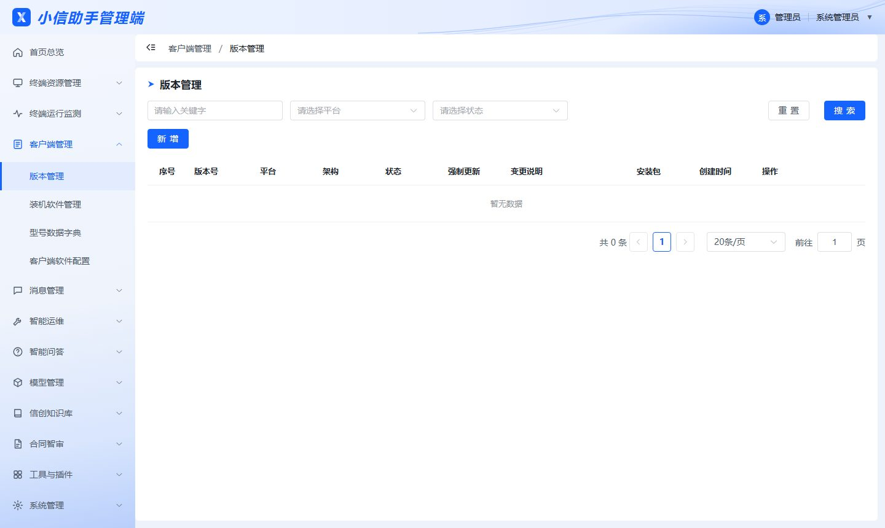

### 6.2 装机软件管理

菜单：**客户端管理 → 装机软件管理**

1. 点击“新 增”，填写软件名称、版本、分类、平台、说明，保存；
2. 在行内点击“上传安装包”；
3. 终端用户可在客户端“软件中心”中下载安装。

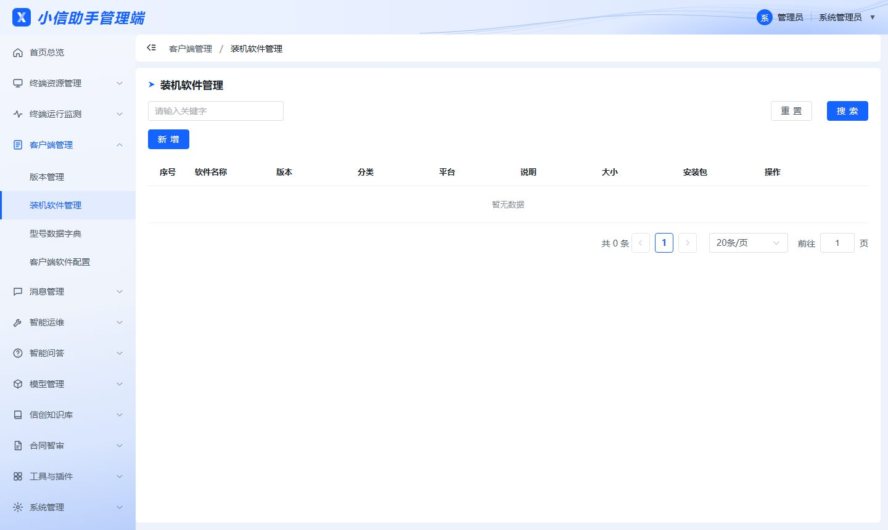

### 6.3 型号数据字典

菜单：**客户端管理 → 型号数据字典**

客户端采集到的原始文本（如 `Phytium FT-2000/4`）通过字典转换为规范名称（如“飞腾FT-2000/4”），并参与信创判定。

1. 点击“新 增”，选择字典类型（cpu / brand / model / os / disk），填写采集原始值（包含匹配）、规范名称；国产 CPU 在“属性”中填“信创”；
2. 字典修改后，点击“按字典重新标准化终端数据”，对已接入的终端重新转换。

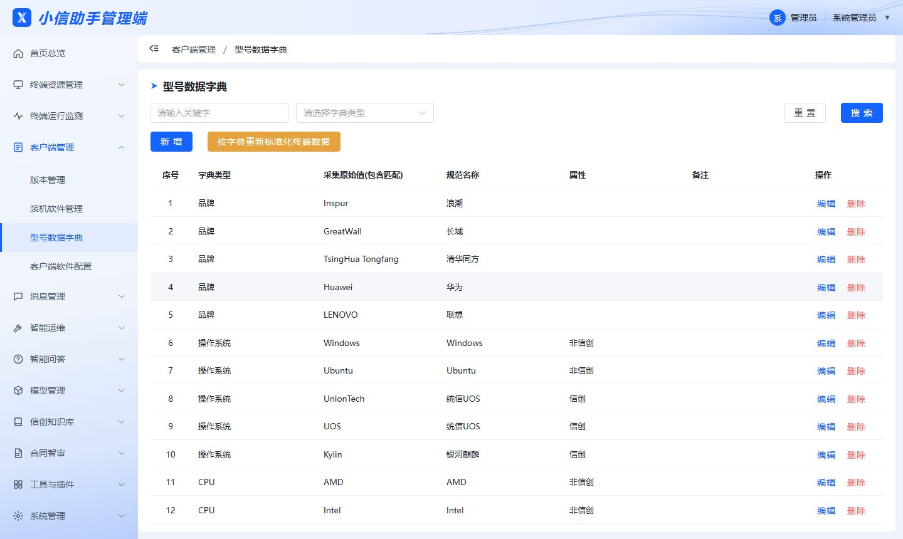

### 6.4 客户端软件配置

菜单：**客户端管理 → 客户端软件配置**

配置客户端各任务的执行方式和周期，修改后客户端下次上报时生效。

| 配置项 | 执行方式 | 默认值 |
|---|---|---|
| 双系统监测进程 | 启动时 | — |
| 版本检查 | 启动时 | — |
| 配件信息采集 | 固定间隔 | 3600 秒 |
| 运行负载采集（心跳） | 固定间隔 | 300 秒 |
| 运行数据采集（应用 / U 盘 / 打印） | 固定间隔 | 1800 秒 |
| 消息拉取 | 固定间隔 | 120 秒 |
| 闲置进程判定 CPU 阈值 | 手动 | 0.5% |
| 大文件阈值 | 手动 | 100MB |

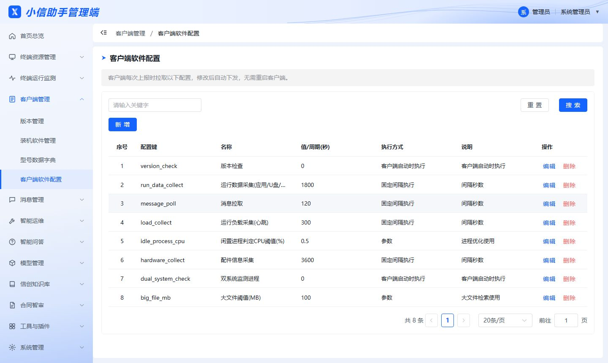

---

## 7. 消息管理

### 7.1 消息列表与新建消息

菜单：**消息管理 → 消息列表/新建任务**

列表显示消息名称、推送范围、创建时间、发送时间、发送对象数、阅读对象数和状态。行内操作：

| 按钮 | 说明 |
|---|---|
| 编辑 / 查阅/编辑 | 修改未发送的消息，或查看已发送的消息 |
| 立即发送 | 立即发送草稿或待发送的消息 |
| 阅读情况 | 查看每台终端的送达和阅读时间 |
| 删除 | 删除消息 |

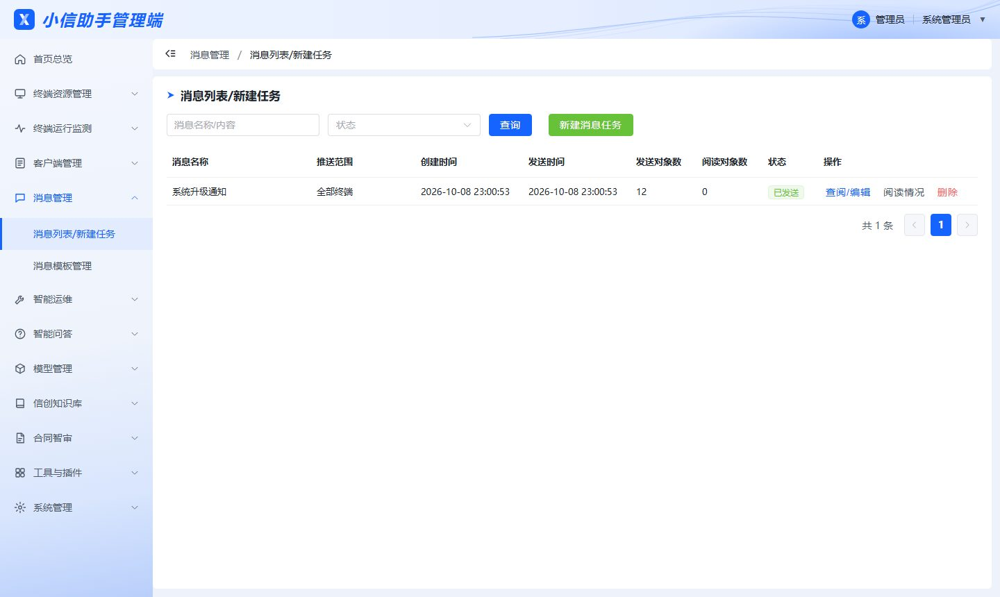

**新建消息**：

1. 点击“新建消息任务”；
2. 可在“消息模板”中选择模板（内容会带入，可二次编辑），或直接填写消息名称和消息内容；
3. 选择推送范围：全部终端 / 按部门 / 指定终端（填写主机名或设备 ID，逗号分隔）；
4. 选择发送方式：即时发送，或定时发送并选择发送时间；
5. 点击“立即发送”（或“定时发送”）；暂不发送可点击“存草稿”。

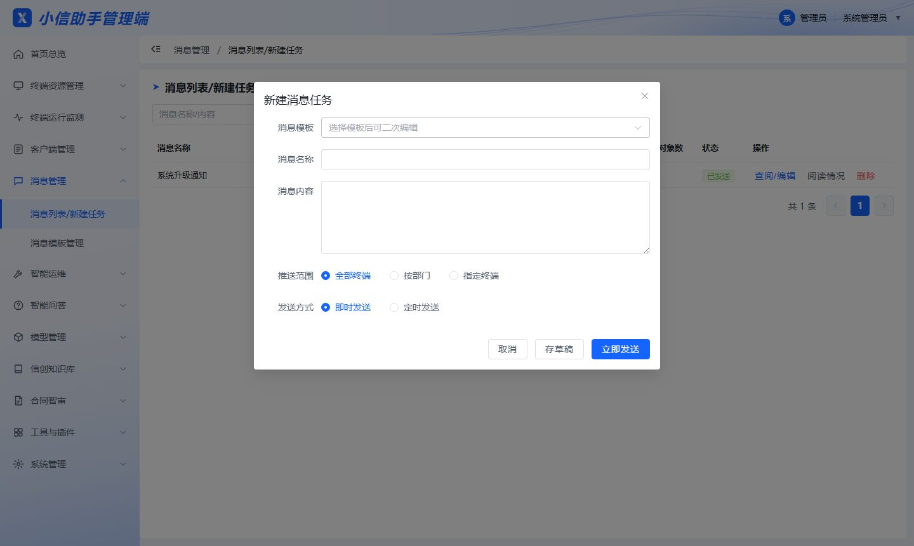

终端客户端收到消息后在屏幕右下角弹窗提醒，悬浮助手显示红点。

### 7.2 消息模板管理

菜单：**消息管理 → 消息模板管理**

维护常用消息模板（模板名称、消息标题、模板内容），新建消息时可直接引用。

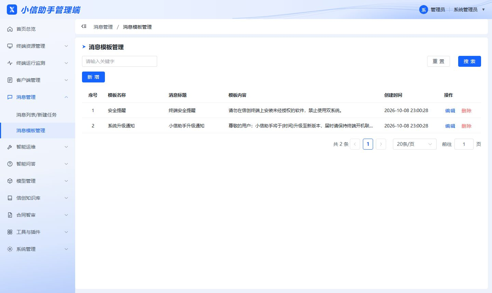

---

## 8. 智能运维

### 8.1 运维工作台

菜单：**智能运维 → 运维工作台**

- 顶部统计各状态的工单数量；
- **工单预警**：提示待指派、挂起待审核的工单；
- **近 7 日工单趋势**；
- **我的待办（快捷入口）**：点击可直接处理。

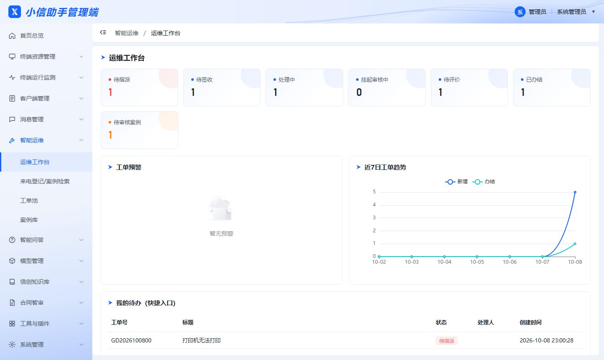

### 8.2 来电登记 / 案例检索

菜单：**智能运维 → 来电登记/案例检索**

**登记来电问题**：

1. 填写问题标题、问题描述，选择问题分类；
2. 填写报修人、联系电话、部门、地点、设备信息；
3. 选择问题状态：
   - **待处理（进入指派流转）**：生成待指派工单，也可在“直接指派”中选择运维人员；
   - **已办结（补录，不流转）**：作为补录工单，填写解决方案后直接办结；
4. 点击“提交登记”。

**检索案例**：在右侧输入关键字，点击“检索”，查看已审核案例的解决方案，高质量案例排在前面，可用于电话中直接指导用户。

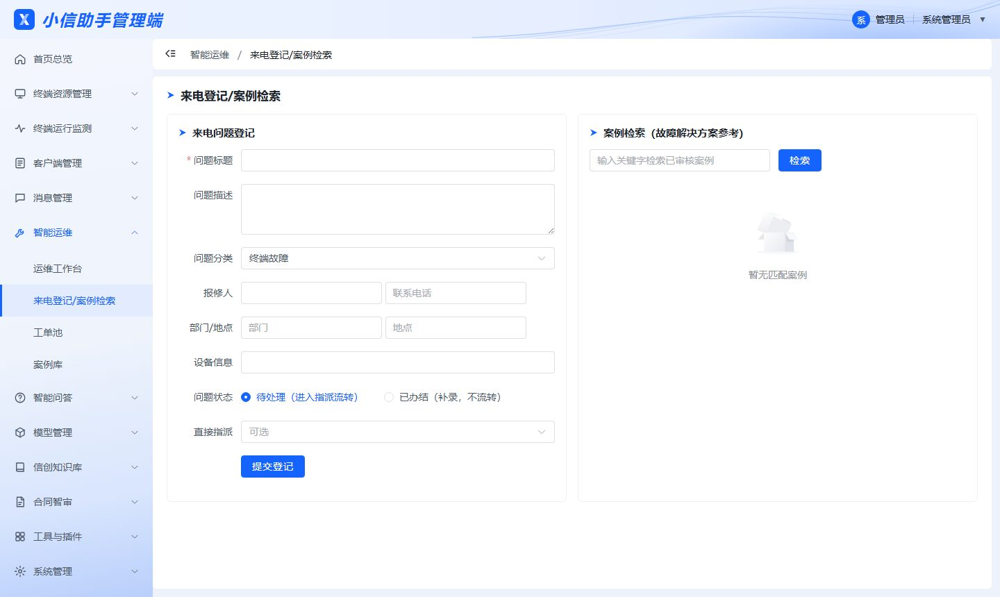

### 8.3 工单池

菜单：**智能运维 → 工单池**

1. 按“工单号 / 标题 / 报修人 / 电话”、状态、分类、来源、时间范围查询，点击“搜索”；
2. 点击“详情”打开工单详情，可进行以下操作：

| 操作 | 适用状态 | 说明 |
|---|---|---|
| 指派运维人员 | 待指派、待签收 | 在下拉框中选择运维人员（显示所属保障站 / 厂商） |
| 挂起审核通过 / 驳回挂起 | 挂起审核中 | 通过后反馈期限按申请天数顺延 |
| 录入用户评价 | 待评价 | 输入 1~5 分，工单办结 |
| 直接办结 | 未办结 | 直接关闭工单 |
| 上报为案例 | 待评价、已办结 | 生成待审核案例 |

详情下方显示工单流转记录。

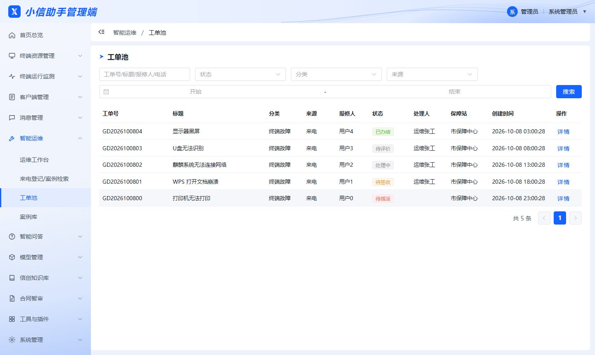

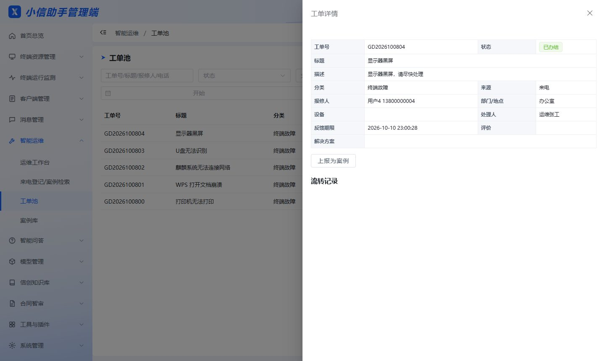

### 8.4 案例库

菜单：**智能运维 → 案例库**

- 查看、维护案例（案例标题、问题类型、问题描述、解答详情、是否高质量案例）；
- 区县保障站上报的案例状态为“待审核”，管理员核实后点击“通过”或“驳回”，审核通过后纳入案例库；
- 勾选“高质量案例”的案例在检索时优先显示。

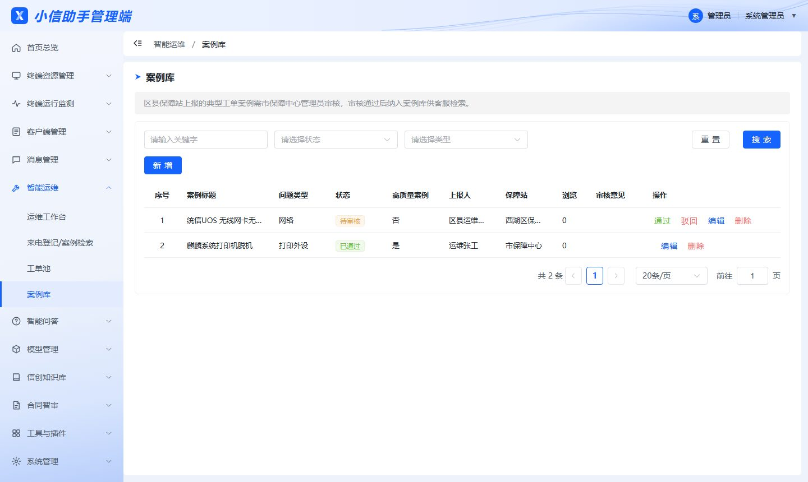

---

## 9. 智能问答

### 9.1 问答测试

菜单：**智能问答 → 问答测试**

1. 点击“+ 新会话”；
2. 选择模式：**智能问答**（直接问大模型）或**本地知识问答**（先检索知识库再回答，可选择知识库）；
3. 模型选择框默认“自动路由（默认模型 + 降级）”，也可指定模型；
4. 在下方输入问题，按 Enter 发送（Shift + Enter 换行）；回答逐字显示，可点击“停止”中断；
5. 回答下方显示实际使用的模型；知识问答还会显示引用来源；
6. 左侧为历史会话，点击可切换，点击“×”删除。

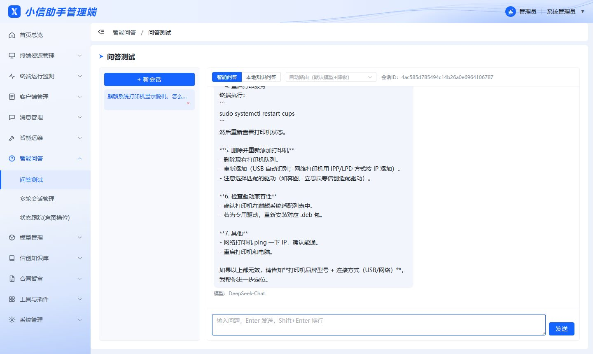

> 输入“我的电脑坏了，需要报修”等内容会进入“故障报修”流程：系统依次询问设备类型、故障现象、地点、联系电话，收集齐后自动创建工单并返回工单号。中途回复“取消”可退出。

### 9.2 多轮会话管理

菜单：**智能问答 → 多轮会话管理**

- **多轮会话参数**：会话超时（分钟）、上下文窗口（轮）、上下文策略（滑动窗口 / 滑动窗口 + 历史摘要），点击“保存”立即生效；
- **会话列表**：查看所有会话的 Session ID、标题、用户 / 设备、模式、进行中的意图、状态、创建和最后活跃时间。

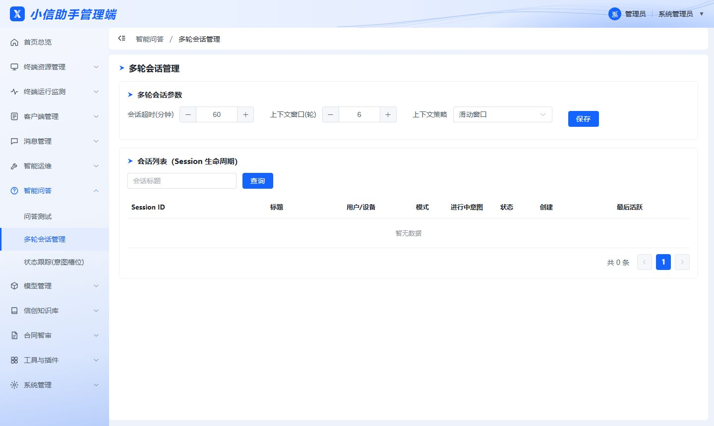

### 9.3 状态跟踪（意图槽位）

菜单：**智能问答 → 状态跟踪(意图槽位)**

配置对话中需要持续收集信息的意图：

| 字段 | 说明 |
|---|---|
| 意图名称 | 如“故障报修” |
| 触发关键词 | 逗号分隔，用户消息中包含任一关键词即进入该意图 |
| 完成动作 | 仅汇总 / 自动创建运维工单 |
| 槽位定义 | JSON 数组，每项包括 `name`（字段名）、`label`（追问时的提示）、`required`（是否必填）、`pattern`（可选的提取正则） |
| 启用 | 是否启用 |

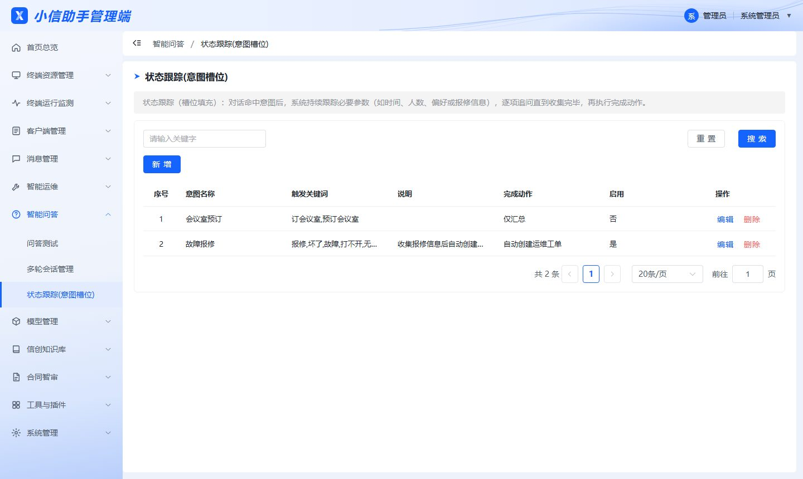

---

## 10. 模型管理

### 10.1 模型接入与配置

菜单：**模型管理 → 模型接入与配置**

**路由策略**：页面顶部选择策略后点击“保存（无需重启）”。

| 策略 | 说明 |
|---|---|
| 优先级 + 自动降级 | 默认模型优先，其余按优先级数字从小到大，失败自动切换 |
| 轮询 | 依次轮流使用各模型 |
| 加权 | 按权重随机选择 |
| 按业务场景 | 优先使用“业务场景”包含当前场景的模型 |

**配置模型**：点击“新 增”或“编辑”，填写：

| 字段 | 说明 |
|---|---|
| 名称 | 显示名称 |
| 厂商适配器 | deepseek / qwen / telechat / openai / mock |
| API 地址、API Key、模型标识 | 如 `https://api.deepseek.com/v1`、`sk-...`、`deepseek-chat` |
| temperature、top_p、max_tokens、超时 | 调用参数 |
| 优先级、权重、业务场景 | 路由使用 |
| 扩展参数（JSON） | 透传给接口的其他参数 |
| 版本、灰度% | 版本管理与灰度发布 |
| 默认、启用 | 是否默认模型、是否启用 |

**行内操作**：

- **健康检查**：测试模型是否可连通，结果显示在“健康”列；
- **调用测试**：输入一句话，查看模型实际回复；
- **发布**：按“版本号,灰度比例”格式填写（如 `v2,30` 表示 30% 用户使用该版本），灰度比例为 100 时全量发布并设为默认。

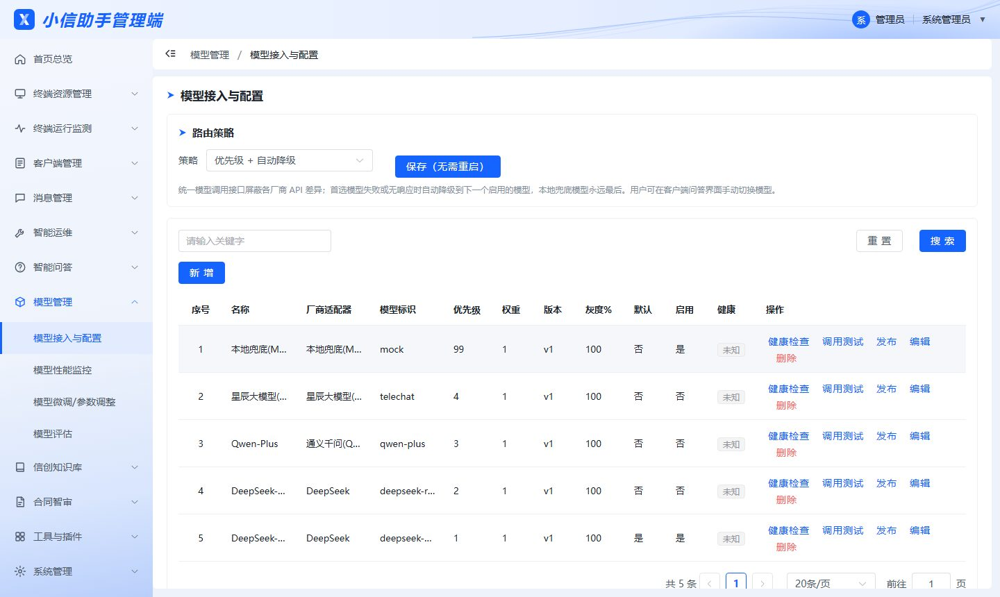

### 10.2 模型性能监控

菜单：**模型管理 → 模型性能监控**

查看近 7 日调用量与平均响应时间、各模型成功率，以及每个模型的调用次数、平均响应、成功率、降级调用次数、输出 Token 数，和最近的失败调用记录。

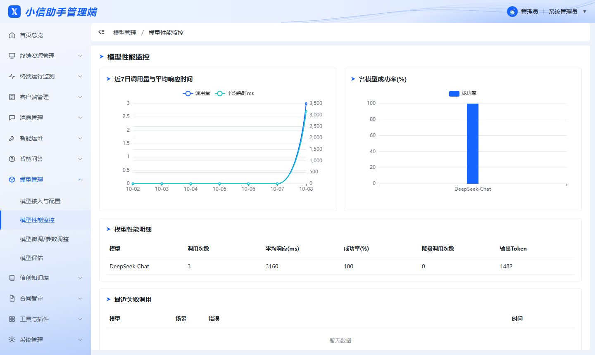

### 10.3 模型微调 / 参数调整

菜单：**模型管理 → 模型微调/参数调整**

**① 上传数据集**：

1. 填写数据集名称，选择类型（运维知识 / 政策知识）；
2. 选择文件（jsonl、json、csv、xlsx），点击“上传并预处理”；
3. 系统自动完成格式标准化、清洗（去除过短、乱码、重复的数据）和分类，列表显示原始条数、有效条数和分类统计。

> 数据格式：每条包含问题和答案。字段名可以是 `instruction` / `input` / `output`、`question` / `answer`，或表头“问题” / “答案”。示例文件：`server/data/finetune_samples/电脑运维微调数据集_400条.jsonl`。

**② 新建微调任务**：选择数据集，填写任务名、基座模型，选择微调方法（LoRA / QLoRA），设置超参数（学习率、训练轮数、批大小、LoRA rank 等），点击“启动训练”。

**③ 训练任务与监控**：

- 列表显示任务进度、状态和最终 Loss；
- “监控”：查看 Loss 曲线、训练日志和生成的训练配置；
- “停止”：中止训练中的任务；
- “调参重训”：修改超参数后重新训练，用于对比效果。

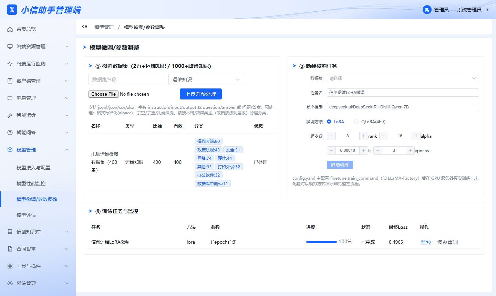

> 服务器未配置训练命令时为模拟训练，用于演示流程；对接 GPU 训练环境的方法见《系统安装部署手册》。

### 10.4 模型评估

菜单：**模型管理 → 模型评估**

1. 维护测试集：测试题为 JSON 数组，每题包含 `question`、`answer`、`keywords`；
2. 选择测试集和模型，点击“开始评估”；
3. 评估完成后查看准确率、专业性、平均耗时；点击“明细”查看每题的模型回答、参考答案、关键词命中情况和是否正确。

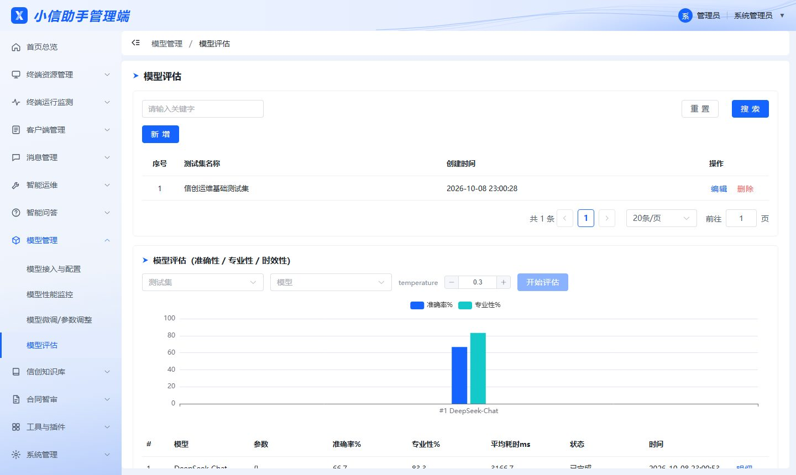

---

## 11. 信创知识库

### 11.1 知识库构建

菜单：**信创知识库 → 知识库构建**

1. 左侧选择知识库，或点击“+新建”创建知识库；
2. 点击“批量导入文档”，选择一个或多个文件，支持 docx、pdf、xlsx、pptx、txt、md、csv、ofd 及 png / jpg 图片（扫描件需服务器开启 OCR）；
3. 导入后在列表中查看处理进度、分片数和被过滤数：
   - 内容与已有文档完全相同的文件会提示冲突并跳过；
   - 与已有文档同名的文件会生成新版本，旧版本下线。
4. 行内操作：

| 按钮 | 说明 |
|---|---|
| 日志 | 查看导入过程日志 |
| 分片 | 查看切分后的文本片段 |
| 版本 | 查看历史版本 |
| 恢复 | 将历史版本恢复为当前版本 |
| 标签 | 修改自动打的分类标签（修改后标记为已人工校验） |
| 重试 | 导入失败的文档重新处理 |
| 删除 | 删除文档及其分片 |

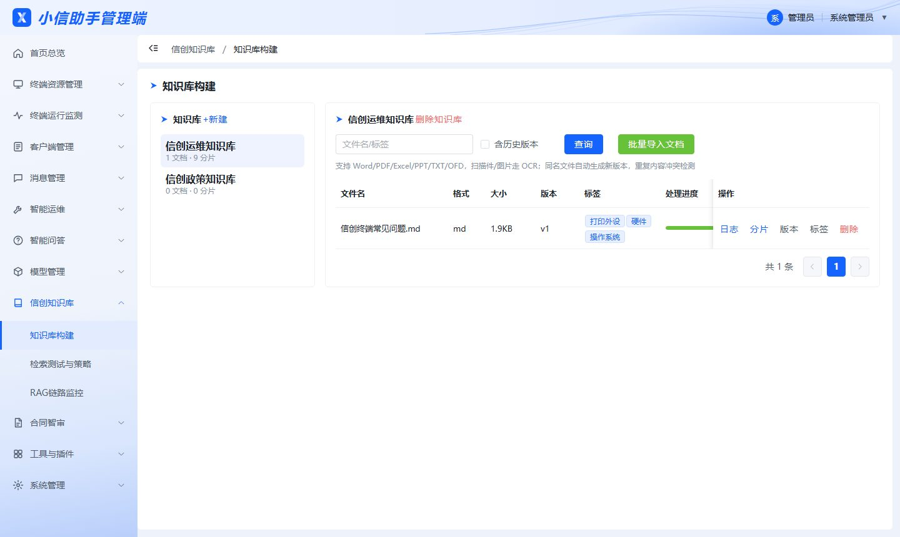

### 11.2 检索测试与策略

菜单：**信创知识库 → 检索测试与策略**

- **检索策略参数**：检索模式（语义检索 / 关键词检索 / 混合检索）、TopK、相似度阈值、混合权重、分片大小、重叠，点击“保存”；
- **检索测试**：选择知识库和模式，输入问题，点击“检索”，查看命中的片段和各项得分（语义、关键词、综合）；
- **检索质量评估**：录入若干测试问题及期望命中的文件名或关键词，点击“评估”，计算召回率和精确率。

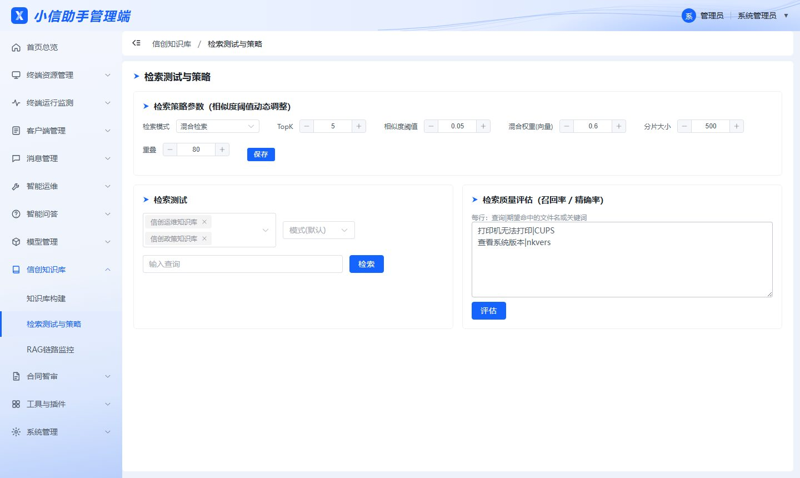

### 11.3 RAG 链路监控

菜单：**信创知识库 → RAG链路监控**

查看检索量与耗时趋势、检索相关度趋势和最近的检索记录（查询内容、模式、命中数、最高分、检索耗时）。

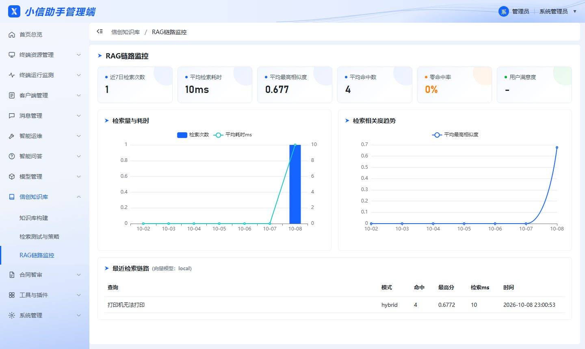

---

## 12. 合同智审

### 12.1 合同审查

菜单：**合同智审 → 合同审查**

1. 选择比对模板（默认第一个），上传合同文件（PDF、OFD、Word 等）；
2. 审查完成后，列表显示风险等级、不合规项数和耗时；可按文件名、风险等级查询；
3. 点击“审查结果”，查看：
   - **合规性研判**：33 条规则的逐条结果，不合规项排在前面并标红，给出预警提醒；
   - **要素提取**：合同名称、编号、甲乙方、金额（大小写）、期限、付款方式、违约责任、管辖等；
   - **模板差异**：与模板逐条比对，绿色一致、红色缺失、橙色格式不符或内容冲突；
   - **条款结构**、**原文**。
4. 规则判断有误时，点击该项的“误报”，计入规则误报统计；修改规则后可点击“重新审查”。

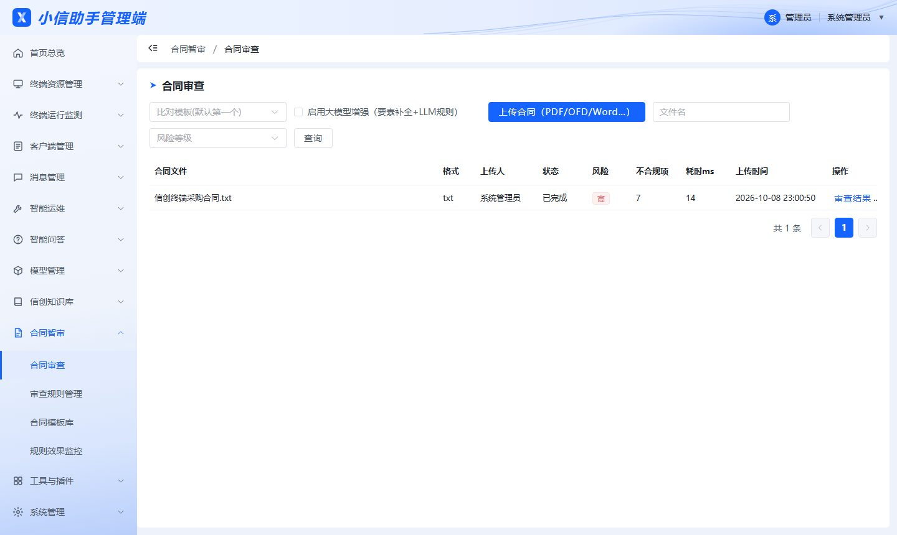

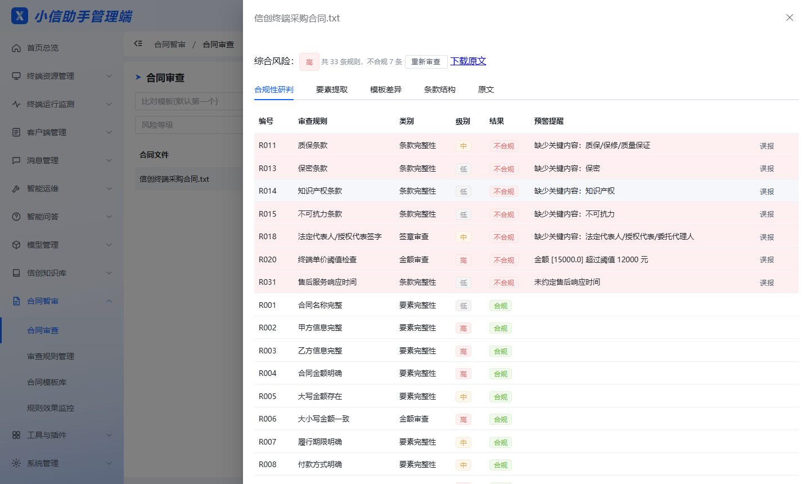

### 12.2 审查规则管理

菜单：**合同智审 → 审查规则管理**

- 按名称 / 编号、类别查询规则；点击“新增规则”或“编辑”打开规则编辑器，设置编号、名称、类别、级别、规则类型和参数，可粘贴一段合同文本点击“测试”即时验证；保存时版本号自动加 1；
- “复用”：以现有规则为模板新建；
- “批量导出” / 导入：以 JSON 文件导出或导入规则。

| 规则类型 | 参数示例 |
|---|---|
| 必备要素 | `{"element": "甲方"}` |
| 必备关键词 | `{"keywords": ["违约"]}` |
| 禁止关键词 | `{"keywords": ["无限连带"]}` |
| 必须匹配 / 禁止匹配正则 | `{"pattern": "...", "message": "提示"}` |
| 金额上限 | `{"pattern": "单价...([\\d,]+)元", "max": 12000}` |
| 大小写金额一致 | `{}` |
| 大模型判定 | `{"prompt": "判断是否包含..."}` |

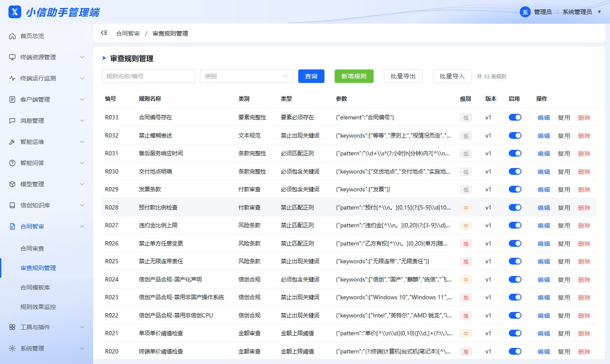

### 12.3 合同模板库

菜单：**合同智审 → 合同模板库**

维护标准合同模板：模板名称、合同类别、行业、条款要素定义（JSON，每项包括条款名称、是否必选、匹配关键词）、模板全文。

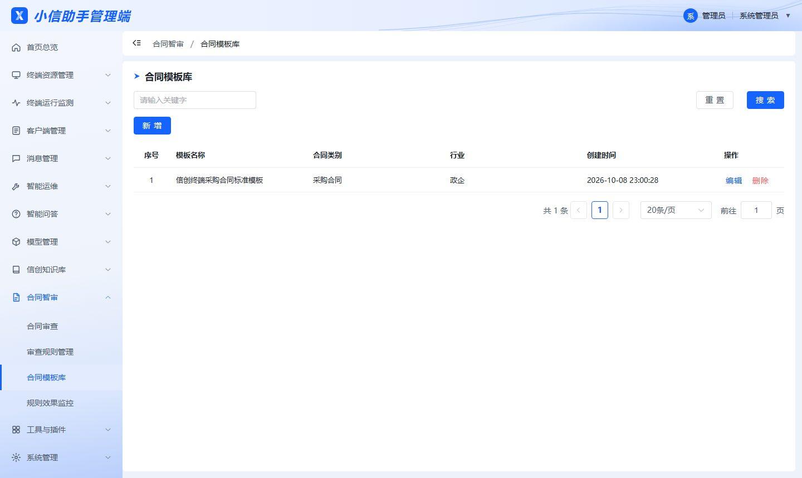

### 12.4 规则效果监控

菜单：**合同智审 → 规则效果监控**

查看每条规则的命中次数、命中率、误报次数和误报率，用于优化规则。

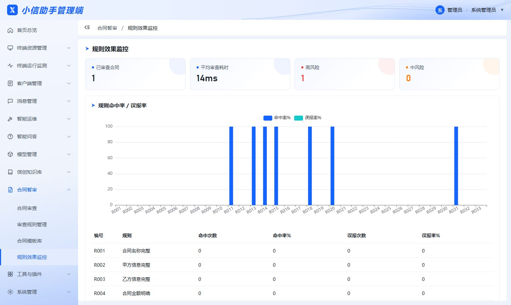

---

## 13. 工具与插件

### 13.1 工具管理

菜单：**工具与插件 → 工具管理**

- 列表包括内置工具（OCR 文字识别、图片场景 / 图表分析、知识库检索、文档解析、文本摘要、计算器、当前时间）和第三方插件；
- 点击“调用测试”，填写参数 JSON 后调用，查看返回结果；
- 第三方插件注册后默认停用，管理员核实后编辑并勾选“启用”。

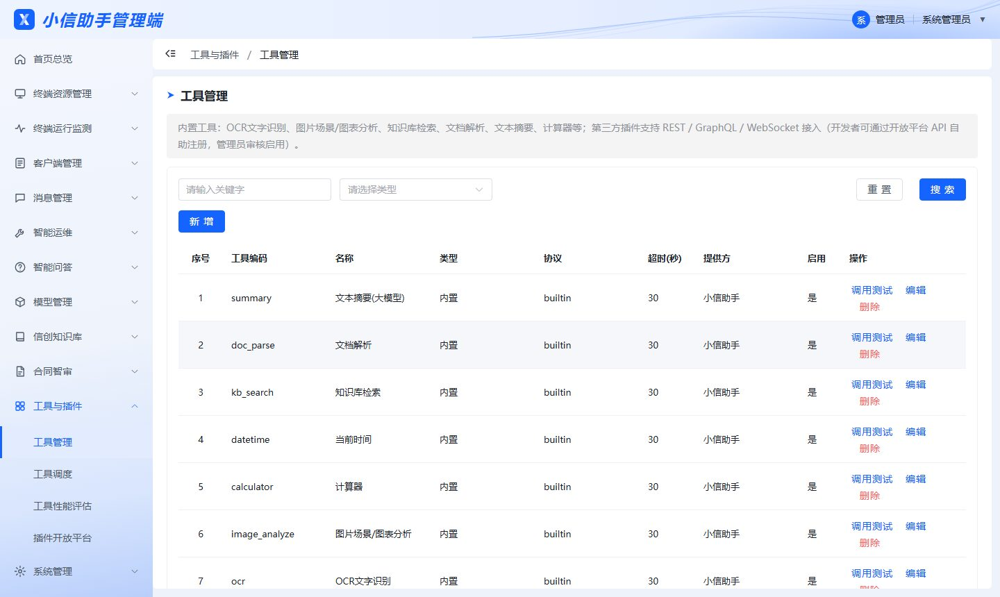

### 13.2 工具调度

菜单：**工具与插件 → 工具调度**

1. 点击“+ 添加步骤”，为每步选择工具、填写参数和超时；参数中可用 `${steps.0.text}` 引用第 1 步的输出；
2. 点击“执行”，查看每一步的结果、耗时和错误。

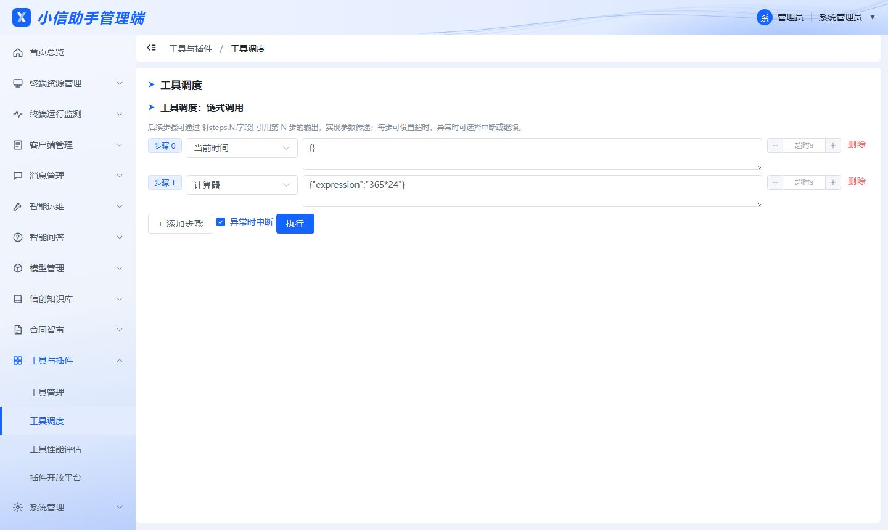

### 13.3 工具性能评估

菜单：**工具与插件 → 工具性能评估**

查看异常告警、调用趋势、各工具成功率，以及调用次数、平均 / P95 / 最大响应时间、成功率和最近异常。

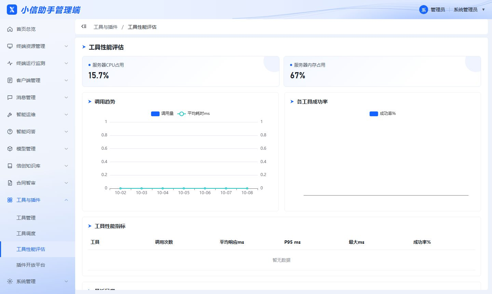

### 13.4 插件开放平台

菜单：**工具与插件 → 插件开放平台**

1. 填写调用方名称，点击“创建 API Key”，**密钥只显示一次**，请复制保存后交给开发者；
2. 不再使用的密钥点击“吊销”；
3. 页面下方提供第三方工具接入说明，开发者使用 `sdk/xiaoxin_sdk.py` 注册插件，详见 `sdk/README.md`。

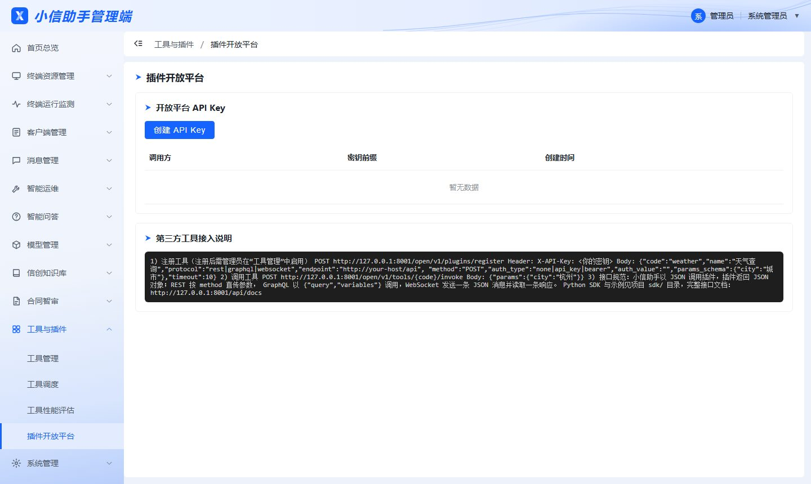

---

## 14. 系统管理

### 14.1 用户管理

菜单：**系统管理 → 用户管理**

新增或编辑用户：账号、姓名、角色（管理员 / 客服 / 运维 / 普通用户）、保障站、供应商 / 厂商（纳管厂商运维人员填写）、电话、密码、是否启用。停用后该用户不能登录。

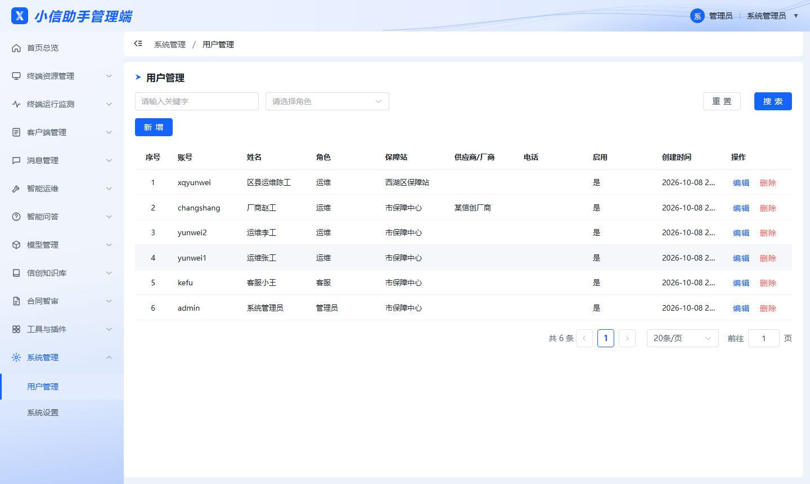

### 14.2 系统设置

菜单：**系统管理 → 系统设置**

- **客户端接入**：查看服务端地址；设置客户端接入密钥（留空表示不校验），设置后终端客户端需在“设置”中填写相同的密钥；
- **修改密码**：输入原密码和新密码，点击“修改”；
- **相关入口**：接口文档、运维移动端地址等。

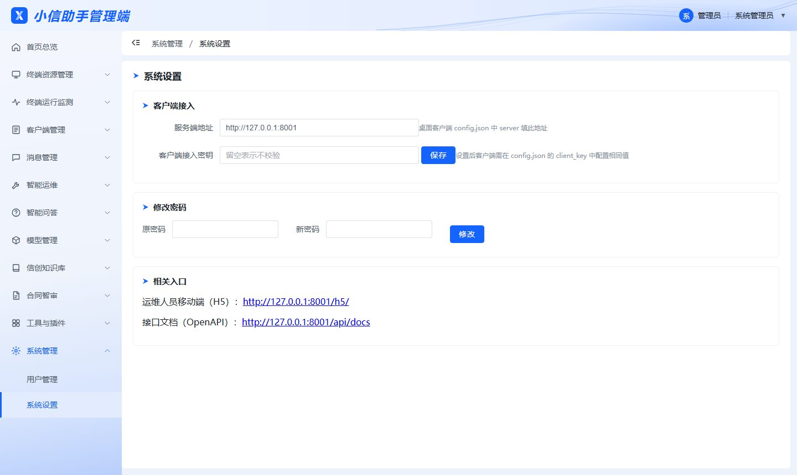

---

## 15. 运维人员移动端

### 15.1 登录

手机浏览器打开 `http://服务器地址:8000/h5/`，输入运维账号和密码，点击“登录”。建议添加到手机桌面方便使用。

### 15.2 我的工单

- 顶部统计待签收、处理中、挂起审核、已办数量；
- 切换“待办 / 已办 / 全部”页签，可按工单号或标题搜索；
- 点击工单进入详情。

### 15.3 处理工单

工单详情显示工单号、状态、标题、问题描述、报修人、部门 / 地点、设备、反馈期限和流转记录，底部按钮随状态变化：

| 按钮 | 适用状态 | 操作 |
|---|---|---|
| 签收 | 待签收 | 在确认框中确认后，工单变为“处理中” |
| 信息补充 | 处理中 | 核对并修改报修人、电话、部门、地点、报修设备等信息后保存 |
| 转派 | 待签收、处理中 | 选择本保障站的其他运维人员（含纳管的厂商运维人员），填写转派原因，点击“确认转派” |
| 挂起 | 处理中 | 填写挂起原因（如等待配件到货）和延期天数，点击“提交审核”，由客服审核 |
| 反馈 | 处理中 | 填写故障原因及解决方法、备注，点击“提交反馈”，工单变为“待评价” |

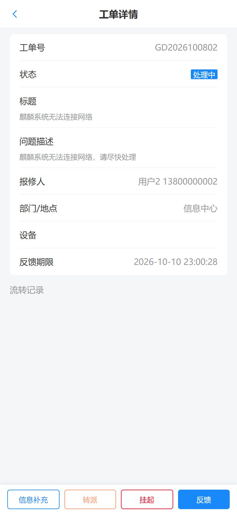

### 15.4 工单补录

已解决但未登记的问题，点击底部“工单补录”，填写问题、描述、分类、报修人、电话、地点、设备、处理结果和备注，点击“提交补录”。补录的工单直接办结。

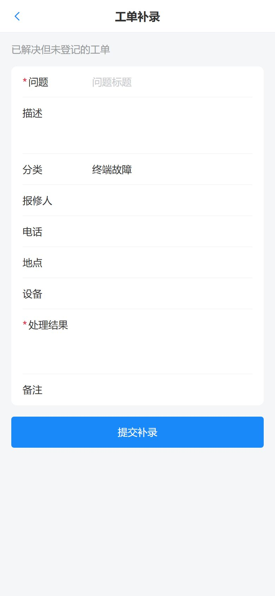

---

## 16. 桌面客户端

> 本章为终端用户使用说明。客户端界面截图建议在实际信创终端（麒麟 / 统信）上补充。

### 16.1 启动与界面

安装后客户端随系统自动启动，也可在开始菜单中打开“小信助手”。主窗口左侧为功能导航：**一键提速、设备监测、智能问答、合同智审、消息中心、软件中心、设置**，导航下方显示与服务器的连接状态（“已连接服务器”或“离线：原因”）。

关闭主窗口后程序继续在后台运行，桌面右侧保留**悬浮助手**：

- 单击悬浮助手：打开智能问答；
- 拖动：移动位置；
- 右键菜单：智能问答、一键提速、设备监测、消息中心、打开主界面、退出小信助手；
- 有未读消息时显示红点。

### 16.2 一键提速

**垃圾清理**：

1. 点击“一键扫描”，等待进度条完成；
2. 在“垃圾分类”树中查看各类垃圾的大小，双击类别切换勾选；右键类别可打开详细信息窗口查看具体文件；
3. 点击“一键清理”。需要管理员权限的项目（如 APT 缓存、/var/log）会弹出系统授权窗口，输入本机密码即可。

**内存加速**：

1. 上方实时显示 CPU、内存、网络、磁盘使用曲线，下方为进程列表，可在“排序”中选择按 CPU、内存、网络或磁盘排序；
2. 点击“一键优化闲置进程”，系统列出长时间无活动的进程，确认后结束；也可选中进程后点击“结束选中进程”。系统进程、浏览器、办公软件、安全软件等不会被列为闲置进程。

**大文件检索**：

1. 设置扫描路径和大小阈值（默认大于 100MB），点击“开始扫描”，可随时“停止”；
2. 列表显示文件名、大小、更新时间，底部汇总文件数、总大小和按类型统计；
3. 勾选或“全选”后点击“删除选中”（会二次确认），也可“打开所在目录”。

### 16.3 设备监测

- **配件信息**：显示本机 CPU、内存、硬盘、操作系统、品牌、型号、序列号等，以及是否信创终端、双系统检测结果；点击“重新采集并上报”立即同步；
- **配件更换记录**：本机的配件变更历史；
- **违规 / 异常预警**：与本机相关的预警。

配件发生变化时，客户端会弹出“配件更换提醒”，并自动上报管理端。

### 16.4 智能问答

1. 选择模式：**智能问答** 或 **本地知识问答**；
2. 在“模型”下拉框中可切换 DeepSeek、星辰、Qwen 等模型（默认自动选择）；
3. 输入问题后点击“发送”，回答逐字显示，可点击“暂停”中断；点击“新会话”开始新的话题；
4. 本地知识问答模式下，可点击“上传私有文档”上传 PDF、Word、TXT 等文件到个人知识库，之后基于这些文档提问，回答下方显示引用来源。

> 描述电脑故障并表示需要报修时，助手会询问设备、现象、地点、电话，并自动生成报修工单。

### 16.5 合同智审

1. 点击“上传合同（PDF/OFD）”选择合同文件；勾选“大模型增强”可用大模型补充要素提取；
2. 上传后自动审查，点击“刷新列表”查看状态；
3. 选中合同，查看“合规性研判”（不合规项标红并给出提醒）、“要素提取”和“差异提示”。

### 16.6 消息中心

查看管理员推送的通知消息。新消息到达时屏幕右下角弹窗提醒，点击“查看”进入消息中心。

### 16.7 软件中心

列出管理员上架的常用软件，选中后点击“下载并安装”；点击“刷新”获取最新列表。

### 16.8 设置

| 设置项 | 说明 |
|---|---|
| 服务器地址 | 管理员提供的服务端地址，如 `http://10.0.0.10:8000` |
| 客户端接入密钥 | 管理员设置了接入密钥时填写 |
| 使用人、部门 | 用于管理端统计 |
| 本机为云桌面用户端、云桌面服务端名称 | 云桌面终端勾选并填写 |
| 显示桌面悬浮助手 | 是否显示悬浮助手 |

修改后点击“保存”。页面下方显示设备 ID、客户端版本和配置文件位置，报修时可提供给运维人员。

---

## 17. 典型业务流程

### 17.1 来电报修到办结

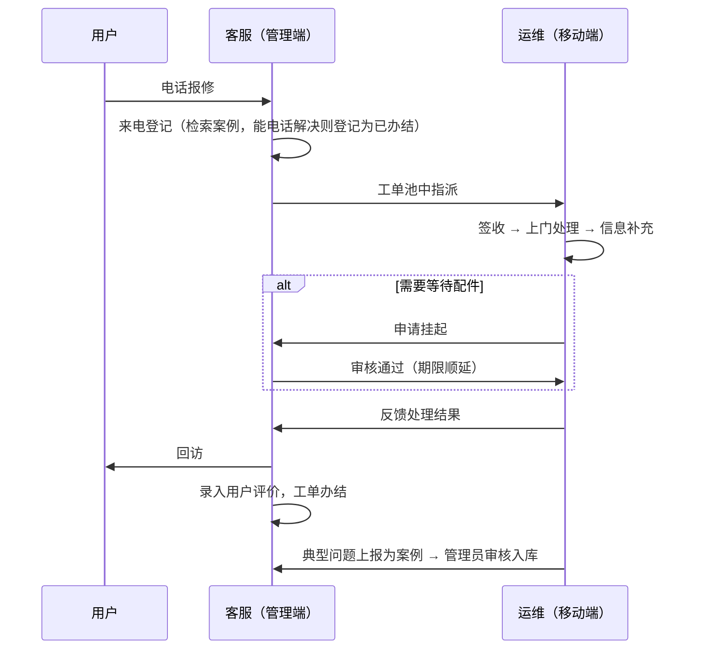

### 17.2 终端用户自助报修

用户在客户端或悬浮助手中描述故障（如“电脑蓝屏了要报修”）→ 助手追问设备、现象、地点、电话 → 自动创建工单 → 工单进入工单池“待指派”，后续按 17.1 流转。

### 17.3 新客户端版本发布

打包新版本 → 管理端“版本管理”新增版本（草稿）→ 上传安装包 → 在少量终端上验证 → 改为“已发布” → 终端启动时提示升级。

### 17.4 知识库建设与问答优化

收集运维手册、常见问题、政策文件 → “知识库构建”批量导入 → 检查标签并人工校验 → “检索测试与策略”用典型问题验证效果并调整阈值、权重 → 在问答中使用“本地知识问答” → 通过“RAG 链路监控”跟踪命中率和满意度，持续补充资料。

---

## 18. 常见问题

| 问题 | 处理方法 |
|---|---|
| 登录提示“用户名或密码错误” | 核对账号密码，注意大小写；忘记密码请联系管理员在“用户管理”中重置 |
| 登录后很快又要求重新登录 | 登录已过期（默认 24 小时）或管理员修改了系统密钥，重新登录即可 |
| 看不到某些菜单 | 菜单按角色显示，需要相应权限请联系管理员 |
| 问答回复“未配置大模型”之类的提示 | 当前没有可用的大模型，请管理员在“模型接入与配置”中配置并通过健康检查 |
| 知识问答回答与资料无关 | 检查知识库中是否有相关资料；在“检索测试”中查看命中情况，适当降低相似度阈值 |
| 文档导入一直“处理中”或“失败” | 点击“日志”查看原因；扫描件需服务器开启 OCR；可点击“重试” |
| 客户端显示“离线” | 检查网络和“设置”中的服务器地址；联系管理员确认服务正常 |
| 客户端没有收到消息 | 消息拉取有间隔（默认 2 分钟）；确认推送范围包含本机；检查客户端是否在线 |
| 移动端看不到工单 | 确认工单已指派给本人；切换“全部”页签查看 |
| 合同审查结果与实际不符 | 点击该项“误报”反馈；请管理员在“审查规则管理”中调整规则后“重新审查” |
