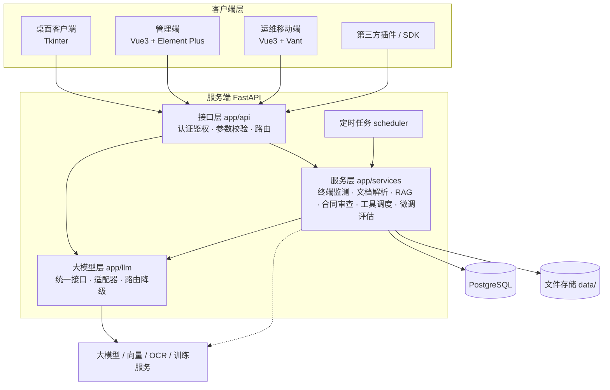
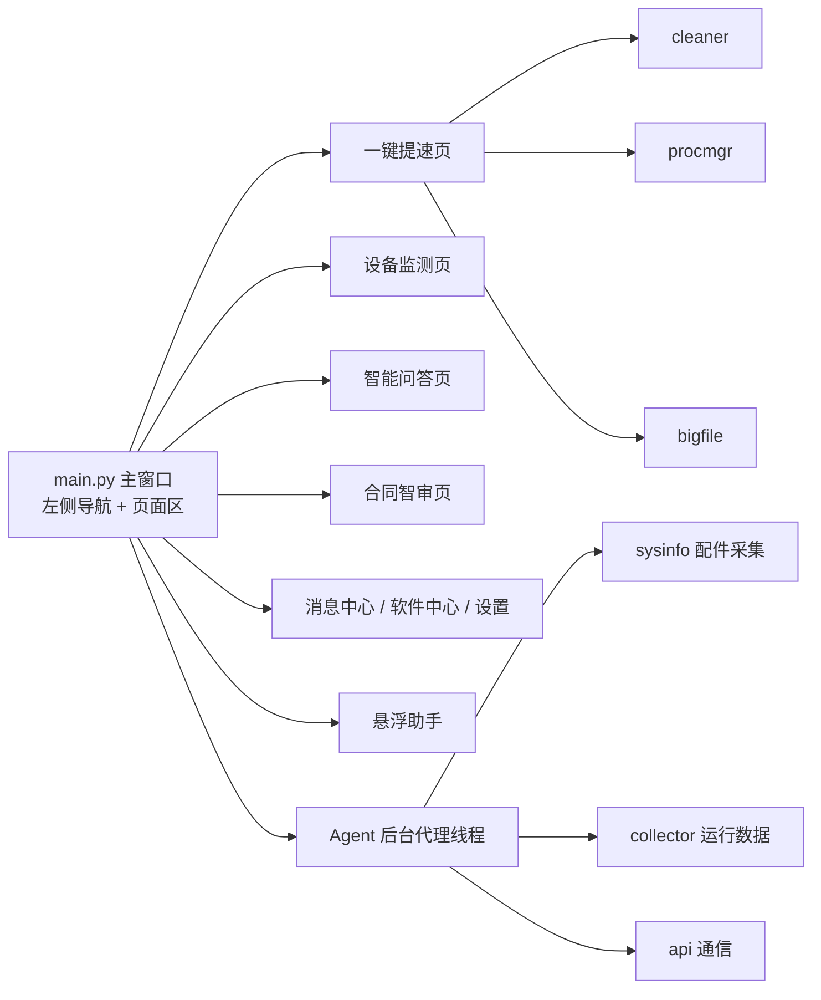
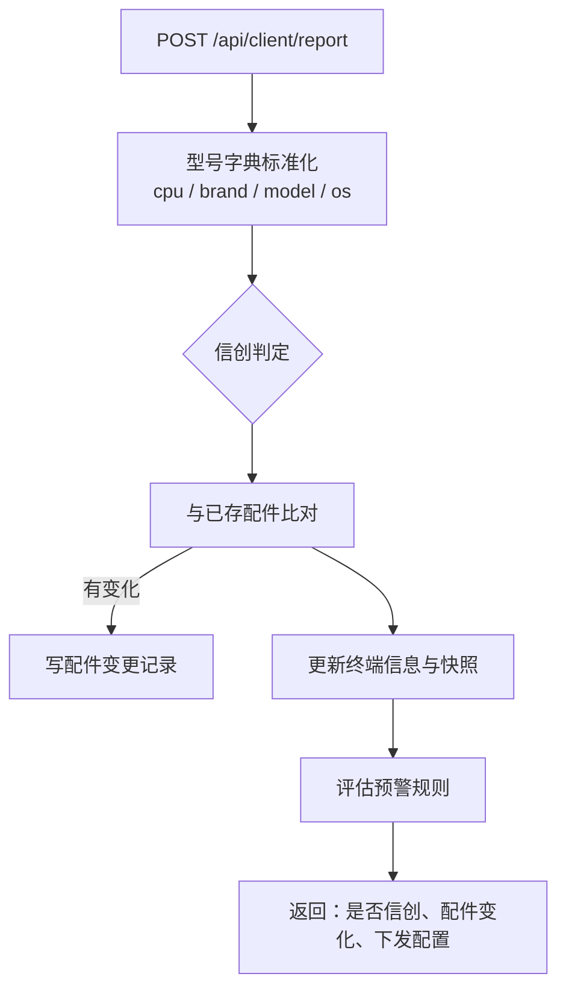
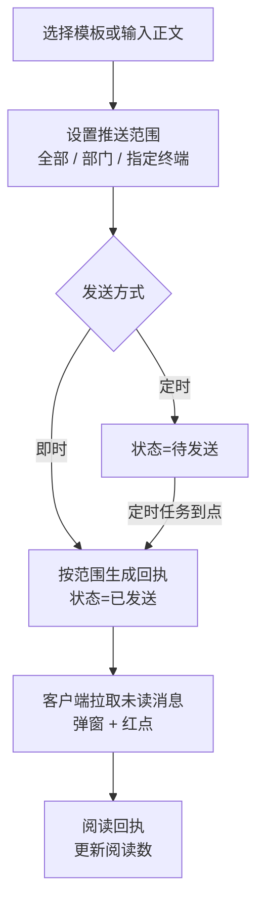
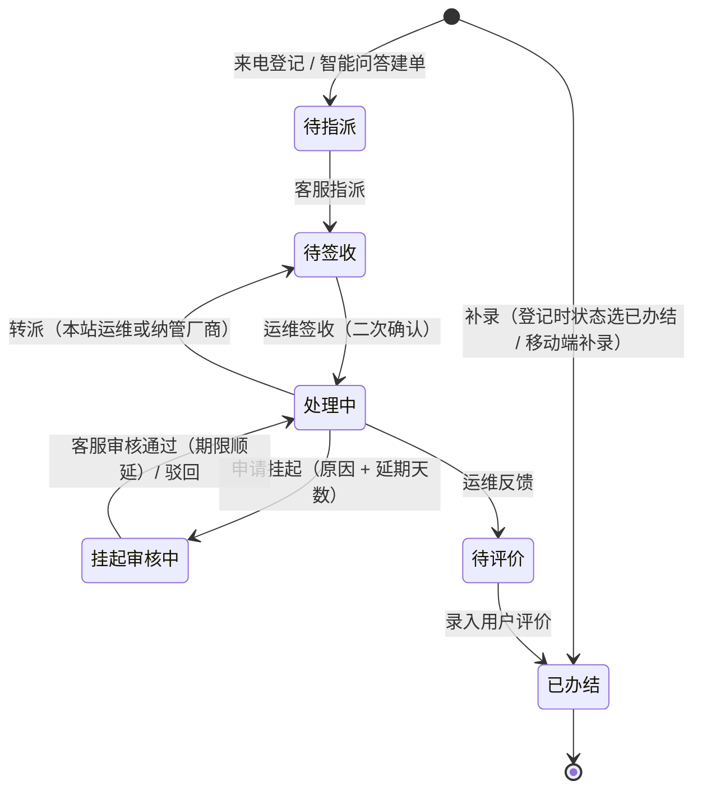
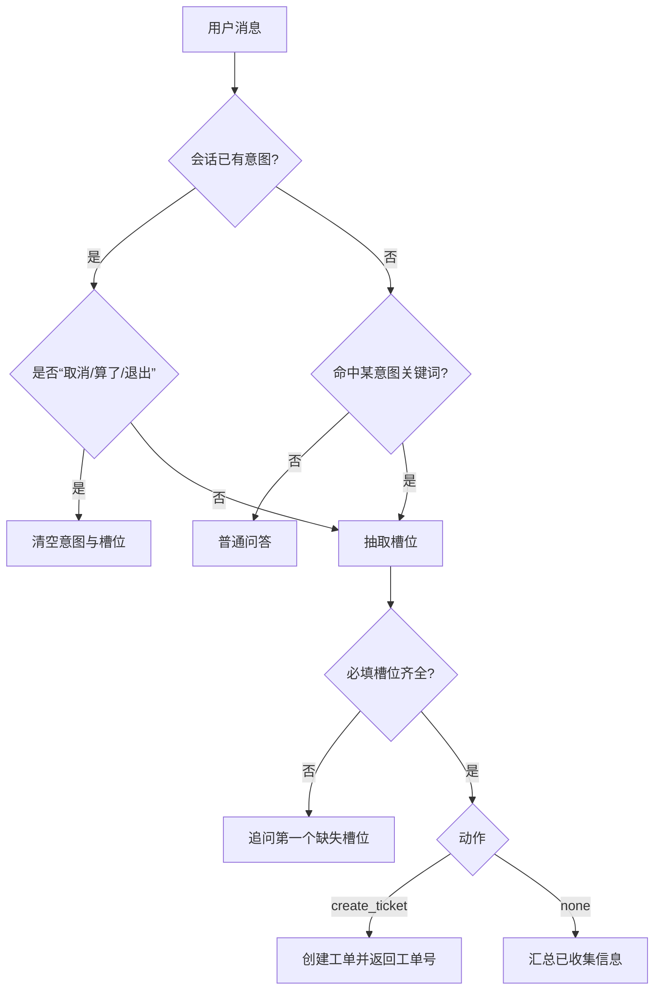
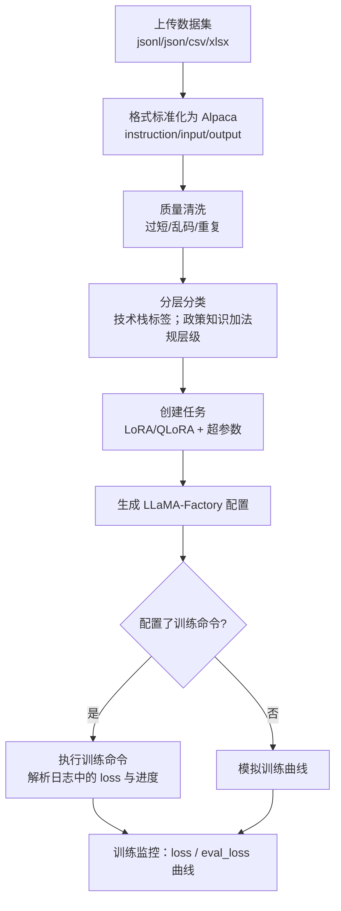
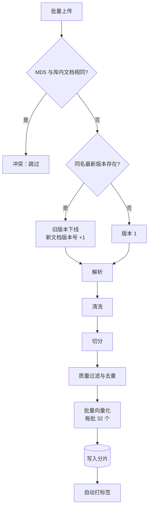
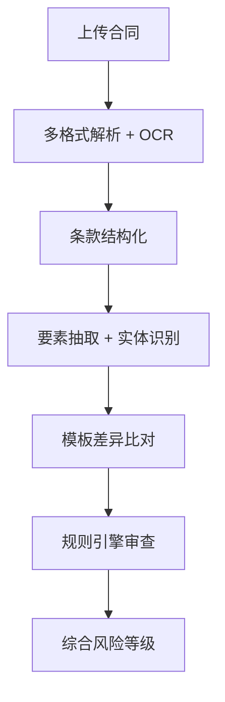

# 小信助手智能体 · 系统设计说明书

| 项目 | 内容 |
|---|---|
| 文档版本 | V1.0 |
| 对应程序版本 | 服务端 1.0.0、桌面客户端 1.0.0 |
| 关联文档 | [需求规格说明书](需求规格说明书.md)、[数据库设计说明书](数据库设计说明书.md)、[技术架构说明](技术架构说明.md)、[系统安装部署手册](部署手册.md) |

## 1. 引言

### 1.1 编写目的

本文在《需求规格说明书》的基础上，说明系统的总体设计和各模块的详细设计，包括处理流程、关键算法、接口和安全设计，供开发、测试和维护人员使用。数据库表结构见《数据库设计说明书》。

### 1.2 设计原则

1. **单体服务、模块分层**：服务端为一个 FastAPI 进程，按“接口层 → 服务层 → 数据层”分层，大模型调用单独抽象为一层。
2. **零构建前端、离线可用**：管理端和移动端是服务端托管的静态页面，前端依赖内置，不依赖外网和 Node.js 构建。
3. **与 CPU 架构无关**：服务端和客户端均为纯 Python 实现，鲲鹏 / 飞腾 / 海光 / 兆芯可共用一套代码。
4. **配置入库、在线生效**：模型、路由、采集周期、预警规则、审查规则、检索参数都存数据库，修改后立即生效。
5. **可降级**：大模型不可用时自动降级到备用模型，最终由本地兜底模型返回提示，其他业务不受影响。

## 2. 总体设计

### 2.1 系统结构



### 2.2 功能模块划分

| 子系统 | 模块 | 主要程序 |
|---|---|---|
| 桌面客户端 | 一键提速（垃圾清理、内存加速、大文件检索） | `client/xiaoxin_client/cleaner.py`、`procmgr.py`、`bigfile.py`、`ui_speedup.py` |
| | 探针监测（配件采集、运行数据、双系统检测、后台代理） | `sysinfo.py`、`collector.py`、`agent.py` |
| | 悬浮助手 | `floating.py` |
| | 智能问答、本地知识问答、合同智审 | `ui_chat.py` |
| | 设备信息、消息中心、软件中心、设置 | `ui_misc.py` |
| | 服务端通信 | `api.py` |
| 管理端 | 终端资源管理、终端运行监测、客户端管理 | `server/app/api/terminal.py`、`services/monitor.py`、`static/admin/js/pages-terminal.js` |
| | 消息管理 | `api/message.py` |
| | 智能运维、运维移动端 | `api/ops.py`、`static/admin/js/pages-ops.js`、`static/h5/index.html` |
| | 系统管理 | `api/system.py`、`static/admin/js/pages-system.js` |
| 大模型能力底座 | 模型管理、智能问答、模型微调与评估 | `api/llm.py`、`llm/*`、`services/finetune.py` |
| | 信创知识库 | `api/kb.py`、`services/rag.py`、`services/docparse.py` |
| | 合同智审 | `api/contract.py`、`services/contract.py` |
| | 工具与插件 | `api/tools.py`、`services/tools.py`、`sdk/` |
| 公共 | 配置、数据模型、认证、种子数据、定时任务 | `config.py`、`db.py`、`auth.py`、`seed.py`、`scheduler.py` |

### 2.3 运行环境

| 组件 | 环境 |
|---|---|
| 服务端 | CentOS 7 / 8 / Stream（aarch64 / x86_64），Python 3.8+，PostgreSQL 10+ |
| 桌面客户端 | 银河麒麟 V10、统信 UOS、Ubuntu（.deb）；Windows 10/11（exe） |
| 浏览器 | Chromium 内核浏览器；手机浏览器 |

## 3. 公共设计

### 3.1 认证与会话

- **密码**：PBKDF2-SHA256，8 字节随机盐，10 万次迭代，存储格式 `盐$哈希`。
- **令牌**：载荷 `{uid, role, exp}` 经 Base64URL 编码后，用 `server.secret_key` 做 HMAC-SHA256 签名，格式 `载荷.签名`；有效期 `token_expire_hours`（默认 24 小时）。前端存于 localStorage，请求时放在 `Authorization: Bearer` 头。
- **客户端身份**：桌面客户端不登录，使用 `X-Device-Id`（设备唯一标识）和可选的 `X-Client-Key` 请求头。
- **调用方抽象**：问答、知识库、合同、工具等接口同时服务管理端和客户端，统一用 `actor()` 依赖解析调用方：有合法令牌即为登录用户，否则凭设备 ID 识别为终端。

### 3.2 角色与权限

| 功能 | admin 管理员 | cs 客服 | ops 运维 | 终端（设备） |
|---|---|---|---|---|
| 终端资源、运行监测、客户端管理 | ✓ | | | |
| 消息管理 | ✓ | ✓ | | 接收消息 |
| 运维工作台、来电登记、工单池、指派、挂起审核 | ✓ | ✓ | | |
| 案例库查询 | ✓ | ✓ | ✓ | |
| 移动端工单处置 | ✓ | | ✓ | |
| 智能问答、合同审查 | ✓ | ✓ | ✓ | ✓ |
| 模型、知识库、微调、规则、工具、用户、系统设置 | ✓ | | | |

管理端菜单按角色过滤显示；接口通过 `require_roles(...)` 校验，管理员拥有全部权限。

### 3.3 通用列表接口

大部分基础资料（用户、模型、版本、软件、字典、客户端配置、消息模板、预警规则、云桌面服务器、意图、评估集、合同模板、审查规则、工具、案例）通过 `crud_router` 生成统一接口：

| 方法 | 路径 | 说明 |
|---|---|---|
| GET | `{prefix}` | 分页列表，参数 `page`、`page_size`、`keyword`（模糊匹配指定字段）及筛选字段；敏感字段脱敏 |
| GET | `{prefix}/{id}` | 详情 |
| POST | `{prefix}` | 新增 |
| PUT | `{prefix}/{id}` | 修改 |
| DELETE | `{prefix}/{id}` | 删除 |

### 3.4 定时任务

后台线程每 30 秒执行一次：

| 任务 | 频率 | 逻辑 |
|---|---|---|
| 定时消息发送 | 每 30 秒 | 查找 `send_type=timed`、状态为待发送且发送时间已到的消息，按推送范围生成回执并标记已发送 |
| 会话超时销毁 | 每 2.5 分钟 | `last_active` 早于 `session_timeout_minutes` 的会话标记为过期 |
| 离线检测 | 每 2.5 分钟 | 超过 10 分钟未上报的在线终端标记为离线；按“长期离线”规则对离线天数超过阈值的终端产生预警 |

### 3.5 文件存储

上传文件保存在 `data/uploads/{kb,contract,finetune,packages,tools}`，文件名加 8 位随机前缀避免重名；数据库只保存路径。

## 4. 桌面客户端设计

### 4.1 程序结构



- 界面线程只负责绘制；耗时操作（扫描、清理、网络请求）在后台线程执行，通过 `ui()` 回到界面线程更新，避免界面卡顿。
- 根据屏幕 DPI 计算缩放系数，适配高分屏。
- 配置合并顺序：内置默认值 → 安装目录 `config.json` → 用户目录 `~/.xiaoxin/config.json`（Windows 为 `%APPDATA%\XiaoxinAssistant\`）。

### 4.2 后台代理（Agent）

启动时拉取服务端下发的 `client_config`，按各任务周期循环执行：

| 任务 | 默认周期 | 内容 |
|---|---|---|
| 双系统检测、版本检查 | 启动时 | 检测双系统并上报；检查新版本，有则提示升级 |
| 配件采集上报 | 3600 秒 | 采集配件信息，与本地缓存比对，发生变化时弹窗提醒并上报 |
| 负载心跳 | 300 秒 | 上报 CPU、内存、磁盘利用率和在线分钟数 |
| 运行数据采集 | 1800 秒 | 开关机、已装应用、运行中的应用、U 盘、打印任务 |
| 消息拉取 | 120 秒 | 拉取未读消息并弹窗，悬浮球显示红点 |

服务端不可达时左侧栏显示“离线：原因”，下一周期自动重连。

### 4.3 配件采集与双系统检测

- **CPU 识别**：读取 `/proc/cpuinfo` 和 `lscpu`；ARM 架构根据 `CPU implementer` 识别厂商（`0x70` 飞腾、`0x48` 海思鲲鹏）；x86 根据 Vendor ID 识别海光（HygonGenuine）、兆芯（CentaurHauls / Shanghai）。
- **整机信息**：品牌、型号、序列号取自 DMI（`/sys/class/dmi/id` 或 `dmidecode`），Windows 取 WMI。
- **双系统检测**：Linux 检查 GRUB 菜单中的 Windows 启动项和 EFI 分区下的 `Microsoft` 目录；Windows 检查是否存在 Linux 文件系统分区。

### 4.4 一键提速

**垃圾清理**：每个类别定义扫描路径、文件名规则和最短存在时间，扫描结果按“类别 → 文件”树状展示。

| 平台 | 类别 |
|---|---|
| Linux | APT（clean、autoclean、autoremove、软件包列表）、Bash 历史、/tmp、/var/tmp、/var/log、~/.xsession-errors、~/.cache、/var/cache、回收站 |
| Windows | %TEMP%、Windows\Temp、日志、更新缓存、Prefetch、浏览器缓存等 |

当前用户无权删除的文件，Linux 通过 `pkexec`（无图形授权时用 `sudo`）提权批量删除。

**进程优化**：采集每个进程的 CPU、内存、网络连接数、磁盘 IO、运行时长。闲置进程判定条件（同时满足）：

1. 属于当前用户，不在保护名单（系统进程、桌面环境、浏览器、办公软件、即时通讯、终端、安全软件、输入法、小信助手自身）内，且可执行文件不在系统目录；
2. CPU ≤ 阈值（默认 0.5%，可在客户端配置中修改）；
3. 内存 ≥ 30MB；
4. 运行时间 ≥ 10 分钟；
5. 无网络连接，且磁盘 IO < 1MB。

结果按内存占用排序，用户确认后结束。

**大文件检索**：从根目录（Windows 为各固定磁盘）遍历，跳过 `/proc`、`/sys`、`/dev`、`/run`、`/snap`、`/var/lib/docker`、`/boot`（Windows 跳过 WinSxS、System Volume Information、回收站、Installer），找出大于阈值（默认 100MB）的文件；实时回调扫描数量和当前路径，可中途停止。

### 4.5 悬浮助手

无边框置顶的圆形小窗，默认位于屏幕右侧中部，可拖动；单击打开智能问答；右键菜单提供智能问答、一键提速、设备监测、消息中心、打开主界面、退出小信助手；有未读消息时显示红点。

### 4.6 问答与合同界面

- 智能问答通过 SSE 流式接收回答并逐字显示，可选择模型，可随时停止；支持“智能问答 / 本地知识问答”两种模式，知识问答可上传私有文档到个人知识库，回答下方显示引用来源。
- 合同智审上传文件后轮询审查状态，结果分为要素、模板差异、审查结果三部分，未通过的审查项按风险级别着色。

## 5. 管理端业务设计

### 5.1 终端接入与信创判定



- **字典标准化**：取对应类型的字典项，按原始值长度从长到短做包含匹配（最精确的优先），命中则替换为规范名称。
- **信创判定**：CPU 命中字典且字典项附加属性含“信创”，或 CPU 文本包含国产 CPU 关键字（飞腾、鲲鹏、海光、兆芯、龙芯、申威等）；**同时**操作系统包含国产操作系统关键字（麒麟、统信、UOS、deepin、openEuler、中科方德等）。
- **配件变更判定**：对 CPU、内存、硬盘容量、硬盘型号、操作系统、品牌、型号、序列号、MAC 逐项比对；数值型差异小于 max(1, 原值 × 5%) 视为未变化，避免采集误差误报；新旧值任一为空时不比较。

### 5.2 监测指标

| 指标 | 计算公式 |
|---|---|
| 接入率 | 已接入终端数 ÷ 应接入终端数（系统设置 `planned_terminals`，未设置时等于已接入数） |
| 替代完成率 | 信创终端数 ÷ 已接入终端数 |
| 双轨率 | 同时拥有信创和非信创终端的使用人数 ÷ 有使用人信息的人数 |
| 活跃率 | 近 7 天有上报的终端数 ÷ 已接入终端数 |
| 违规双系统数 | 检测到双系统的终端数 |

指标可按部门计算。与阈值（系统设置 `indicator_thresholds`，默认接入率 90%、替代完成率 80%、活跃率 70%、双轨率 20%、违规双系统 0）比较：前三项低于阈值、双轨率高于阈值、违规双系统数大于阈值时生成预警，在“监测指标与预警”页面标红。

### 5.3 预警规则引擎

| 指标 | 触发时机 | 判定 |
|---|---|---|
| cpu_usage / mem_usage / disk_usage | 上报、心跳 | 按运算符与阈值比较 |
| dual_system | 上报 | 终端存在双系统 |
| non_xinchuang | 上报 | 终端不是信创终端 |
| hw_change | 上报 | 本次有配件变化 |
| usb | 运行数据上报 | 出现 U 盘插入记录 |
| blacklist_app | 运行数据上报 | 已装或运行中的应用名包含阈值中的任一关键字 |
| offline_days | 定时任务 | 最近上报时间早于阈值天数 |

**去重**：同一终端、同一规则在 6 小时内已有未处理预警时不重复生成。

### 5.4 终端运行监测

- 心跳上报的在线分钟数按日累计到 `terminal_active_day`，按日 / 按周统计活跃终端数。
- 运行数据按类型存储，支持按终端、类型、时间查询，并统计开机次数、常用应用、U 盘使用和打印情况。

### 5.5 客户端管理

- **版本管理**：版本按平台、架构区分，状态为草稿 / 灰度 / 已发布 / 已下线。客户端启动时带上平台、架构、当前版本请求 `/api/client/version`，服务端在同平台、架构匹配（或架构为 all）的已发布版本中取版本号最高者，高于当前版本时返回新版本号、更新说明、是否强制更新和下载地址。
- **装机软件**：管理员上传安装包，客户端按平台列出并下载。
- **型号数据字典**：修改字典后可执行“重算”，对存量终端重新标准化并更新信创判定。
- **客户端软件配置**：每项配置包含执行方式（启动时 / 固定间隔 / 手动）和取值，随上报响应和 `/api/client/config` 下发。

### 5.6 消息管理



### 5.7 智能运维与工单

工单状态流转：



- 每次状态变化写入工单日志（操作、操作人、说明）。
- 工作台统计各状态工单数量，对“待指派”和“挂起审核中”的工单预警。
- **案例沉淀**：已办结工单可上报为案例（状态“待审核”），管理员审核通过后入库；可标记高质量案例。案例检索按关键字匹配标题、问题和答案，高质量案例优先，同等条件按查看次数排序。

## 6. 大模型能力底座设计

### 6.1 模型统一调用与路由

**候选模型生成**（每次调用都实时读库）：

1. 取全部启用的模型，剔除未完成配置的模型（云端模型未填 API Key 或地址）；
2. **灰度过滤**：用户标识做 MD5 后对 100 取模得到分桶号，只保留 `gray_percent` 大于分桶号的模型；
3. 按（是否默认，优先级）排序，再按路由策略调整首选：

| 策略 | 规则 |
|---|---|
| priority | 默认模型优先，其余按优先级数字从小到大 |
| round_robin | 在排序结果上按调用计数轮转起点 |
| weighted | 按权重随机选出首选，其余保持顺序作为备用 |
| scene | 适用场景包含当前业务场景（chat / kb / contract / ops / summary / eval）的模型排前 |

4. 本地兜底（Mock）始终排最后；调用方指定模型时，该模型排第一。

**自动降级**：依次尝试候选模型，失败则换下一个。流式调用在首个分片产出前失败才降级。每次调用记录耗时、Token 数、成败和是否为降级调用，用于模型性能监控。

**适配器**：`BaseAdapter` 定义 `chat` 和 `stream`；`OpenAICompatibleAdapter` 实现通用请求与响应解析；DeepSeek、通义千问、星辰 TeleChat 继承它，只覆盖参数构造或消息格式转换；Mock 返回固定提示。

### 6.2 多轮会话

1. 创建会话时生成 32 位十六进制 Session ID，记录模式（智能问答 / 知识问答）、模型和知识库。
2. **上下文**：取最近 N 轮（`context_window_rounds`，默认 6 轮即 12 条消息）作为历史；`context_strategy=summary` 时，把更早的对话交给大模型压缩成 200 字以内的摘要，拼入系统提示词。
3. 回答以 SSE 返回：先返回 `meta`（会话 ID、引用来源），再逐段返回内容，最后返回结束标记；用户可调用停止接口中断生成。
4. 会话超过 `session_timeout_minutes`（默认 60 分钟）无活动后由定时任务标记过期。

### 6.3 状态跟踪（槽位填充）



槽位抽取分三步：① 槽位定义了正则（如手机号）时按正则从文本中提取；② 仍有缺失时，请大模型按槽位定义从用户的话中抽取 JSON；③ 若上一轮正在追问某个槽位且仍未取到，把用户本轮回答（100 字以内）直接填入该槽位。建单后继续补充的信息会更新到同一工单。

### 6.4 模型微调



- 字段兼容：问题取 `instruction` / `question` / `问题`，答案取 `output` / `answer` / `答案`。
- 清洗规则：问题或答案少于 4 个字的丢弃，问题 + 答案的 MD5 相同视为重复。
- 分类：按关键词规则打技术栈标签（操作系统、办公软件、打印外设、网络、数据库中间件、安全、硬件、政策法规）；政策知识另按内容判断法律法规 / 部门规章 / 规范性文件。
- QLoRA 在 LoRA 配置基础上增加 4 bit 量化。支持停止和调参重训。

### 6.5 模型评估

对测试集逐题调用指定模型：

- 相似度 = 回答与参考答案的文本相似度（SequenceMatcher）；
- 关键词命中率 = 回答中包含的关键词数 ÷ 关键词总数（无关键词时取相似度）；
- 单题正确：关键词命中率 ≥ 0.6 或相似度 ≥ 0.5；
- **准确率** = 正确题数 ÷ 总题数；**专业度** = 关键词命中率平均值；**时效性** = 平均耗时。

### 6.6 信创知识库

**导入流水线**：



| 环节 | 设计 |
|---|---|
| 解析 | TXT / MD（编码依次尝试 UTF-8、GBK、GB18030、UTF-16、Big5）、PDF、DOCX、XLSX、PPTX、OFD；图片和无文字层的扫描件走 OCR |
| 清洗 | 去除乱码字符，统一全角空格和换行，合并多余空白和空行 |
| 切分 | 按段落累加到 `chunk_size`（默认 500 字）；遇 Markdown 标题强制切分；超长段落按窗口滑动切分，相邻片段重叠 `chunk_overlap`（默认 80 字） |
| 质量过滤 | 少于 10 个字，或汉字和字母占比低于 30% 的片段视为无效；内容 MD5 相同视为重复 |
| 断点续传 | 处理前查询已入库的分片序号，只处理未完成的分片 |
| 失败重试 | 失败后记录日志，自动重试，最多 3 次；也可手动重试 |
| 自动打标 | 按关键词规则统计各标签命中次数，取前 3 个；支持人工修改并标记已校验 |
| 版本回滚 | 可把历史版本恢复为最新版本 |

**向量化**：

- `local`（默认，零依赖）：文本切成英文词、单个汉字和相邻汉字二元组，每个词做 MD5 哈希映射到 512 维中的一维，按哈希位决定正负号，权重为 1 + ln(词频)，最后做 L2 归一化。
- `api`：调用 BGE-M3 / m3e 等 OpenAI 兼容的 Embeddings 服务。

**检索**：

1. 每个知识库首次检索时，把全部分片向量加载为矩阵，同时预计算词频、文档频率和平均长度，缓存在进程内存中；文档变化时失效。
2. 向量得分 = 分片向量与查询向量的点积（余弦相似度）；关键词得分 = BM25（k1 = 1.2，b = 0.75），归一化到 0~1。
3. 混合得分 = α × 向量得分 + (1 − α) × 关键词得分，α = `hybrid_alpha`（默认 0.6）；也可只用向量或关键词模式。
4. 每个知识库取前 3 × top_k 个候选，过滤低于 `score_threshold` 的结果。
5. **去重合并**：两个片段前 200 字的词集合 Jaccard 相似度 > 0.8 时只保留得分高的。
6. **重排序**：重排得分 = 0.7 × 混合得分 + 0.3 × 查询词覆盖率，取前 top_k。
7. 构造提示词：按编号列出参考资料及来源文件，要求模型依据资料回答、注明引用编号，资料中没有的如实说明。
8. 记录检索日志（命中数、最高分、检索与生成耗时）；用户可对回答反馈有用 / 无用。

**检索评估**：给定测试问题和期望命中的文件名或关键词，召回率 = 至少命中一条相关结果的问题占比，精确率 = 各问题中相关结果占返回结果比例的平均值。RAG 链路监控按日统计检索次数、平均耗时、平均命中数、平均最高分、零命中率和反馈满意度。

### 6.7 合同智审



| 环节 | 设计 |
|---|---|
| 条款结构化 | 按“第X条 / 第X章”（一级）和“一、”“1.”（二级）等标题切分条款，保留层级；标题行长度需小于 60 字 |
| 要素抽取 | 正则规则抽取合同名称、编号、甲方、乙方、合同金额（小写 / 大写）、签订日期、履行期限、付款方式、质保期、违约责任、争议解决 / 管辖地、签字盖章；大写金额转换为数字，用于大小写一致性校验；可选用大模型补全 |
| 实体识别 | 金额、时间表达式、责任主体（公司 / 中心 / 局等）、地点（省 / 市 / 区 / 县） |
| 模板差异 | 对模板中的每个条款要素：关键词都未出现 → 必选为“缺失”（红）、可选为“未包含”（灰）；出现但与条款标题相似度 < 0.5 → “格式不符（未独立成条）”（橙）；否则“一致”（绿）。定义了标准文本时再比较内容相似度，< 0.6 标为“内容冲突”（橙） |
| 规则引擎 | 支持 8 种规则类型（见下表），默认 33 条规则（R001~R033），可编辑、启停、测试 |
| 风险等级 | 未通过规则的最高级别（高 / 中 / 低），全部通过为“无” |
| 效果统计 | 每条规则累计命中次数；人工标记误报后累计误报次数，计算命中率与误报率 |

| 规则类型 | 判定 |
|---|---|
| element_required | 指定要素已抽取到 |
| keyword_required | 包含关键词（任一或全部） |
| keyword_forbidden | 不得出现关键词 |
| regex_required / regex_forbidden | 必须匹配 / 不得匹配正则 |
| amount_max | 按正则提取的金额不得超过上限（如终端单价 12000 元） |
| amount_consistent | 大小写金额一致 |
| llm | 交给大模型按提示词判定“合规 / 不合规：原因” |

### 6.8 工具与插件

- **内置工具**：OCR 文字识别、图片场景 / 图表分析、知识库检索、文档解析、文本摘要（大模型）、计算器、当前时间。
- **调用**：在线程池中执行，按工具配置或请求参数控制超时；每次调用记录成败与耗时。
- **链式调度**：按顺序执行步骤，参数中可用 `${steps.N.字段}` 引用第 N 步的输出；默认遇错即停，返回每步的结果、耗时和错误。
- **第三方插件**：开发者凭 API Key 调用 `/open/v1/plugins/register` 注册，插件默认停用，管理员审核后启用。调用时按协议转换：REST 按配置的方法请求，GraphQL 发送 `{query, variables}`，WebSocket 发送一条 JSON 并读取一条响应；认证方式支持 API Key 头或 Bearer。
- **性能评估**：按工具统计调用量、成功率、平均 / P95 / 最大耗时、峰值每分钟调用数；成功率低于 90% 等异常情况给出告警。

## 7. 接口设计

### 7.1 接口约定

| 项目 | 约定 |
|---|---|
| 协议 | HTTP，JSON 请求和响应；文件上传使用 multipart/form-data；流式问答使用 SSE（`text/event-stream`） |
| 认证 | 管理端 / 移动端：`Authorization: Bearer <token>`；客户端：`X-Device-Id`、`X-Client-Key`；开放平台：`X-API-Key` |
| 错误 | HTTP 状态码 + `{"detail": "错误说明"}`；401 未登录或过期，403 无权限，404 不存在，400 参数错误 |
| 分页 | 请求 `page`、`page_size`；响应 `{"items": [...], "total": n}` |
| 文档 | 在线接口文档 `/api/docs`（OpenAPI） |

### 7.2 接口清单

| 模块 | 主要接口 |
|---|---|
| 系统 | `POST /api/login`、`GET /api/me`、`POST /api/me/password`、`/api/users`（CRUD）、`GET /api/staff`、`GET/PUT /api/settings/{key}` |
| 客户端 | `POST /api/client/report`、`POST /api/client/heartbeat`、`POST /api/client/run-records`、`GET /api/client/config`、`GET /api/client/status`、`GET /api/client/messages`、`POST /api/client/messages/{id}/read`、`GET /api/client/version`、`GET /api/client/software`、`GET /api/client/download/{kind}/{id}` |
| 终端管理 | `GET /api/admin/terminals`、`/terminals/{id}`、`/cloud-desktops`、`/overview`、`/indicators`、`/hw-changes`、`POST /hw-changes/{id}/confirm`、`GET /alerts`、`POST /alerts/handle`、`GET /activity`、`/run-records`、`/run-records/stats`、`POST /upload/{kind}/{id}`、`POST /dicts/apply`；CRUD：`/api/admin/{cloud-servers,alert-rules,versions,software,dicts,client-config}` |
| 消息 | `/api/admin/messages`（列表、新建、修改、删除）、`POST /api/admin/messages/{id}/send`、`GET /api/admin/messages/{id}/receipts`；CRUD：`/api/admin/message-templates` |
| 智能运维 | `GET /api/ops/workbench`、`GET/POST /api/ops/tickets`、`GET /api/ops/tickets/{id}`、`POST /api/ops/tickets/{id}/{assign,suspend-audit,close,rate,to-case}`、`POST /api/ops/cases/{id}/{audit,view}`、`GET /api/ops/case-search`；CRUD：`/api/ops/cases` |
| 运维移动端 | `GET /api/mobile/tickets`、`GET /api/mobile/stats`、`POST /api/mobile/tickets/{id}/{sign,transfer,suspend,feedback}`、`PUT /api/mobile/tickets/{id}/info`、`POST /api/mobile/tickets/supplement`、`GET /api/mobile/colleagues` |
| 模型与问答 | `GET /api/models/available`、`GET/PUT /api/admin/route`、`POST /api/admin/models/{id}/{health,test,publish}`、`GET /api/admin/models-metrics`、`/api/chat/sessions`（创建、列表、详情、删除）、`POST /api/chat/send`（SSE）、`POST /api/chat/stop/{sid}`、`POST /api/chat/ask`、`GET /api/admin/chat/sessions`；CRUD：`/api/admin/{models,intents,eval-sets}` |
| 微调评估 | `/api/admin/ft/datasets`（列表、上传、删除、预处理）、`/api/admin/ft/jobs`（列表、详情、创建、停止、重训）、`/api/admin/eval-runs`（列表、详情、创建） |
| 知识库 | `/api/kb/bases`（CRUD）、`POST/GET /api/kb/bases/{id}/docs`、`GET /api/kb/docs/{id}/{versions,logs,chunks}`、`POST /api/kb/docs/{id}/{rollback,retry}`、`PUT /api/kb/docs/{id}/tags`、`DELETE /api/kb/docs/{id}`、`GET /api/kb/import-progress`、`POST /api/kb/search`、`GET/PUT /api/kb/settings`、`POST /api/kb/feedback/{id}`、`POST /api/kb/evaluate`、`GET /api/kb/metrics` |
| 合同智审 | `POST /api/contract/upload`、`GET /api/contract`、`GET /api/contract/stats`、`GET /api/contract/{id}`、`GET /api/contract/{id}/file`、`POST /api/contract/{id}/{reanalyze,false-positive}`、`DELETE /api/contract/{id}`、`GET /api/contract-rules/export`、`POST /api/contract-rules/import`、`POST /api/contract-rules/test`；CRUD：`/api/contract/{templates,rules}` |
| 工具插件 | `GET /api/tools`、`POST /api/tools/upload`、`POST /api/tools/invoke/{code}`、`POST /api/tools/chain`、`GET /api/tools/metrics`、`/api/tools/api-keys`；CRUD：`/api/admin/tools`；开放平台：`POST /open/v1/plugins/register`、`POST /open/v1/tools/{code}/invoke` |
| 运维 | `GET /api/health` |

### 7.3 关键接口示例

**终端上报** `POST /api/client/report`

```json
{
  "device_id": "18644fad-...", "hostname": "T1", "user_name": "张三", "dept": "信息中心",
  "hardware": {"cpu_model": "Phytium FT-2000/4", "cpu_vendor": "Phytium", "cpu_cores": 4,
               "mem_total": 8, "disk_total": 256, "os_name": "Kylin V10", "arch": "aarch64",
               "brand": "GreatWall", "serial": "SN1", "dual_system": false},
  "load": {"cpu": 35, "mem": 50, "disk": 40}
}
```

响应：`{"ok": true, "is_xinchuang": true, "changes": [], "config": {...}}`

**流式问答** `POST /api/chat/send`

```json
{"session_id": "可选", "message": "打印机无法打印怎么办", "mode": "kb", "kb_id": 1, "model_id": null}
```

响应（SSE）：

```
data: {"type":"meta","session_id":"...","refs":[{"file":"...","content":"...","score":0.82}]}
data: {"type":"delta","text":"可以先检查"}
data: {"type":"done", ...}
```

**插件注册** `POST /open/v1/plugins/register`（Header：`X-API-Key`）

```json
{"code": "weather", "name": "天气查询", "protocol": "rest", "endpoint": "http://插件地址/", "method": "POST",
 "params_schema": {"city": "城市"}}
```

## 8. 安全设计

| 方面 | 设计 |
|---|---|
| 身份认证 | 密码加盐哈希；签名令牌带过期时间；`secret_key` 可通过环境变量注入 |
| 访问控制 | 角色鉴权；菜单按角色显示；接口按角色校验 |
| 敏感信息 | 列表接口对密码哈希、API Key、插件密钥脱敏 |
| 客户端接入 | 设备 ID + 可选接入密钥；当前版本接入密钥只校验智能接口，终端上报类接口需依靠网络访问控制限制来源 |
| 第三方接入 | API Key 认证；插件注册后默认停用，需审核启用 |
| 客户端行为 | 不注入进程、不挂钩 API；开机自启使用标准方式（Linux XDG autostart、Windows 当前用户 Run 键）；结束进程需确认，关键进程受保护；提权操作使用系统授权框 |
| 部署 | 支持内网离线部署；数据库只对本机开放 |

## 9. 可靠性与性能设计

| 方面 | 设计 |
|---|---|
| 大模型 | 多模型自动降级 + 本地兜底；调用超时可配置 |
| 知识导入 | 后台线程处理，失败重试，断点续传 |
| 检索性能 | 知识库索引缓存在内存中，用矩阵运算一次性计算全部相似度 |
| 数据库 | 连接池 + 连接可用性预检（pool_pre_ping） |
| 客户端 | 耗时操作在后台线程执行；服务端不可达时自动重连 |
| 运行约束 | 服务端必须单进程运行：会话中止标记、检索缓存、定时任务都在进程内；扩展为多实例前需将这些状态迁移到外部存储 |

## 10. 部署设计

服务端部署为 systemd 服务 `xiaoxin`（单进程），与 PostgreSQL 同机或分开部署；提供一键脚本、离线依赖包、Docker 三种方式。客户端按 CPU 架构分别打包为 `.deb` 或 Windows 安装目录。详见《系统安装部署手册》。
